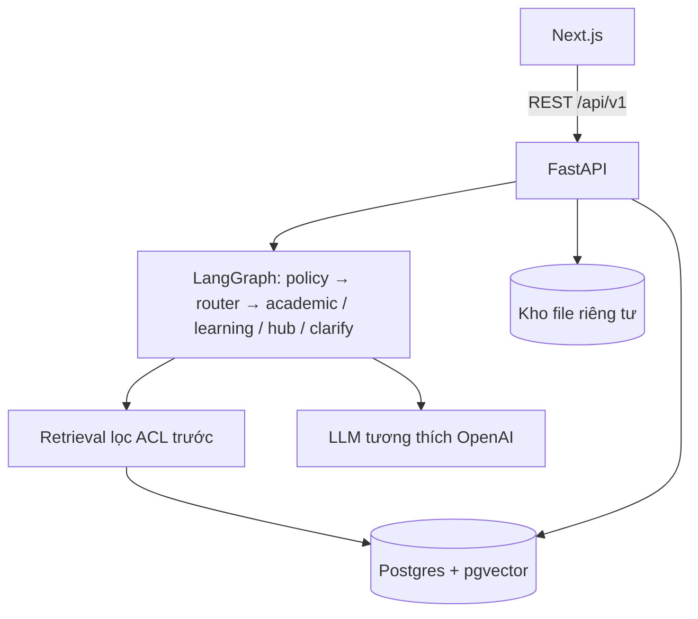
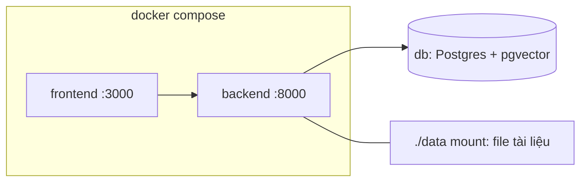

# Architecture Document — EDU-04 Kho tri thức hỗ trợ học thuật X

Sơ đồ đầy đủ (thành phần, luồng hỏi đáp, vòng đời tài liệu, lộ trình, triển khai):
[docs/architecture_diagram.md](docs/architecture_diagram.md).

## System Overview

Trợ lý học thuật dùng RAG cho Trung tâm X. Ba trợ lý được điều phối bằng LangGraph: **Academic Assistant** (hỏi đáp
có trích dẫn tới đúng trang), **Learning Assistant** (giải thích, tự kiểm tra, lộ trình học) và **Knowledge Hub** (tìm
tài liệu). Tài liệu đi qua quy trình upload → duyệt → phát hành → thu hồi. Mọi quy tắc nghiệp vụ BR-01…BR-13 được
thực thi ở backend theo nguyên tắc mặc định từ chối.

## Components

### 1. Frontend (`frontend/`, Next.js + TypeScript)
- **Trang:** đăng nhập (có nút đăng nhập demo khi bật), chat, thư viện (`/library`), học tập và lộ trình
  (`/learning`, `/learning/plans`), quản lý và duyệt tài liệu (`/hub/manage`, `/hub/review`), dashboard GV, admin
  (người dùng, quota, chi phí AI, giám sát).
- **Nguyên tắc:** không tự quyết quyền; mọi nút "được phép" lấy từ API (`/me`, `/me/courses`).

### 2. Backend (`src/`, FastAPI)
- **Router:** `auth`, `conversations`, `documents`, `sources`, `learning_path`, `quizzes`, `dashboard`, `admin` dưới
  `/api/v1`; `/health`.
- **Xác thực:** mật khẩu băm scrypt; phiên là bearer token ngẫu nhiên (lưu sha256 trong bộ nhớ, hết hạn theo
  `AUTH_SESSION_TTL_MINUTES`); giới hạn đăng nhập sai theo (login_id, IP). Mỗi request đọc lại user từ DB.
- **Phân quyền (`services/acl.py`):** quyền theo môn (membership: đọc, tải, upload, duyệt, hạn hiệu lực), ACL theo
  vai trò và nhãn liêm chính của từng phiên bản. Không bao giờ tin role/user_id/course do client gửi (BR-02).
- **Lỗi:** định dạng `{status, error: {code, retryable, request_id}}`; kết quả nghiệp vụ (không đủ căn cứ, cần làm
  rõ) trả HTTP 200 kèm `status`.
- **Idempotency:** header `Idempotency-Key` cho gửi câu hỏi, upload, quyết định duyệt.

### 3. AI Agent (`src/agents/`, LangGraph)
- **Graph:** `START → policy → router → (academic | learning | hub | clarify) → END`, `recursion_limit = 8`.
- **policy:** yêu cầu lời giải cuối bài tính điểm → chuyển hướng, không trả lời (BR-06).
- **router:** LLM chọn MÔN trong danh sách môn người dùng được đọc và chọn trợ lý; không xác định được môn → clarify,
  không truy xuất.
- **Trợ lý (`services/assistants/`):** academic (trả lời có [n], kiểm trích dẫn theo từng câu), learning (giải thích
  3 mức, câu hỏi tự luận/trắc nghiệm, flashcard, điền khuyết, chẩn đoán), hub (tìm tài liệu).
- **LLM:** chỉ qua `services/llm.py::get_llm()`; endpoint tương thích OpenAI (`AI_*`), có timeout và ghi token/chi phí.
- **Chống prompt injection:** nội dung tài liệu là dữ liệu trong khối NGUỒN, không phải chỉ thị (BR-09).

### 4. Lộ trình học (`src/services/learning_path/`)
- Khai báo đã học tới bài N → bài đánh giá ≤ `LEARNING_ASSESSMENT_MAX_QUESTIONS` câu (mặc định 15), chia xoay vòng
  để mọi bài đã học đều có câu → chấm và chẩn đoán theo chủ đề bằng code → 3 phương án lộ trình → các bước cụ thể.
- Bước học bài mới bị khóa tới khi đạt ≥ 80% bài kiểm tra đứng trước; trượt → tự chèn vòng ôn lại.
- Câu hỏi do LLM soạn phải kèm câu trích nguyên văn trong nguồn chứng minh đáp án, không có thì bị loại.

### 5. Database (`src/models/orm.py`, SQLAlchemy 2 + Alembic)
- **Postgres 17 + pgvector** (D-84), service `db` trong docker compose (volume `pgdata`). Trước D-84 dùng SQLite
  `data/app.db` (D-20) — vẫn chạy được khi đặt `DATABASE_URL=sqlite:///./data/app.db`. Đổi DB bằng `DATABASE_URL`
  (SQLAlchemy; đã có driver Postgres `psycopg2-binary`).
- **Bảng:** `users`, `courses`, `memberships`, `documents`, `document_versions`, `chunks`, `ingestion_jobs`,
  `approvals`, `audit_events`, `conversations`, `messages`, `citations`, `feedback`, `study_plans`,
  `idempotency_records`, `usage_events`, `course_quizzes`, `quiz_attempts`, `learner_progress`,
  `learning_assessments`, `topic_mastery`, `learning_paths`.
- **Migrations:** `migrations/` (Alembic).

### 6. Vector search
- Không dùng vector DB riêng: embedding lưu trong `chunks.embedding` — Postgres: cột `vector`, top-k cosine bằng
  pgvector trong SQL (D-84, quét exact sau khi lọc version, chưa có index ANN); SQLite: BLOB + NumPy (D-21).
- **Thứ tự bắt buộc:** xác định tập version được phép bằng SQL + ACL → CHỈ nạp embedding của các version đó → top-k.
  Không bao giờ tính trên toàn kho rồi mới lọc (BR-03).
- **Embedding:** Gemini (`gemini-embedding-001`) hoặc OpenAI, cấu hình `EMBEDDING_*`.
- **Knowledge Hub:** vector + BM25 + RRF + reranker trên phạm vi được phép.

### 7. Ingestion (`src/services/ingestion.py`, `src/ingestion/`)
- Nhận diện loại file theo nội dung (PDF/PPTX), trích text theo trang/slide, làm sạch, chunk ~600 token có chồng lấn,
  embedding theo lô (retry khi bị 429). Chạy bằng thread nền, giới hạn `JOB_MAX_WORKERS`, tự resume khi khởi động lại.

## Data Flow (hỏi đáp)

1. Frontend gửi câu hỏi tới `POST /api/v1/conversations/{id}/messages` kèm bearer token.
2. Backend xác thực, kiểm quota ngày và idempotency.
3. LangGraph: policy → router chọn môn (trong môn được phép) và trợ lý.
4. Retrieval lọc theo môn, ACL, trạng thái Published trước khi tính tương đồng; dưới ngưỡng bằng chứng → báo không đủ
   căn cứ (BR-05).
5. LLM sinh câu trả lời có [n]; backend kiểm từng [n] khớp nguồn, kiểm lại quyền nguồn ngay trước khi trả.
6. Lưu message, citation (trang thật trong chunk nhiều trang), usage; trả về frontend. Mở lại lịch sử cũng kiểm lại
   quyền — nguồn đã thu hồi thì câu trả lời bị che (FR-05.4).

## Deployment Architecture

- `Dockerfile` backend: multi-stage Python 3.11, chạy bằng user không phải root; `data/`, `.env` không vào image.
- `frontend/Dockerfile`: Next.js `output: "standalone"`.
- CI (`.github/workflows/ci.yml`): ruff + pytest (Python 3.11) và lint + build frontend (Node 20).

## Security

- Key chỉ trong `.env` (không commit), đọc qua `src/config.py`.
- Kiểm quyền ở backend cho mọi request; tài nguyên ngoài quyền trả 404 (không lộ sự tồn tại), nguồn đã thu hồi trả 410.
- Khóa tài khoản và thu hồi tài liệu có hiệu lực ngay (kiểm tại thời điểm gọi).
- Rate limit đăng nhập/đăng ký, quota câu hỏi theo ngày, CORS theo `CORS_ORIGINS`.
- Audit cho duyệt/từ chối/phát hành/thu hồi/khóa/đổi quyền (BR-11). Quản trị không đọc nội dung học tập.

## Design Decisions

| Decision | Choice | Reason |
|----------|--------|--------|
| Framework | FastAPI | Async, tự sinh docs, type-safe với Pydantic |
| Agent | LangGraph | Graph điều phối rõ ràng, giới hạn số bước |
| Database | Postgres 17 + pgvector (D-84) | Ghi đồng thời (ingest + chat), một DB cho cả dữ liệu và vector |
| Vector store | pgvector trong cùng Postgres | Lọc ACL và tìm cosine trong cùng câu SQL; thu hồi tài liệu trong một transaction (BR-03, BR-07) |
| LLM | Endpoint tương thích OpenAI | Đổi nhà cung cấp/model bằng `.env` |
| Frontend | Next.js | Routing theo trang, build standalone cho Docker |
