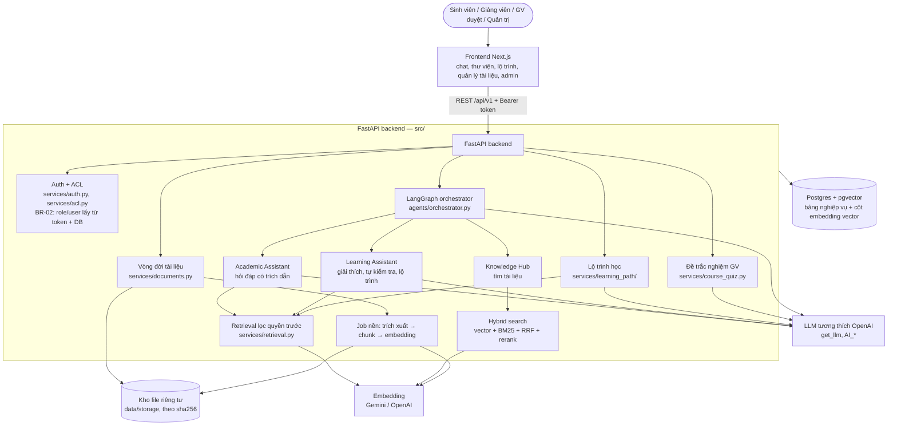
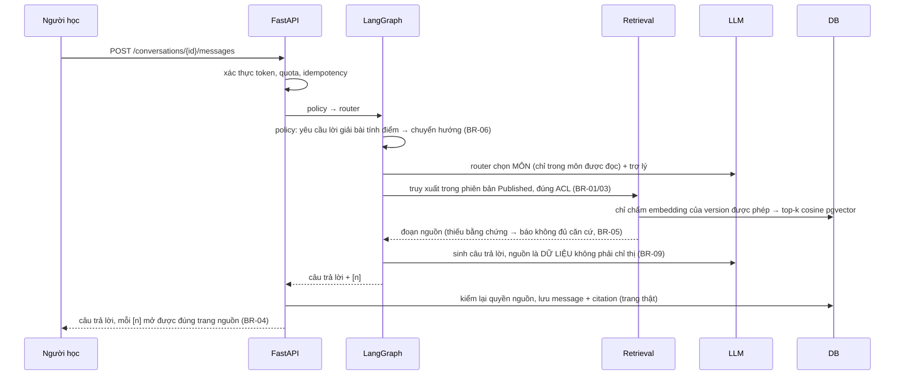
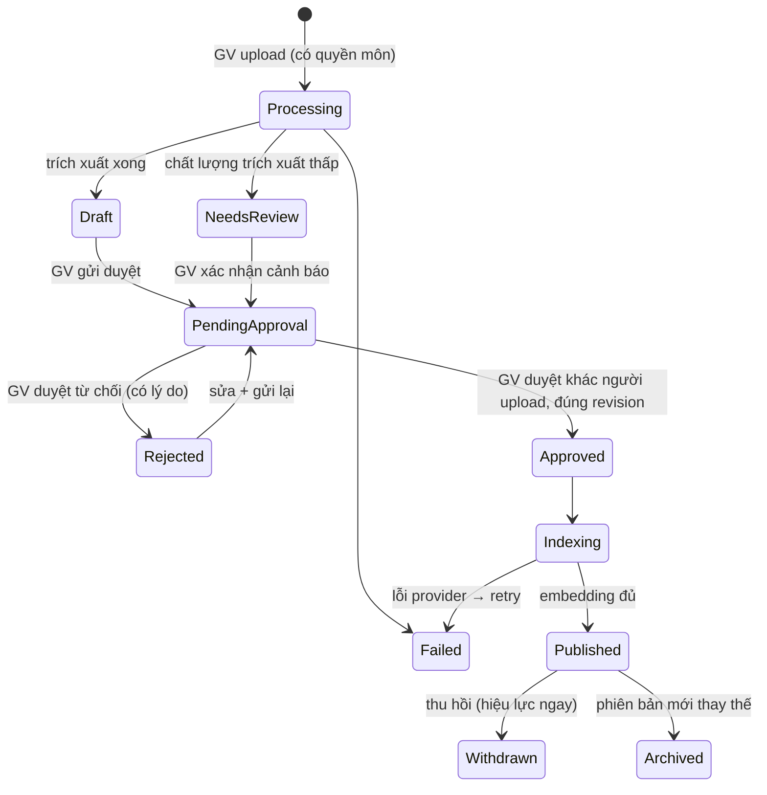
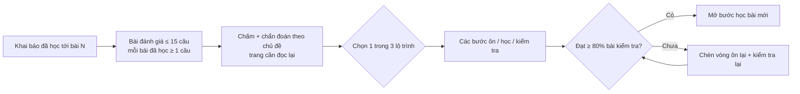
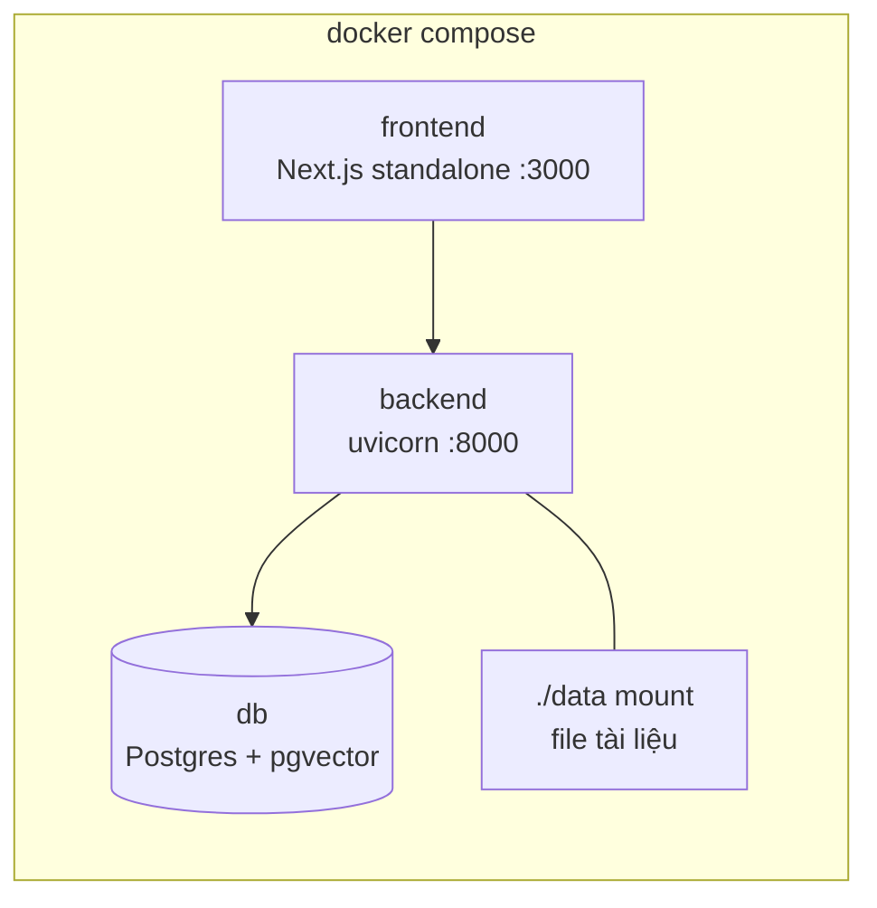

# Architecture Diagram — EDU-04 Kho tri thức hỗ trợ học thuật X

Mô tả chi tiết từng thành phần: [ARCHITECTURE.md](../ARCHITECTURE.md).

## 1. Thành phần hệ thống

## 2. Luồng hỏi đáp (data flow)

## 3. Vòng đời tài liệu

Chỉ bản **Published, hiện hành, không bị khóa khẩn cấp, đúng ACL** mới vào retrieval, citation, thư viện.
Mọi chuyển trạng thái quan trọng ghi audit (BR-11).

## 4. Luồng lộ trình học

## 5. Triển khai

