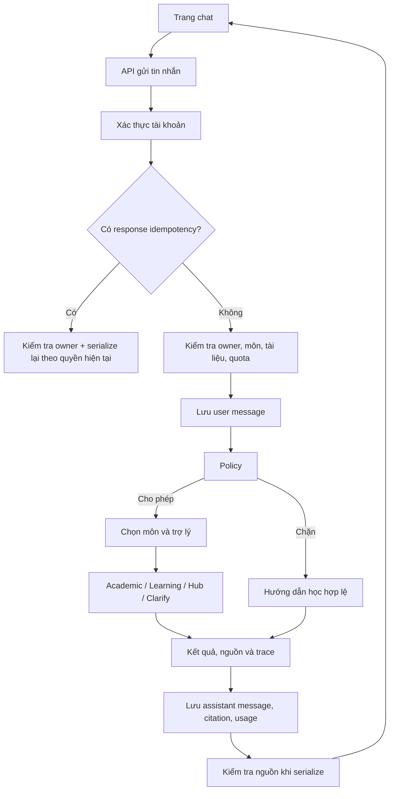

# Cấu trúc dự án và đánh giá code hiện tại

Ngày rà soát: **27/09/2026**.

Tài liệu mô tả code đang có trong working tree, gồm cả thay đổi chưa commit. Đây là ảnh chụp hiện trạng, không phải kiến trúc mục tiêu hay xác nhận hệ thống đã sẵn sàng production. Các đường dẫn bên dưới tính tương đối từ thư mục `docs`.

## 1. Tổng quan

Dự án EDU-04 xây dựng kho tri thức hỗ trợ học thuật: người học hỏi đáp theo tài liệu có nguồn, tìm tài liệu và sử dụng công cụ học tập; giảng viên tải tài liệu, người duyệt kiểm tra và phát hành; quản trị viên quản lý tài khoản, phân quyền và khóa tài liệu.

Kiến trúc hiện tại là **backend nguyên khối được chia module**, đi cùng frontend Next.js riêng. LangGraph điều phối các dịch vụ trợ lý trong cùng backend; đây không phải hệ thống nhiều microservice.

| Thành phần | Hiện trạng trong code |
| --- | --- |
| Frontend | Next.js App Router, React, TypeScript, CSS riêng |
| Backend | FastAPI, Pydantic, SQLAlchemy |
| Điều phối AI | LangGraph: policy → router → một trợ lý hoặc hỏi làm rõ |
| LLM | LangChain client kết nối endpoint tương thích OpenAI |
| Embedding | Gemini hoặc endpoint tương thích OpenAI, theo cấu hình |
| Dữ liệu nghiệp vụ | SQLite mặc định, bật WAL và foreign keys |
| Tìm kiếm vector | Vector lưu ở `Chunk.embedding`; NumPy tính cosine similarity; cache ma trận trong RAM |
| File tài liệu | Kho riêng `data/storage`, tên theo checksum SHA-256 |
| Trích xuất | PDF bằng pypdf, PPTX bằng python-pptx; chưa có OCR |
| Đọc trang PDF | pypdfium2 render PNG phía server |
| Xác thực | Token phiên ngẫu nhiên; server lưu hash token trong bộ nhớ tiến trình |
| Job nền | Bản ghi job trong DB, thực thi bằng daemon thread |
| Đánh giá AI | Bộ công cụ riêng trong `eval`: accuracy, safety, router, RAGAS, benchmark và performance |

**Không nên suy ra công nghệ từ cấu hình sót lại:** code retrieval hiện không dùng Chroma dù còn `chroma_persist_dir` trong settings. Các giá trị trong `requirements.txt` là ràng buộc cài đặt, không phải bằng chứng phiên bản thực tế đang chạy.

## 2. Cấu trúc thư mục

```text
P-134/
├── src/                         Backend Python
│   ├── main.py                  FastAPI app, router, lifespan, health/ready
│   ├── config.py                Settings đọc biến môi trường
│   ├── db.py                    Engine, session, tạo bảng, migration SQLite
│   ├── api/                     HTTP endpoints và request validation
│   ├── agents/                  Graph, state, node điều phối
│   ├── services/                Nghiệp vụ, ACL, retrieval, ingestion, auth
│   │   └── assistants/          Academic, Learning, Hub, study tools
│   └── models/                  ORM và một phần schema API
├── frontend/
│   ├── src/app/                 Trang và layout Next.js
│   ├── src/components/          UI dùng chung, đọc nguồn, công cụ học tập
│   ├── src/lib/                 API client, session, thông báo
│   ├── next.config.ts           Proxy /api/* sang backend
│   └── package.json             Script dev/build/start/typecheck
├── tests/                       Test Python hiện chủ yếu kiểm tra template
├── eval/                        Công cụ đánh giá chất lượng và hiệu năng AI
├── scripts/                     Chạy dev, seed/import/reprocess, công cụ log
├── data/                        Dữ liệu runtime, file tài liệu, dữ liệu đánh giá
├── docs/
│   ├── documentions/            Brief, PRD, backlog, wireframe, phân công
│   ├── decisions/               Quyết định thiết kế
│   ├── guide/                   Hướng dẫn kỹ thuật từ template
│   ├── plans/                   Kế hoạch
│   ├── handover/                Bàn giao
│   ├── uat/                     Tài liệu kiểm thử chấp nhận
│   ├── rules/                   Quy tắc dự án
│   └── work/                    Tài liệu công việc
├── presentation/                Tài liệu trình bày
├── .github/workflows/           CI
├── Dockerfile                   Image backend
├── docker-compose.yml           Service backend và volume data
├── Makefile                     Lệnh phát triển/kiểm tra
└── README.md                    Vẫn thiên về mô tả template AI20K
```

Các thư mục `.venv`, `node_modules`, cache công cụ và file DB runtime không phải module nghiệp vụ. Không nên gom chúng với dead code hoặc xóa khi chưa xác định dữ liệu cần giữ.

## 3. Cấu trúc backend

### 3.1. Lớp API

| File | Trách nhiệm |
| --- | --- |
| [main.py](../src/main.py) | Khởi tạo DB, khôi phục job gián đoạn, CORS, handler `AppError`, đăng ký router |
| [api/deps.py](../src/api/deps.py) | Bearer token, current user, kiểm tra role, lưu/replay idempotency |
| [api/auth.py](../src/api/auth.py) | Đăng nhập/đăng xuất, thông tin người dùng và môn học |
| [api/conversations.py](../src/api/conversations.py) | Hội thoại, tin nhắn, quiz, kế hoạch học |
| [api/documents.py](../src/api/documents.py) | Thư viện, upload, phiên bản, preview, submit, duyệt, retry, thu hồi |
| [api/sources.py](../src/api/sources.py) | Citation/chunk source, text và ảnh trang, feedback |
| [api/dashboard.py](../src/api/dashboard.py) | Dashboard và phản hồi trong phạm vi quản lý |
| [api/admin.py](../src/api/admin.py) | Tài khoản, membership, môn học, khóa tài liệu, audit |
| [api/routes.py](../src/api/routes.py) | Endpoint chat/status mẫu còn sót và vẫn được đăng ký |

API chính có prefix `/api/v1`. Request schema đang phân bố ở từng file API và `models/schemas.py`; không có một bộ schema hợp đồng tập trung hoàn chỉnh.

### 3.2. Điều phối và dịch vụ AI

| File/module | Trách nhiệm |
| --- | --- |
| [agents/orchestrator.py](../src/agents/orchestrator.py) | Xây graph, thực thi và trả kết quả cùng trace |
| [agents/orchestrator_state.py](../src/agents/orchestrator_state.py) | Kiểu state, mode, quyết định route |
| [agents/nodes/orchestration.py](../src/agents/nodes/orchestration.py) | Policy, chọn môn/trợ lý, chuẩn hóa tham số và gọi dịch vụ |
| [services/assistants/academic.py](../src/services/assistants/academic.py) | Evidence gate, hỏi đáp theo nguồn, kiểm tra citation |
| [services/assistants/learning.py](../src/services/assistants/learning.py) | Giải thích, quiz, đánh giá câu trả lời, kế hoạch học |
| [services/assistants/hub.py](../src/services/assistants/hub.py) | Tìm tài liệu và trả thẻ kết quả |
| [services/assistants/study_tools.py](../src/services/assistants/study_tools.py) | Diagnose, flashcards, cloze, analogy, triage, gợi ý trang ôn tập |
| [services/assistants/__init__.py](../src/services/assistants/__init__.py) | `AssistantResult`, gọi JSON, format nguồn/lịch sử, kiểm tra citation/quote |
| [services/retrieval.py](../src/services/retrieval.py) | Embedding, chọn nguồn theo ACL, cache vector, similarity, tái kiểm tra nguồn |
| [services/llm.py](../src/services/llm.py) | Tạo client LLM/embedding |
| [services/policy.py](../src/services/policy.py) | Luật nhận diện yêu cầu xin lời giải bài tính điểm, thông báo nghiệp vụ |

Graph hiện chọn **một trợ lý cho mỗi lượt**. Chưa triển khai kế hoạch gọi nhiều trợ lý phụ thuộc nhau trong một yêu cầu. `document_scope()` dùng `ContextVar` để giới hạn retrieval vào tài liệu được chọn trong lượt đó.

### 3.3. Dịch vụ nghiệp vụ

- [conversations.py](../src/services/conversations.py): quyền sở hữu hội thoại, lưu tin nhắn, dựng lịch sử, quota, điều phối, citation, kế hoạch và quiz. Đây là module đang tập trung nhiều trách nhiệm nhất của luồng chat.
- [documents.py](../src/services/documents.py): vòng đời phiên bản, job trích xuất/embedding/index, phê duyệt, thu hồi và khóa khẩn cấp.
- [ingestion.py](../src/services/ingestion.py), [text_cleaning.py](../src/services/text_cleaning.py): xác định định dạng, trích xuất, làm sạch, chia chunk theo trang/slide.
- [acl.py](../src/services/acl.py): quyền theo tài khoản, môn, role, nhãn liêm chính và trạng thái phiên bản.
- [auth.py](../src/services/auth.py): scrypt password hash, token phiên và giới hạn đăng nhập sai.
- [storage.py](../src/services/storage.py), [page_render.py](../src/services/page_render.py): lưu file riêng tư và render trang PDF.
- [audit.py](../src/services/audit.py), [errors.py](../src/services/errors.py): sự kiện audit và lỗi nghiệp vụ chuẩn hóa.

### 3.4. Dữ liệu

Các bảng nằm trong [models/orm.py](../src/models/orm.py).

| Nhóm | Model | Quan hệ/chức năng chính |
| --- | --- | --- |
| Danh tính và quyền | `User`, `Course`, `Membership` | User có quyền theo môn; membership có thời hạn và quyền đọc/tải/upload/duyệt |
| Kho tài liệu | `Document`, `DocumentVersion`, `Chunk` | Document có nhiều phiên bản; phiên bản có nhiều chunk; document trỏ phiên bản hiện hành |
| Xử lý và duyệt | `IngestionJob`, `Approval`, `AuditEvent` | Theo dõi job, revision được duyệt và hành động |
| Hội thoại | `Conversation`, `Message`, `Citation` | Hội thoại thuộc owner; citation nối câu trả lời tới chunk/version/document |
| Học tập/phản hồi | `StudyPlan`, `Feedback` | Kế hoạch có phiên bản; feedback có tùy chọn chia sẻ nội dung |
| Vận hành | `IdempotencyRecord`, `UsageEvent` | Replay request; usage, latency, quota |

Nhiều payload học tập lưu bằng JSON. Cách này giúp bổ sung tính năng nhanh nhưng cần validation rõ vì DB không kiểm tra cấu trúc bên trong.

## 4. Cấu trúc frontend

| Trang/module | Vai trò |
| --- | --- |
| `app/page.tsx`, `app/login/page.tsx` | Điều hướng ban đầu, đăng nhập |
| [app/chat/page.tsx](../frontend/src/app/chat/page.tsx) | Danh sách hội thoại, gửi/retry, hiển thị câu trả lời, nguồn và tương tác học tập |
| `app/library/page.tsx` | Thư viện và bắt đầu hội thoại theo tài liệu |
| `app/lecturer/documents/page.tsx` | Quản lý/upload tài liệu |
| `app/lecturer/review/page.tsx` | Kiểm tra, duyệt phiên bản |
| `app/lecturer/dashboard/page.tsx` | Dashboard quản lý |
| `app/admin/page.tsx` | Quản trị |
| `components/AppShell.tsx` | Khung giao diện và điều hướng theo vai trò |
| `components/SourceReader.tsx`, `CiteChip.tsx` | Đọc nguồn và mở citation |
| `components/VersionPreview.tsx` | Preview phiên bản phục vụ kiểm tra |
| `components/StudyTools.tsx` | Công cụ học tập và thao tác nhanh |
| [lib/api.ts](../frontend/src/lib/api.ts) | Type API, fetch wrapper, Bearer token, lỗi, tải file |
| `lib/session.ts`, `lib/useSession.ts` | Token trong sessionStorage và trạng thái phiên |
| `lib/messages.ts` | Nội dung thông báo/nhãn |

[next.config.ts](../frontend/next.config.ts) chuyển `/api/*` sang FastAPI. `layout.tsx` nạp `globals.css` rồi `theme.css`; file theme cố ý ghi đè style nền, vì vậy không thể kết luận mọi selector trùng là code thừa.

## 5. Các luồng xử lý chính

### 5.1. Hỏi đáp



Trong Academic/Learning, retrieval chọn nguồn được phép trước khi tính similarity; evidence gate có thể dừng trước bước sinh câu trả lời. Luồng lỗi LLM/embedding giữ user message đã lưu để retry. Nhánh replay nay kiểm tra owner trước rồi serialize lại message theo quyền hiện tại (đã sửa, xem mục 7.1).

### 5.2. Tài liệu

1. Nhận upload, kiểm tra quyền và metadata; lưu nội dung vào kho file riêng.
2. Tạo version/job; thread nền trích xuất và làm sạch text, chia chunk theo trang/slide.
3. Chuyển sang `Draft` hoặc `NeedsReview`; nếu bật `embed_on_upload`, tạo job embedding trước duyệt.
4. Người quản lý xử lý cảnh báo và submit sang `PendingApproval`.
5. Reviewer duyệt đúng revision; sau duyệt chạy index và chỉ phát hành khi điều kiện được đáp ứng.
6. Phiên bản mới trở thành `Published`/hiện hành; phiên bản cũ được lưu trữ. Thu hồi và khóa khẩn cấp ngăn phục vụ nguồn.

Embedding trước duyệt **không đồng nghĩa công khai tài liệu**: retrieval còn lọc `Published`, phiên bản hiện hành, khóa và ACL.

### 5.3. Mở nguồn

UI nhận citation/chunk ID → API kiểm quyền → trả đoạn trích và metadata → reader tải text hoặc ảnh trang. Quyền tải file gốc kiểm tra riêng. Render PDF có khóa luồng và cache PNG; PPTX chưa có ảnh trang tương ứng, dùng text trích xuất.

## 6. Những điểm đang làm tốt

- Có ranh giới API/service/model và lớp ACL dùng lại được; không chỉ dựa vào việc ẩn nút trên frontend.
- Retrieval lọc tập tài liệu được phép trước similarity, giảm nguy cơ tìm trên toàn kho rồi lọc thiếu.
- Phân biệt document với version, lưu revision phê duyệt và citation tới phiên bản cụ thể.
- Evidence gate, business status và lỗi kỹ thuật đã được phân biệt; embedding lỗi không bị biến thành câu trả lời không có nguồn.
- Citation dùng ID backend và kiểm tra lại nguồn khi đọc thông thường; đây là nền tảng tốt dù replay/history còn khe hở.
- File không phục vụ bằng thư mục public; mật khẩu hash có salt, token server lưu dạng hash.
- Có trace điều phối, usage event, audit, dữ liệu job và bộ công cụ đánh giá AI riêng.
- Công cụ học tập tái sử dụng evidence/ACL thay vì tự truy xuất bằng một đường hoàn toàn khác.

## 7. Lỗi và điểm yếu cụ thể

Mức ưu tiên: **P1** cần sửa sớm vì quyền dữ liệu hoặc chức năng cốt lõi; **P2** lỗi hành vi/độ tin cậy; **P3** bảo trì và dọn cấu trúc. Đây là ưu tiên đề xuất cho dự án, không phải chứng nhận mức độ an toàn.

### 7.1. P1 — Replay trả nội dung cũ mà không tái kiểm tra quyền

**Code:** `api/conversations.py::send`, `api/deps.py::Idempotency.replay`.

API trả `replayed` trước khi vào service. Response lưu sẵn chứa content/citation; việc xóa hội thoại, thu hồi nguồn hoặc thay quyền không được kiểm tra lại tại nhánh này.

**Đã kiểm chứng:** tạo response idempotency trong SQLite in-memory, xóa mềm hội thoại rồi replay cùng key vẫn nhận content đã lưu. Trường hợp nguồn bị thu hồi suy ra từ cùng đường trả trực tiếp, chưa chạy mô phỏng đầy đủ qua HTTP.

**Cải thiện:** kiểm tra ownership/trạng thái trước replay; đối với response chứa nguồn, lưu tham chiếu kết quả và serialize lại theo quyền hiện tại. Test cả xóa hội thoại, thu hồi version, khóa tài liệu và mất membership.

**Trạng thái 27/09/2026 — đã sửa (log `work/22_cai_thien_theo_codebase_review.md`):** `api/conversations.py::send` gọi `get_owned` trước replay (hội thoại đã xóa → 404); `services/conversations.py::replay` đọc lại message theo `message_id` đã lưu và `serialize()` theo quyền hiện tại. Đã chạy thử trên bản sao `data/app.db`: sau khi khóa tài liệu nguồn, replay trả thông báo thu hồi, không có citation; message lạ → 404. Chưa có test tự động (MVP không viết test mới).

### 7.2. P1 — History đưa vào LLM không lọc lại quyền nguồn

**Code:** `services/conversations.py::_history`, `services/assistants/__init__.py::format_history`.

History lấy trực tiếp `Message.content`; trong khi đường hiển thị dùng `serialize()` để che nội dung nguồn đã mất quyền. Với hội thoại nhiều môn, người dùng mất quyền môn A nhưng còn môn B vẫn có thể gửi lượt mới; nội dung trả lời cũ của A nằm trong sáu tin gần nhất vẫn đi vào prompt.

**Ảnh hưởng:** nội dung bị che trên UI vẫn có thể được gửi tới LLM và được model nhắc lại. Việc model có nhắc lại hay không chưa được kiểm chứng.

**Cải thiện:** tạo history đã kiểm quyền, loại hoặc thay thế message có nguồn không còn phục vụ được; test riêng follow-up sau khi thu hồi quyền.

**Trạng thái 27/09/2026 — đã sửa (log `work/22_cai_thien_theo_codebase_review.md`):** `_history(db, user, conv, before)` chỉ lấy 6 tin trước lượt hiện tại bằng truy vấn có `limit` và kiểm tra lại quyền từng câu trả lời: câu trả lời có nguồn không còn phục vụ được (hoặc kết quả Hub không còn tài liệu nào) được thay bằng thông báo thu hồi. `_previous_course` cũng dùng truy vấn giới hạn thay vì đọc toàn bộ hội thoại. Chạy thử trên bản sao DB: sau khi khóa tài liệu, nội dung cũ không còn trong history.

### 7.3. P2 — Hội thoại dài bị giới hạn ở 100 tin đầu

**Code:** `frontend/src/app/chat/page.tsx::loadMessages`, `services/conversations.py::list_messages`.

Frontend tải `limit=100` nhưng bỏ `next_cursor`; backend sắp theo thời gian tăng dần. Sau 100 tin, tải lại vẫn trả trang đầu nên người dùng không thấy câu trả lời vừa tạo. Danh sách hội thoại cũng chỉ tải một trang 50 mục.

**Đã kiểm chứng:** fixture 102 tin trả đúng 100 tin đầu và `next_cursor=100`; frontend không dùng cursor đó.

**Cải thiện:** mở hội thoại ở trang mới nhất, thêm tải lịch sử cũ; phân trang danh sách hội thoại. Test mốc 101/102 tin và hơn 50 hội thoại.

**Trạng thái 27/09/2026 — đã sửa (log `work/22_cai_thien_theo_codebase_review.md`):** `GET /conversations/{id}/messages?latest=true` trả trang mới nhất (vẫn theo thứ tự tăng dần) và `next_cursor` để tải tin cũ hơn; không truyền `latest` thì giữ hành vi cũ. Frontend mở trang mới nhất, có nút "Tải tin nhắn cũ hơn" (không kéo màn hình xuống cuối khi tải) và "Xem thêm hội thoại" theo `next_cursor`. Đã chạy thử phân trang trên bản sao DB; chưa thử trên trình duyệt.

### 7.4. P2 — Request cũ có thể ghi đè hội thoại đang mở

**Code:** `frontend/src/app/chat/page.tsx::loadMessages`, `send`.

Khi A tải chậm, người dùng chuyển sang B, response A vẫn gọi `setMessages()` mà không đối chiếu hội thoại hiện hành. Tương tự, gửi tin tại A rồi chuyển sang B trong lúc chờ có thể khiến dữ liệu A hiện dưới lựa chọn B.

**Trạng thái:** xác định qua luồng code; chưa chạy tái hiện trên trình duyệt.

**Cải thiện:** quản lý request sequence/ID hội thoại, hủy fetch khi phù hợp và chỉ cập nhật state nếu response còn thuộc màn hình hiện tại. Pending/retry nên gắn với conversation ID.

**Trạng thái 27/09/2026 — đã sửa (log `work/22_cai_thien_theo_codebase_review.md`):** `loadMessages` dùng số thứ tự lần tải và ref hội thoại đang mở, bỏ response của lần tải cũ hoặc hội thoại khác. `Pending` mang `convId`: pending/lỗi chỉ hiện ở đúng hội thoại, "Thử lại" gửi vào hội thoại gốc của request. `tsc --noEmit` pass; chưa tái hiện trên trình duyệt.

### 7.5. P2 — Idempotency chưa bảo đảm khi hai request chạy đồng thời

**Code:** `services/conversations.py::send`, `models/orm.py::Message`, `api/deps.py::Idempotency.store`.

Việc kiểm tra message cũ và tạo message mới là các bước tách biệt. `Message` không có unique constraint cho `(conversation_id, request_id, role)`. Hai request cùng key có thể cùng không thấy kết quả, cùng gọi LLM và tạo dữ liệu; unique constraint của `IdempotencyRecord` chỉ xuất hiện ở bước lưu response sau đó.

**Trạng thái:** rủi ro đồng thời xác định từ code/schema, chưa stress test.

**Cải thiện:** đặt cơ chế nhận quyền xử lý request một cách nguyên tử, constraint phù hợp và trạng thái đang xử lý/thành công/thất bại. Không chỉ bắt lỗi trùng ở bước lưu response cuối.

### 7.6. P2 — JSON hợp lệ chưa chắc có cấu trúc hợp lệ

**Code:** `services/assistants/__init__.py::call_json`; vòng lặp đọc `questions`, `topics` trong `learning.py` và các công cụ học tập.

`call_json()` parse JSON nhưng không validate schema nghiệp vụ. Ví dụ model trả `{"questions":["bad"]}` vẫn parse được, sau đó `q.get(...)` phát sinh lỗi thay vì trả `LlmError` có kiểm soát.

**Cải thiện:** schema Pydantic riêng cho từng output, validate trước xử lý; định nghĩa lỗi output sai và số lần retry giới hạn. Thêm ca JSON đúng cú pháp nhưng sai kiểu, thiếu trường hoặc citation sai.

**Trạng thái 27/09/2026 — đã sửa một phần (log `work/22_cai_thien_theo_codebase_review.md`):** thêm `json_list`/`json_dicts` trong `services/assistants/__init__.py`; quiz, assess, plan, diagnose, flashcards/cloze, triage và `missing` của Academic chỉ lặp trên phần tử đúng kiểu, nên `{"questions":["bad"]}` bị bỏ qua thay vì gây 500. Chưa có schema Pydantic cho từng output và chưa có retry khi output sai.

### 7.7. P3 — Code template và cấu hình sót lại

| Vị trí | Vấn đề | Hướng xử lý |
| --- | --- | --- |
| `api/routes.py`, `agents/graph.py`, `agents/nodes/example_node.py`, `agents/state.py` | Chat mẫu chỉ ghép chuỗi, vẫn đăng ký thành API thật | Loại khỏi app khi đã xác nhận không có client dùng; cập nhật test/schema liên quan |
| `agents/tools/example_tool.py` | Không thấy nơi import/gắn tool; search chỉ trả chuỗi giả | Bỏ hoặc chuyển thành ví dụ ngoài runtime |
| `services/policy.py::looks_like_injection` | Không thấy nơi gọi dù docstring nói dùng gắn cờ log | Nối vào logging nếu có yêu cầu, hoặc bỏ |
| `example_node.py::respond_node` | Nhánh `if error` không tới qua graph hiện tại vì router đã kết thúc khi có error | Bỏ cùng template hoặc thống nhất đường xử lý lỗi |
| `learning.py::_source_refs`, `study_tools.py::_refs` | Lặp logic kiểm tra và loại trùng số nguồn | Gom helper dùng chung |
| `config.py` | Không thấy consumer của `ai_provider`, `auth_users_file`, `chroma_persist_dir` trong `src`/`scripts` đã rà | Xác minh tương thích bên ngoài rồi loại hoặc ghi rõ chưa dùng |

Không nên xem mọi `pass`, comment hoặc CSS override là garbage code. Ví dụ class exception rỗng và SQLAlchemy declarative base là cách dùng hợp lệ.

## 8. Những giới hạn kiến trúc và vận hành

### 8.1. Backend hiện phù hợp mô hình một tiến trình hơn là nhiều worker

Session và giới hạn đăng nhập sai ở RAM. Khi restart, người dùng mất phiên; khi chạy nhiều worker, token tạo ở worker A không tự tồn tại ở B. Job cũng chạy trong tiến trình web, chưa có hàng đợi bền vững hay cơ chế nhận job độc quyền giữa worker.

**Đề xuất:** trước mắt ghi rõ cấu hình triển khai một worker; khi cần mở rộng, chuyển session/rate limit sang kho dùng chung và job sang worker có claim/lease, retry, giới hạn concurrency. Có bản ghi job và cơ chế resume không đồng nghĩa đã bảo đảm mỗi job chỉ chạy một lần.

### 8.2. Retrieval và lịch sử có giới hạn tăng trưởng

- `_cache` của retrieval là dictionary không có giới hạn số version hay cơ chế eviction; mỗi process giữ ma trận riêng.
- Similarity tính trên các ma trận được phép bằng NumPy, chưa có chỉ mục ANN, hybrid search hoặc reranker trong `search()` hiện tại.
- `_history()` và `_previous_course()` đọc nhiều message trong hội thoại, trong khi prompt chỉ dùng sáu tin cuối.
- SQL/ACL lặp theo nhiều citation/version có thể tạo nhiều truy vấn; cần đo trước khi tối ưu.

**Đề xuất:** giới hạn cache theo dung lượng/số mục, truy vấn history có limit và mốc thời gian rõ ràng, đo latency/memory theo số chunk thực tế. Chỉ đổi vector backend khi số liệu chứng minh cần thiết.

### 8.3. Transaction và trách nhiệm module còn phân tán

`conversations.py` vừa CRUD, quota, điều phối, serialize, quản lý plan và chấm quiz. Nhiều tầng gọi `commit()`; riêng gửi tin có commit trong `finally` để ghi usage. Điều này khiến hành vi khi lỗi giữa chừng và khi request đồng thời khó suy luận.

**Đề xuất:** tách service gửi tin, đọc lịch sử, plan/quiz; đặt ranh giới transaction rõ cho từng thao tác. Nếu usage phải được ghi kể cả lỗi, dùng transaction riêng và không để lỗi ghi usage che lỗi chính.

`assistants/__init__.py` chứa nhiều logic thực thi; nên tách thành module output validation, citation, prompt formatting và client để import có ý nghĩa rõ hơn.

### 8.4. Migration và deployment chưa hoàn chỉnh

- `db.py` tạo bảng bằng `create_all()` và chạy migration SQLite thủ công; chưa có lịch sử migration có version. Đổi `DATABASE_URL` không bảo đảm nâng cấp schema tương đương trên DB khác.
- Dockerfile cài package với `--user` dưới `/root/.local`, sau đó chạy bằng `appuser` nhưng vẫn đặt PATH vào `/root/.local/bin`. Bố trí này có nguy cơ không truy cập được executable/package dưới home root. Cần sửa sang virtualenv chung như `/opt/venv` và kiểm chứng image chạy bằng non-root. **Chưa build/chạy Docker trong lần rà này.**
- Compose hiện chỉ định nghĩa backend; chưa đóng gói frontend thành một deployment đầy đủ.
- `.dockerignore` chưa loại `frontend/node_modules` và dữ liệu runtime, trong khi Dockerfile `COPY . .`; nếu có trong build context, chúng có thể làm image nặng và mang dữ liệu local vào image.

**Đề xuất:** migration có version, smoke test container, giới hạn build context và mô tả rõ quy trình deploy frontend/backend/data backup.

### 8.5. Các giới hạn sản phẩm cần ghi rõ

- Chưa OCR: PDF scan không được xử lý như PDF có text.
- PPTX chưa có render ảnh trang trong reader như PDF.
- Policy liêm chính dựa regex, có thể chặn nhầm hoặc bỏ sót; cần safety evaluation thay vì coi regex là bảo đảm.
- Citation validator kiểm tra số nguồn/quyền không đồng nghĩa đã chứng minh mọi mệnh đề được nguồn hỗ trợ.
- Hội thoại xóa mềm; chưa thấy tác vụ retention dọn dữ liệu tương ứng trong phạm vi code đã rà.

Đây là giới hạn cần công bố và kiểm thử theo phạm vi sản phẩm, không nhất thiết phải triển khai tất cả ngay.

## 9. Kiểm thử, CI và tài liệu

### Hiện trạng

- `tests/test_agents/test_graph.py` có hai test graph mẫu; `tests/test_api/test_routes.py` có ba test health, message rỗng và status mẫu.
- Các test này không bảo vệ trực tiếp luồng ACL, thu hồi nguồn, chat thật, phê duyệt, idempotency hay công cụ học tập.
- Fixture `mock_llm` tạo mock nhưng không tự patch client mà code nghiệp vụ sử dụng; test muốn dùng phải nối mock vào dependency thật.
- `eval/` có runner và schema đánh giá đáng kể. Sự tồn tại của runner/config không chứng minh dataset đã chạy đạt; không dùng mục tiêu trong config như kết quả thực nghiệm.
- CI hiện chạy Ruff và pytest cho `src/`, `tests/`; chưa thấy bước frontend typecheck/build, kiểm tra `eval/`/`scripts/`, smoke test Docker hoặc test trình duyệt trong workflow đã đọc.
- `Makefile` gọi `mypy` nhưng requirements chưa khai báo công cụ này; `make check` gọi `format` có sửa file thay vì chỉ kiểm tra định dạng.
- README chính vẫn giới thiệu template và graph mẫu, dễ dẫn người mới vào luồng không phải sản phẩm hiện tại.

### Cần bổ sung trước

| Nhóm test | Ca ưu tiên |
| --- | --- |
| ACL | Sai owner, mất membership, khóa tài khoản, khóa/thu hồi/thay phiên bản nguồn |
| Chat | Replay sau thu hồi, history mất quyền, retry cùng key, cùng key khác payload, hai request đồng thời |
| Tài liệu | Duyệt sai revision, retry job, chỉ bản Published hiện hành được retrieval |
| LLM output | JSON sai cấu trúc, citation ngoài context, nguồn rỗng, lỗi provider |
| Frontend | Hơn 100 tin, đổi hội thoại khi request đang chờ, retry đúng hội thoại |
| Triển khai | Image khởi động non-root, `/ready`, mount data và cấu hình backend URL |

Test nghiệp vụ nên dùng DB tạm và mock provider ở đúng boundary; không gọi model thật hoặc ghi vào `data/app.db` mặc định. Evaluation với model thật là một bước riêng, có dataset/version và chi phí được kiểm soát.

## 10. Thứ tự cải thiện đề xuất

| Giai đoạn | Việc làm | Điều kiện hoàn thành |
| --- | --- | --- |
| 1 — Quyền dữ liệu | Sửa replay và history (đã sửa 27/09); còn thiếu regression test | Nguồn mất quyền không xuất hiện trong response replay hoặc prompt history |
| 2 — Chat ổn định | Phân trang, chặn response cũ ghi đè, retry gắn conversation ID (đã sửa 27/09, chưa thử trên trình duyệt) | Hội thoại dài hiện tin mới; đổi hội thoại nhanh không lẫn nội dung |
| 3 — Backend đáng tin cậy | Idempotency nguyên tử, validation output, transaction rõ | Request trùng không tạo kết quả trùng; output lỗi trả lỗi có kiểm soát |
| 4 — Kiểm tra tự động | Test ACL/document/chat, frontend typecheck/build, container smoke test | CI kiểm tra luồng sản phẩm thay vì chỉ template |
| 5 — Dọn code/tài liệu | Bỏ template đã xác minh không dùng, gom helper, cập nhật README | Người mới xác định đúng entry point và luồng sản phẩm |
| 6 — Mở rộng theo số liệu | Shared session, job worker, giới hạn cache, tối ưu retrieval | Có đo đạc chứng minh tính đúng đắn và hiệu năng ở tải mục tiêu |

Không cần viết lại toàn bộ dự án. Nền phân lớp và mô hình version/ACL đang có thể giữ lại; nên sửa các điểm cắt ngang như tái kiểm tra quyền, request lifecycle và transaction trước khi tách thêm tầng.

## 11. Phạm vi kiểm chứng

Tài liệu dựa trên đọc source backend, frontend, schema, cấu hình build/CI và công cụ eval; kết hợp kết quả review trước đó trong cùng phiên làm việc:

- Ruff với `F401,F811,F841` không báo lỗi trong `src`, `eval`, `scripts`, `tests` tại thời điểm chạy. Đây chỉ là kiểm tra import/biến/định nghĩa, không chứng minh không còn dead code hay lỗi nghiệp vụ.
- TypeScript với `--noEmit --incremental false --noUnusedLocals --noUnusedParameters` đã qua tại thời điểm chạy.
- SQLite in-memory xác nhận replay sau xóa mềm hội thoại và phân trang 100/102 message; history đọc raw content cũng đã được đối chiếu bằng fixture.
- Chưa chạy toàn bộ pytest, browser E2E, Docker, tải đồng thời hoặc evaluation model thật trong đợt review này. Chưa xác nhận khả năng khai thác thực tế của các rủi ro đồng thời.
- Không đọc giá trị bí mật trong `.env`, không đưa nội dung DB/tài liệu người dùng vào báo cáo và không sửa code nghiệp vụ khi viết tài liệu này.

Khi code thay đổi, cần cập nhật tài liệu theo hành vi mới; đặc biệt không giữ nguyên các nhận định lỗi sau khi đã có bản sửa và test xác nhận.
