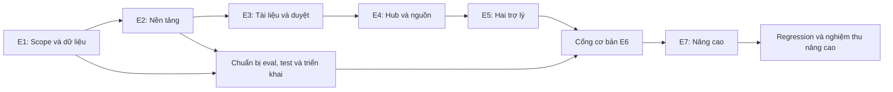

# EDU-04 — PRODUCT BACKLOG

| Thuộc tính | Nội dung |
|---|---|
| Dự án | Kho tri thức hỗ trợ học thuật X — Bộ trợ lý học thuật & học tập AI |
| Tên nhóm | [TỰ ĐIỀN TÊN NHÓM] |
| Phiên bản | 2.0 — 23/09/2026  |
| Trạng thái | Backlog đề xuất để refinement; chưa phải cam kết tiến độ hoặc xác nhận đã triển khai |
| Căn cứ | [Brief](brief_edu04.md), [PRD](PRD_edu04.md) (v2.0), [Wireframe & UI flow](wireframe&UIflow_edu04.md) (v2.0) |


**Thay đổi chính so với bản 1.0:** (1) bộ nghiệm thu accuracy chuyển từ 30 câu/≥24 đạt sang **100 mẫu holdout chia đều 5 nhóm ×20, ngưỡng ≥80/100** theo PRD mục 13.1–13.2; (2) **Dashboard Giảng viên (UI-09, FR-12) là Must**, phải hoàn tất cùng bản cơ bản cuối tuần 3 — không còn nằm gọn trong phạm vi nâng cao E7; (3) sửa các mã FR/UI tham chiếu sai hoặc đã đổi số ở bản 1.0 (ví dụ ký hiệu rút gọn "F-xx" cũ, UI-04/05/07B không còn tồn tại sau khi UI-03 hợp nhất ba trợ lý); (4) liên kết pain point trỏ đúng sang [Brief mục 3](brief_edu04.md) vì PRD v2.0 không còn mục "#pain-points" riêng.

## 1. Cách sử dụng backlog

Backlog chia thành 7 epic tương ứng PRD, gồm 40 hạng mục có ID ổn định `BL-01…BL-40`. Mỗi hạng mục có mục tiêu, đầu việc, điều kiện nghiệm thu; bảng tổng hợp là nơi theo dõi ưu tiên, ước lượng, người phụ trách và phụ thuộc.

- **Must:** bắt buộc để nghiệm thu bản cơ bản; không bỏ các kiểm soát nguồn, quyền, HITL và liêm chính để kịp demo.
- **Should:** thuộc mức nâng cao; bắt buộc nếu nhóm cam kết nghiệm thu mức đó. Không mặc nhiên coi một phần Should hoàn thành là đạt toàn bộ nâng cao.
- **Ưu tiên A:** cần làm sớm để mở đường hoặc bảo vệ luồng chính. **B:** làm sau nền tảng nhưng vẫn bắt buộc nếu là Must. **C:** mở rộng sau cổng cơ bản. A/B/C khác với mức độ lỗi P0–P3 của PRD.
- **SP:** story point tương đối về khối lượng, độ phức tạp và bất định; dùng thang 1, 2, 3, 5, 8, 13. Không quy đổi cố định SP thành giờ/ngày. Các điểm trong bảng chỉ là ước lượng ban đầu.
- **Phụ thuộc:** đầu ra phải sẵn sàng trước khi nghiệm thu hạng mục sau; phần UI/mock có thể làm trước sau khi thống nhất hợp đồng API, nhưng không coi mock là hoàn tất tích hợp.
- **Trạng thái ban đầu:** tất cả ở **Draft**, vì chưa đối chiếu việc triển khai trong repository và chưa được nhóm refinement. Brief/PRD/flow hiện có là đầu vào của BL-01, không tự chứng minh yêu cầu đã được các bên phê duyệt.

Nhóm cập nhật status trên board hoặc thêm cột trạng thái vào bảng. Không tạo hai nơi quản lý trạng thái trái nhau. Task có thể đặt ID con như `BL-12-T1`; điểm của task không cộng thêm vào điểm story mẹ.

## 2. Nhóm và trách nhiệm

| Mã | Họ tên | MSV | Trách nhiệm gợi ý |
|---|---|---|---|
| TV1 | Ngô Đinh Minh Nhật | 2A202602569 | BA, điều phối, QA/UAT, nhãn và báo cáo |
| TV2 | Ngụy Quang Hùng | 2A202602998 | Backend, dữ liệu, auth/ACL, audit, vận hành |
| TV3 | Nguyễn Văn Việt | 2A202602904 | Ingestion, AI/RAG, citation, guardrails, eval |
| TV4 | Đinh Văn Bình | 2A202602830 | Frontend, UX/UI, tích hợp, Docker/demo |

Owner trong bảng chịu trách nhiệm kéo hạng mục tới Done, không có nghĩa làm một mình. TV1 kiểm tra nghiệp vụ; TV2/TV3 kiểm tra chéo dữ liệu và AI; TV4 kiểm tra tương tác và tích hợp. GV hoặc người được ủy quyền xác nhận nguồn, nhãn và chất lượng học thuật; nhóm không tự thay vai trò chuyên môn này.

## 3. Epic và thứ tự giá trị

| Epic | Mục tiêu | Bằng chứng kết thúc |
|---|---|---|
| E1 — Nghiệp vụ và dữ liệu | Thống nhất làm gì, dùng nguồn nào, chấm ra sao | Scope, danh mục dữ liệu/quyền, dev/holdout, rubric |
| E2 — Nền tảng | Người dùng chỉ thao tác trong phạm vi được cấp | Auth, ACL, mô hình dữ liệu, navigation, audit |
| E3 — Vòng đời tài liệu | Chỉ nguồn được kiểm tra và duyệt mới được phục vụ | Upload → preview → duyệt → Published → thu hồi |
| E4 — Hub và retrieval | Tìm được nội dung phù hợp và mở được đúng nguồn | Search có ACL, viewer, citation hợp lệ |
| E5 — Hai trợ lý | Hỗ trợ hiểu bài và hỏi đáp có căn cứ | Academic, Learning, lịch sử, phản hồi, guardrails |
| E6 — Kiểm chứng và phát hành | Có bản cơ bản sử dụng được và đạt tiêu chí | Accuracy ≥80%, safety/UAT, Docker, vận hành |
| E7 — Nâng cao | Cải thiện điều phối, chất lượng và hiệu quả | Router, hybrid/reranker, OCR, RAGAS, dashboard, cache/dedup |



Kiểm thử, hạ tầng và chuẩn bị nhãn bắt đầu sớm; sơ đồ không yêu cầu chờ lập trình xong mới kiểm tra chất lượng. Sau E7 phải chạy lại kiểm thử ảnh hưởng và cổng an toàn, không tái sử dụng kết quả cơ bản làm bằng chứng cho cấu hình AI đã thay đổi.

## 4. Bảng backlog tổng hợp

### 4.1. E1 — Nghiệp vụ và dữ liệu

| ID | Hạng mục | Phạm vi | Ưu tiên | SP | Owner | Phụ thuộc | Truy vết |
|---|---|---|---|---|---|---|---|
| BL-01 | Chốt scope, quy tắc và các quyết định mở | Must | A | 3 | TV1 | — | PRD 4/5/17 |
| BL-02 | Kiểm kê nguồn, quyền sử dụng và nhãn môn | Must | A | 5 | TV1 | BL-01 | FR-06, BR-06 |
| BL-03 | Tạo dev/holdout (100 mẫu, 5 nhóm ×20), rubric và bộ safety | Must | A | 8 | TV1 | BL-01, BL-02 | PRD 13.1–13.3 |

### 4.2. E2 — Nền tảng

| ID | Hạng mục | Phạm vi | Ưu tiên | SP | Owner | Phụ thuộc | Truy vết |
|---|---|---|---|---|---|---|---|
| BL-04 | Thiết kế schema, migration và hợp đồng API | Must | A | 5 | TV2 | BL-01 | PRD 9/11 |
| BL-05 | Đăng nhập, đăng xuất và quản lý phiên | Must | A | 5 | TV2 | BL-04 | FR-01.1/01.2 |
| BL-06 | ACL theo môn/tài liệu và quản lý phân công | Must | A | 8 | TV2 | BL-04, BL-05 | FR-01.4, BR-01/02/03/11 |
| BL-07 | Khung giao diện, chọn môn và navigation | Must | A | 5 | TV4 | BL-05, BL-06 | UI-01/UI-02, FR-01.1/01.3 |
| BL-08 | Audit nghiệp vụ và revision chống ghi đè | Must | A | 5 | TV2 | BL-04, BL-06 | BR-07/11, UAT-14 |

### 4.3. E3 — Vòng đời tài liệu

| ID | Hạng mục | Phạm vi | Ưu tiên | SP | Owner | Phụ thuộc | Truy vết |
|---|---|---|---|---|---|---|---|
| BL-09 | Upload, metadata, file storage riêng tư | Must | A | 8 | TV2 | BL-02, BL-06, BL-08 | FR-06 |
| BL-10 | Parse PDF/PPTX, chunk và job xử lý nền | Must | A | 8 | TV3 | BL-09 | FR-07 (Must: PDF text/PPTX) |
| BL-11 | Preview, sửa bản nháp và gửi duyệt | Must | A | 5 | TV4 | BL-07, BL-10 | FR-07/FR-08, UI-07 |
| BL-12 | Duyệt độc lập và từ chối có lý do | Must | A | 8 | TV2 | BL-08, BL-11 | FR-08, UI-08 |
| BL-13 | Index và phát hành có kiểm soát | Must | A | 8 | TV3 | BL-10, BL-12 | BR-01/07, UAT-10 |
| BL-14 | Phiên bản, thu hồi và cơ chế vô hiệu hóa | Must | A | 8 | TV2 | BL-08, BL-13 | FR-08 |

### 4.4. E4 — Hub và retrieval

| ID | Hạng mục | Phạm vi | Ưu tiên | SP | Owner | Phụ thuộc | Truy vết |
|---|---|---|---|---|---|---|---|
| BL-15 | Vector retrieval đúng quyền và phạm vi | Must | A | 8 | TV3 | BL-06, BL-13, BL-14 | FR-04, BR-03 |
| BL-16 | Hub: tìm kiếm, lọc, phân trang | Must | A | 5 | TV4 | BL-07, BL-15 | FR-04.1/04.2/04.3, UI-03 (Hub) |
| BL-17 | Xem nguồn đúng phiên bản và quyền tải | Must | A | 5 | TV4 | BL-06, BL-13, BL-14 | FR-04.4/04.5, FR-10.6, UI-06 |
| BL-18 | Hợp đồng citation và evidence gate | Must | A | 8 | TV3 | BL-15, BL-17 | FR-10, BR-04/05 |

### 4.5. E5 — Hai trợ lý

| ID | Hạng mục | Phạm vi | Ưu tiên | SP | Owner | Phụ thuộc | Truy vết |
|---|---|---|---|---|---|---|---|
| BL-19 | Hội thoại cá nhân và ngữ cảnh theo môn | Must | A | 8 | TV2 | BL-06, BL-07, BL-14 | FR-05.1/05.2/05.3 |
| BL-20 | Guardrails liêm chính và prompt injection | Must | A | 8 | TV3 | BL-02, BL-06, BL-19 | FR-02.3, BR-06/09, PRD 10.4 |
| BL-21 | Academic hỏi đáp có nguồn đầu cuối | Must | A | 8 | TV3 | BL-18, BL-19, BL-20 | FR-02, UI-03 |
| BL-22 | Learning giải thích và tự kiểm tra | Must | B | 5 | TV3 | BL-18, BL-19, BL-20 | FR-03.1/03.2/03.3/03.4, UI-03 |
| BL-23 | Learning lập/điều chỉnh lộ trình ôn | Must | B | 5 | TV4 | BL-22 | FR-03.5–03.13, UI-03 |
| BL-24 | Phản hồi chất lượng và chia sẻ có lựa chọn | Must | B | 3 | TV4 | BL-19, BL-21 | FR-05.5/05.6 |

### 4.6. E6 — Kiểm chứng và phát hành

| ID | Hạng mục | Phạm vi | Ưu tiên | SP | Owner | Phụ thuộc | Truy vết |
|---|---|---|---|---|---|---|---|
| BL-25 | Log, token/chi phí, timeout và hạn mức | Must | A | 8 | TV2 | BL-05, BL-08, BL-21 | NFR-01/02/05/09 |
| BL-26 | Retention, xóa dữ liệu và riêng tư | Must | B | 5 | TV2 | BL-08, BL-19, BL-24 | FR-05.7 (PRD mục retention chưa được đánh số lại ở v2.0 — cần bổ sung khi refinement) |
| BL-27 | Chạy eval accuracy (100 mẫu, 5 nhóm ×20) và phân tích lỗi | Must | A | 8 | TV1 | BL-03, BL-21, BL-22, BL-23, BL-25 | PRD 13.1–13.4/13.7, UAT-17 |
| BL-28 | Security, safety và integration regression | Must | A | 8 | TV1 | BL-14, BL-17, BL-20, BL-24, BL-25, BL-26 | UAT-02/07/11/13/15/19 |
| BL-29 | Docker, môi trường demo và khôi phục | Must | A | 8 | TV4 | BL-04, BL-13, BL-21, BL-25, BL-26 | PRD 16, NFR phục hồi |
| BL-35 | Dashboard Giảng viên (UI-09) — **Must, không còn thuộc nâng cao** | Must | A | 8 | TV4 | BL-12, BL-19, BL-24 | FR-12, UI-09 |
| BL-30 | UAT, hiệu năng và tài liệu bàn giao cơ bản | Must | B | 5 | TV1 | BL-16, BL-23, BL-24, BL-27, BL-28, BL-29, BL-35 | PRD 14/16 |

### 4.7. E7 — Nâng cao

| ID | Hạng mục | Phạm vi | Ưu tiên | SP | Owner | Phụ thuộc | Truy vết |
|---|---|---|---|---|---|---|---|
| BL-31 | Router LangGraph cho ba trợ lý | Should | C | 8 | TV3 | BL-30 | FR-11, F-11 |
| BL-32 | Hybrid BM25 + vector + reranker | Should | C | 8 | TV3 | BL-30 | FR-12, UAT-18 |
| BL-33 | OCR và kiểm tra chất lượng scan | Should | C | 8 | TV3 | BL-30 | FR-07, UAT-12 |
| BL-34 | Hub tổng hợp nhiều tài liệu | Should | C | 5 | TV3 | BL-31, BL-32 | FR-04.6, FR-11 |
| BL-36 | RAGAS và mở rộng bộ kiểm chứng vượt 100 mẫu bắt buộc | Should | C | 8 | TV1 | BL-31, BL-32, BL-33, BL-34 | FR-14, PRD 13.5 |
| BL-37 | Cache có ACL và revision nguồn/quyền | Should | C | 8 | TV2 | BL-30, BL-32 | FR-15, BR-10 |
| BL-38 | Phát hiện và xử lý semantic dedup | Should | C | 5 | TV3 | BL-30, BL-33 | FR-16 |
| BL-39 | Dashboard vận hành và ngân sách | Should | C | 5 | TV2 | BL-30, BL-37 | FR-01.4, NFR-01, PRD 11.2 (`GET /metrics`) |
| BL-40 | Benchmark và nghiệm thu nâng cao | Should | C | 5 | TV1 | BL-34, BL-36, BL-37, BL-38, BL-39 | UAT-18, PRD 14.3 |

**BL-35 (Dashboard Giảng viên) đã chuyển sang bảng E6 — mục 4.6** vì PRD v2.0 mục 7.1.10 xếp Dashboard GV vào Must, "hoàn tất cùng bản cơ bản cuối tuần 3"; không còn là hạng mục nâng cao độc lập. Nội dung task/AC chi tiết của BL-35 vẫn giữ nguyên ở mục 11 bên dưới (chỉ đổi vị trí bảng tổng hợp và mức Must/Should).

BL-25/28/29 có thể chuẩn bị skeleton, test và cấu hình từ sớm; phụ thuộc nêu trong bảng áp dụng khi nghiệm thu tích hợp. Trước khi kéo story 8 SP vào sprint, tách các đầu việc đủ nhỏ để một thành viên có thể hoàn thành và review; không tách rời kiểm soát an toàn khỏi tính năng khi phát hành.

## 5. Backlog chi tiết — E1

### BL-01 — Chốt phạm vi và quyết định mở

**Story:** Là nhóm thực hiện, tôi muốn thống nhất yêu cầu và mức nghiệm thu để tránh mỗi người hiểu sản phẩm khác nhau.

**Task:** walkthrough Brief/PRD/flow; chọn mức cơ bản/nâng cao; chốt môn pilot, người duyệt, ngân sách, retention, giới hạn file và tiêu chí; lập decision log và danh sách câu hỏi chưa trả lời.

**Xác thực pain point:** dùng [PP-01…PP-10](brief_edu04.md) (Brief mục 3), phỏng vấn/quan sát ngắn ngày 1–2 và ghi sổ bằng chứng. Phân biệt sự cố thực tế, lời người dùng báo cáo và rủi ro dự phòng; không gán số liệu giả. TV1 tổng hợp trong BL-01, không tạo giai đoạn khảo sát mới làm lùi mốc tuần 3.

**AC:**

- Mỗi quyết định có người xác nhận, ngày và phạm vi áp dụng; giả định chưa xác nhận được đánh dấu rõ.
- Phạm vi ngoài dự án, Must/Should và các ngưỡng đề xuất không bị trộn với kết quả đã đạt.
- Có bảng ánh xạ người phụ trách nghiệp vụ, nguồn và nhãn; điểm chưa chốt chặn công việc phụ thuộc được ghi thành blocker.

**Bằng chứng:** phiên bản tài liệu đã review và decision log; không yêu cầu thay toàn bộ tài liệu chỉ để đổi trạng thái.

### BL-02 — Kiểm kê và chuẩn bị nguồn

**Story:** Là GV, tôi muốn biết nguồn nào được phép đưa vào pilot và ai được đọc để giữ đúng quyền sử dụng.

**Task:** lập danh mục đề xuất 2 môn/30–50 tài liệu; xác nhận quyền xử lý với dịch vụ AI; kiểm kê PDF/PPTX/scan; gắn phiên bản, môn, ACL, nhãn tính điểm/đáp án và nguồn gốc; chọn mẫu file lỗi cho test.

**AC:**

- Mỗi nguồn có chủ sở hữu/người xác nhận, môn, loại file, phiên bản và trạng thái quyền sử dụng.
- Nguồn chưa được phép không được đưa vào pipeline phục vụ; đáp án GV không có ACL của SV.
- Có mẫu đại diện cho file hợp lệ, scan, lỗi, trùng và hai phiên bản để kiểm thử.

**Bằng chứng:** data inventory và quyết định sử dụng nguồn; dữ liệu nhạy cảm không nằm trong tài liệu công khai.

### BL-03 — Bộ nhãn, rubric và safety fixtures

**Story:** Là người nghiệm thu, tôi muốn có bộ kiểm chứng độc lập để đo chất lượng thay vì đánh giá qua vài câu demo.

**Task:** tạo dev riêng (20–30 câu, PRD 13.2); chuẩn bị đủ **100 câu holdout chia đều 5 nhóm ×20 mẫu** (tra cứu/định nghĩa, giải thích khái niệm, so sánh/tổng hợp, vận dụng kiến thức, câu nối tiếp) và phân bổ theo môn theo ma trận PRD 13.2; gán đáp án, ý bắt buộc, nguồn/version/locator và quyền theo schema PRD 13.3; chuẩn bị ≥40 kịch bản safety đề xuất theo PRD 13.6; review nhãn cùng GV; khóa version/checksum và quyền truy cập holdout.

**AC:**

- Câu có nguồn được tách khỏi ca thiếu nguồn/từ chối; rubric chấm đủ bốn tiêu chí của PRD 13.4 (đúng kiến thức, đủ câu trả lời, grounding, citation).
- Đủ 100 mẫu có nhãn/nguồn hợp lệ, đúng 20 mẫu/nhóm; chưa đủ thì chưa đạt điều kiện chạy nghiệm thu (PRD 13.2) — không dùng bộ nhỏ hơn thay thế.
- Dev và holdout không trùng/gần trùng; holdout không được dùng tinh chỉnh prompt/retrieval trước vòng đánh giá (BR-12).
- Nhãn có tác giả/người review; ca nhiều lượt lưu đủ ngữ cảnh và hành vi mong đợi.

**Bằng chứng:** dataset version, rubric, nguồn đối chiếu và danh sách reviewer.

## 6. Backlog chi tiết — E2

### BL-04 — Schema và API

**Story kỹ thuật:** Là developer, tôi muốn một hợp đồng dữ liệu thống nhất để frontend/backend/AI tích hợp mà không đoán trường dữ liệu.

**Task:** thiết kế các thực thể PRD mục 9; migration; hợp đồng auth/chat/document/review/source/error; state/revision/idempotency; seed fixture đúng quyền; chọn kho vector qua thử nghiệm nhỏ có ghi quyết định.

**AC:** migration chạy trên DB sạch; ràng buộc owner/course/version rõ; schema response có status/citation/request_id; seed không chứa secret hoặc dữ liệu thật chưa được phép; có phương án rollback migration phù hợp.

### BL-05 — Xác thực và phiên

**Story:** Là người dùng, tôi muốn đăng nhập an toàn và đăng xuất để bảo vệ tài khoản và hội thoại.

**Task:** cấp tài khoản demo; API login/logout/me; bảo vệ secret/mật khẩu; hết hạn/thu hồi phiên; UI-01; thông báo lỗi và chống gửi lặp.

**AC:** tài khoản hợp lệ vào được ứng dụng; sai thông tin nhận lỗi chung; tài khoản khóa/phiên hết hạn không gọi được API; logout xóa dữ liệu riêng tư trên UI; không triển khai tự đăng ký ngoài phạm vi.

### BL-06 — ACL và phân công

**Story:** Là Trung tâm X, tôi muốn cấp quyền theo môn và vai trò để tài liệu chỉ đến đúng người.

**Task:** membership có hiệu lực; ACL read/download/review; API/admin UI tối thiểu để gán quyền, khóa tài khoản và phân công duyệt; cơ chế revision quyền; fixtures truy cập chéo.

**AC:** server không tin role/user_id do client gửi; SV không đọc được môn khác bằng ID/URL; quyền quản trị không tự cấp quyền nội dung; thu hồi quyền được kiểm tra khi đọc nguồn/trước trả đáp án; có audit cho mọi thay đổi.

### BL-07 — App shell và chọn môn

**Story:** Là người dùng, tôi muốn thấy rõ môn và chức năng được phép để không hỏi nhầm phạm vi.

**Task:** UI-02, menu theo quyền, ba lối vào trợ lý; responsive; trạng thái không môn/loading/error; đổi môn và bảo toàn hội thoại cũ; deep link sau đăng nhập.

**AC:** môn luôn hiển thị; đổi môn mở phiên mới sau xác nhận; tài khoản chưa có môn thấy hướng dẫn; deep link được kiểm tra lại quyền; desktop/mobile dùng được bằng bàn phím.

### BL-08 — Audit và concurrency

**Story kỹ thuật:** Là người vận hành, tôi muốn truy vết các thay đổi quan trọng và ngăn quyết định cũ ghi đè quyết định mới.

**Task:** audit event actor/action/object/reason/time; revision check/409; transaction cho chuyển trạng thái; idempotency quyết định/upload; quyền đọc audit.

**AC:** duyệt/từ chối/thu hồi/thay quyền có đủ dấu vết; hai thao tác trên revision khác nhau không ghi đè; retry cùng thao tác không tạo tác dụng phụ trùng; audit không lưu khóa API hoặc cho user tự sửa.

## 7. Backlog chi tiết — E3

### BL-09 — Upload và metadata

**Story:** Là GV phụ trách môn, tôi muốn tải file và khai báo quyền trước xử lý để kho có nguồn gốc rõ ràng.

**Task:** UI-07/07A; storage riêng tư; kiểm tra loại file thực tế/kích thước/mật khẩu; metadata bắt buộc; checksum; nhãn liêm chính; trả job_id.

**AC:** chỉ người quản lý môn tải được; file không hợp lệ bị từ chối rõ; file trùng cảnh báo nhưng không hợp nhất ACL; nguồn chưa rõ quyền giữ bản nháp; không cấu hình đáp án GV cho SV; chưa Published thì không phục vụ từ Hub.

### BL-10 — Parse, chunk và worker

**Story kỹ thuật:** Là hệ thống, tôi cần chuyển PDF/PPTX thành đoạn có vị trí gốc để truy xuất và trích dẫn được.

**Task:** worker/hàng đợi; parse PDF text và slide; loại header/footer có kiểm soát; chunk theo cấu trúc; giữ trang/slide/section; phân biệt lỗi parse và index; retry hữu hạn/idempotent.

**AC:** chunk truy ngược đúng phiên bản/vị trí; không ghép qua ACL/version; scan bản cơ bản được báo chưa hỗ trợ; công thức/bảng lỗi được gắn cờ; retry không nhân bản chunk/job; xử lý không chặn luồng chat.

### BL-11 — Preview và gửi duyệt

**Story:** Là GV tải tài liệu, tôi muốn so sánh bản gốc với text đã trích xuất để sửa sai trước khi gửi duyệt.

**Task:** UI-07 (khối trạng thái job/preview); tiến độ theo stage; preview gốc/text; cảnh báo chất lượng; sửa metadata/file; checklist sẵn sàng; submit transition.

**AC:** xem preview cần quyền riêng, SV không truy cập được; trang/slide lỗi nhận biết được; không hiển thị phần trăm giả; dữ liệu thiếu không gửi duyệt; thành công chuyển PendingApproval chứ không Published.

### BL-12 — Duyệt độc lập

**Story:** Là GV được phân công duyệt, tôi muốn kiểm tra chất lượng, ACL và nhãn trước khi cho tài liệu vào Hub.

**Task:** hàng đợi UI-08; preview revision; approve/reject; lý do từ chối; kiểm tra khác uploader; cảnh báo thiếu người duyệt; audit và conflict.

**AC:** tự duyệt/ngoài môn bị chặn cả API; người duyệt xem bản gốc/text/nhãn/quyền; từ chối thiếu lý do không hợp lệ; revision đổi phải xem lại; Approved chỉ xác nhận nội dung, chưa báo phát hành.

### BL-13 — Index và Published

**Story kỹ thuật:** Là hệ thống, tôi chỉ muốn công bố bản đã duyệt khi chỉ mục thực sự sẵn sàng.

**Task:** tạo embedding/index sau duyệt; gắn metadata ACL/version; publication transaction; kiểm tra readiness; failure/retry; hiển thị trạng thái.

**AC:** index lỗi giữ ngoài nguồn truy xuất; không công bố một phần; Published cần approval đúng revision và index sẵn sàng; retry cùng nội dung không yêu cầu duyệt lại nhưng sửa nội dung thì phải duyệt lại.

### BL-14 — Phiên bản và thu hồi

**Story:** Là GV có quyền, tôi muốn thay hoặc thu hồi bản tài liệu để ngừng sử dụng nội dung sai/lỗi thời.

**Task:** tạo version mới bất biến; chuyển current version; archive; withdraw có lý do/xác nhận; revision nguồn; sự kiện invalidation cho search/source/chat/cache; lưu quan hệ nguồn phục vụ truy vết.

**AC:** bản mới đi qua duyệt; bản cũ không tự bị xóa khi bản mới xử lý; thu hồi chặn phục vụ ngay dù dọn index chạy nền; citation cũ không tự chuyển sang trang cùng số của bản mới; có contract invalidation được BL-15/17/19/37 tích hợp và BL-28 kiểm tra đầu cuối.

## 8. Backlog chi tiết — E4

### BL-15 — Retrieval cơ bản

**Story:** Là người học, tôi muốn hệ thống tìm đúng đoạn trong tài liệu được phép để câu trả lời có nền tảng đáng tin.

**Task:** query embedding; lọc Published/ACL/course trước lấy ứng viên; giới hạn top-k/context; kiểm tra lại quyền; trace chunk IDs; đo recall trên dev.

**AC:** không lấy ứng viên ngoài quyền rồi mới giấu ở UI; nguồn thu hồi không vào context; ghi cấu hình retrieval để tái lập; không đủ nguồn trả trạng thái thích hợp, không mở rộng toàn kho ngầm định.

### BL-16 — Knowledge Hub cơ bản

**Story:** Là SV/GV, tôi muốn tìm và lọc tài liệu để không phải mở từng file.

**Task:** UI-03 (chế độ Hub trong hội thoại chung); search API; lọc chủ đề/loại/phiên bản hiện hành; snippets/count/pagination; empty/error/loading; nút hỏi về tài liệu.

**AC:** count/snippet đúng ACL; chỉ thấy Published; không kết quả nêu phạm vi hiện tại; hỏi về file mở phiên mới giới hạn đúng file/môn; phân trang không lộ bản chưa được phép.

### BL-17 — Viewer và tải có quyền

**Story:** Là người học, tôi muốn mở đúng phần tài liệu được dẫn để kiểm tra nội dung trả lời.

**Task:** UI-06/panel; source API; page/slide navigation; text fallback; read/download tách biệt; đường truy cập riêng tư; quay lại hội thoại giữ vị trí.

**AC:** locator đúng phiên bản; ghi rõ trang PDF/trang in nếu khác; kiểm tra quyền mỗi lần mở/tải; thu hồi giữa chừng không phục vụ tiếp bằng URL cũ; không có quyền tải thì không được tải qua endpoint trực tiếp.

### BL-18 — Citation và evidence gate

**Story:** Là người dùng, tôi muốn biết từng ý học thuật dựa vào đâu và phần nào chưa có bằng chứng.

**Task:** citation schema/claim mapping; whitelist chunk ID từ context; kiểm tra tồn tại/quyền/locator; đánh giá hỗ trợ khẳng định; partial/insufficient/mâu thuẫn; unit/integration fixtures.

**AC:** ID giả bị chặn; nguồn tồn tại nhưng không chứng minh ý không tính đúng; thiếu bằng chứng phải bỏ/sửa ý hoặc báo thiếu nguồn; không dùng similarity làm xác suất đúng; citation được UI mở qua BL-17.

## 9. Backlog chi tiết — E5

### BL-19 — Hội thoại và lịch sử riêng tư

**Story:** Là SV/GV, tôi muốn hỏi tiếp trong đúng môn và chỉ mình xem được lịch sử riêng.

**Task:** conversation/message API và UI; owner check; đổi tên/xóa; tóm tắt ngữ cảnh; giới hạn context; source dependencies; che lịch sử khi mất quyền/nguồn; idempotent send.

**AC:** đọc conversation_id người khác bị chặn; đổi môn không mang nguồn cũ; lịch sử không là nguồn học thuật; tóm tắt giữ tín hiệu liêm chính; nội dung phụ thuộc nguồn thu hồi được che phía server; xóa hiển thị theo chính sách retention, không tuyên bố xóa backup tức thì.

### BL-20 — Liêm chính và injection

**Story:** Là GV, tôi muốn AI hỗ trợ hiểu bài mà không làm bài tính điểm hoặc thi hành lệnh độc hại từ nguồn.

**Task:** policy input/history/output; nhãn GV; phát hiện ý định; phản hồi chuyển hướng; kiểm tra đa lượt/đổi trợ lý; tách nguồn khỏi instruction; hạn chế công cụ theo scope server.

**AC:** không đưa đáp án hạn chế vào context SV; xin đáp án trực tiếp/đóng vai/dịch/chia nhỏ được kiểm tra; nhãn SV không ghi đè nhãn GV; ca chưa rõ chỉ hỗ trợ khái niệm và hỏi lại; file chứa lệnh không được thay quyền hoặc gọi công cụ trái phép; không kết tội người học.

### BL-21 — Academic đầu cuối

**Story:** Là người học, tôi muốn hỏi chuyên môn và nhận câu trả lời có nguồn theo môn hiện tại.

**Task:** prompt Academic; pipeline retrieve → evidence → generate → validate; UI-03; câu hỏi nối tiếp; status response; nguồn/feedback hooks; lỗi provider.

**AC:** có căn cứ thì trả đúng trọng tâm cùng citation; câu nhiều phần có trạng thái partial khi thiếu; kiểm tra quyền/nguồn lại trước trả; không công bố draft chưa kiểm tra; trả đủ status theo PRD và mở được citation trong UI.

### BL-22 — Learning giải thích

**Story:** Là SV chưa hiểu bài, tôi muốn được giải thích ngắn gọn/từng bước và tự kiểm tra để hiểu nội dung.

**Task:** UI-03 (chế độ Learning trong hội thoại chung); prompt mức độ; ví dụ minh họa có căn cứ; câu tự kiểm tra không tính điểm; hỏi tiếp/giải thích lại.

**AC:** diễn giải không đổi nghĩa kiến thức; ví dụ AI tạo ghi rõ và kiểm tra đúng; nguyên lý có nguồn; đổi mức độ không mất guardrail; thiếu nguồn nói rõ, không bịa ví dụ như trích nguyên văn.

### BL-23 — Lộ trình ôn

**Story:** Là SV, tôi muốn lịch ôn phù hợp quỹ thời gian và nguồn học để biết học gì mỗi buổi.

**Task:** form mục tiêu/chủ đề/ngày/phút; kiểm tra input; retrieval theo chủ đề; tạo kế hoạch; điều chỉnh; lưu trong hội thoại; citation từng nguồn học.

**AC:** mỗi buổi có mục tiêu/thời lượng/nguồn/hoạt động; tổng thời lượng không vượt quỹ; phần thiếu nguồn được thông báo trước khi tiếp tục; sửa quỹ thời gian tạo kế hoạch cập nhật; không hứa điểm thi hoặc thêm xuất lịch/file ngoài scope.

### BL-24 — Phản hồi và quyền chia sẻ

**Story:** Là người dùng, tôi muốn báo câu trả lời chưa tốt và tự chọn nội dung nào được chia sẻ cho GV.

**Task:** hữu ích/báo lỗi; loại lỗi/ghi chú; checkbox chia sẻ không mặc định; preview nội dung chia sẻ; feedback API; xác nhận gửi và quyền đọc cơ bản.

**AC:** feedback gắn answer_id nhưng không mở quyền đọc toàn hội thoại; GV chỉ xem nội dung được phép; người khác không gửi feedback lên answer không được xem; phản hồi không tự sửa nguồn/nhãn; không chia sẻ thì chỉ dữ liệu được phép/tổng hợp xuất hiện cho GV.

## 10. Backlog chi tiết — E6

### BL-25 — Quan sát và hạn mức

**Story:** Là người vận hành, tôi muốn kiểm soát độ trễ và chi phí để ứng dụng không treo hoặc vượt ngân sách không kiểm soát.

**Task:** request/trace ID; token/latency/errors; chi phí cấu hình; rate/concurrency limit; timeout và retry hữu hạn; quota reservation/đối soát; UI quá tải/hết hạn mức; log nội dung thô tắt mặc định.

**AC:** retry tối đa theo cấu hình trong deadline toàn yêu cầu; chạm hạn mức không gọi thêm AI trái ngân sách; yêu cầu đồng thời không vượt quota do race; số tiền được ghi “ước tính” khi chưa đối soát; log không có secret; Hub còn hoạt động khi có thể.

### BL-26 — Retention và riêng tư

**Story:** Là người dùng, tôi muốn biết dữ liệu được lưu bao lâu và thao tác xóa có hiệu lực ra sao.

**Task:** chốt chính sách theo BL-01; retention job; xóa hội thoại; thông báo trên UI; tách audit tối thiểu và nội dung; backup expiry; test quyền truy cập log.

**AC:** cấu hình/hiển thị thời hạn thống nhất PRD hoặc quyết định sửa; xóa ẩn ngay và dọn bản hoạt động đúng thời hạn; backup hết hạn theo chính sách; không dùng hội thoại huấn luyện/tạo nhãn khi chưa được phép; audit không giữ nguyên nội dung không cần thiết.

### BL-27 — Accuracy trên holdout

**Story:** Là người nghiệm thu, tôi muốn kết quả có thể kiểm tra lại để biết hệ thống đạt KPI hay chưa.

**Task:** eval runner snapshot/config; chạy đủ 100 mẫu; lưu output/citation/lỗi/latency/cost; chấm rubric; review độc lập ≥20% mẫu + toàn bộ ca tranh chấp theo PRD 13.4; báo accuracy tổng, theo 5 nhóm (20 mẫu/nhóm) và theo môn (16–17 mẫu/môn); phân tích nguyên nhân không đạt (data/retrieval/generation/citation/routing).

**AC:** báo số đạt/tổng với mẫu số khóa (100 mẫu, không đổi mẫu số sau khi biết điểm); **cần ≥80/100 đạt cả bốn tiêu chí rubric**, không làm tròn kết quả dưới 80%; timeout/từ chối sai/citation sai là không đạt; không trộn safety vào accuracy; chưa đạt tạo bug/task sửa và chạy lại theo quy tắc chống rò holdout (BR-12, PRD 13.7 bước 7 — cần holdout mới cho ước lượng độc lập); mock LLM không dùng làm bằng chứng.

**Lưu ý:** mục tiêu story là cung cấp bằng chứng và đạt ngưỡng trước phát hành, không “hoàn thành” bằng cách đổi rubric sau khi xem điểm.

### BL-28 — Safety và regression đầu cuối

**Story:** Là Trung tâm X, tôi muốn kiểm tra các đường rò rỉ hoặc vượt kiểm soát trước khi cho người học sử dụng.

**Task:** chạy safety suite; truy cập chéo môn/owner; đáp án GV; đa lượt/injection; revision race; thu hồi đang query; lịch sử/snippet/count/download; retention; retry/idempotency; tạo bug có fixture.

**AC:** không còn ca lộ tài liệu/đáp án tính điểm/nguồn chưa duyệt trong bộ bắt buộc; kiểm tra cả backend và UI; ca hợp lệ không bị chặn quá mức; log kết quả và giới hạn; P0/P1 chặn phát hành, không bỏ test để đạt.

### BL-29 — Docker và demo có thể tái lập

**Story:** Là nhóm trình diễn, tôi muốn dựng lại ứng dụng từ hướng dẫn để demo không phụ thuộc một máy cá nhân.

**Task:** Docker backend/frontend/DB/worker/retrieval; biến môi trường mẫu; healthcheck/migration/seed; triển khai môi trường được chọn; HTTPS; backup/restore; rollback và smoke test.

**AC:** người thứ hai chạy theo hướng dẫn được; dữ liệu/khóa không nằm trong image hoặc repo; nguồn/private storage không công khai; thử phục hồi có bằng chứng theo RPO/RTO được chốt; rollback không tái mở nguồn/ACL đã thu hồi.

### BL-30 — Cổng cơ bản và bàn giao

**Story:** Là GV/người nhận bàn giao, tôi muốn sử dụng sản phẩm theo các luồng thực tế và biết rõ chất lượng, cách chạy, giới hạn còn lại.

**Task:** walkthrough UI-01…UI-03, UI-06…UI-09 cần thiết (theo mã màn hình hiện tại ở Wireframe v2.0 — UI-03 đã hợp nhất Academic/Learning/Hub, UI-09 là Dashboard GV Must); UAT người đại diện; đo tải/latency trên corpus pilot; tổng hợp accuracy/safety; hướng dẫn SV/GV/vận hành; demo script/video nếu yêu cầu; biên bản lỗi/phạm vi.

**Đo giá trị sử dụng:** ghi kết quả tác vụ tìm đúng đoạn/phiên bản, mở nguồn kiểm chứng và giải thích lại khái niệm theo pain point ở [Brief mục 3](brief_edu04.md). Báo baseline, số mẫu và giới hạn nếu có dữ liệu; chưa đo thì ghi rõ, không dùng mức hài lòng thay cho accuracy hoặc tự thêm ngưỡng cải thiện chưa được chốt.

**AC:** toàn bộ BL-01…BL-29, BL-35 (Dashboard GV) và Must liên quan hoàn tất; **≥80/100 mẫu holdout đạt**; safety đạt; không P0/P1; báo p50/p95/cache state/corpus/tải thật và đối chiếu ngưỡng đã chốt; có URL/demo, version phát hành, hướng dẫn và người xác nhận. Nếu chưa đạt ngưỡng bắt buộc, giữ cổng mở và bổ sung công việc khắc phục.

## 11. Backlog chi tiết — E7

### BL-31 — Router ba trợ lý

**Story:** Là người dùng, tôi muốn gửi yêu cầu ở chế độ Tự động và được chuyển tới trợ lý phù hợp.

**Task:** graph/state; intent labels; nhánh Academic/Learning/Hub; hỏi làm rõ; giới hạn bước; hiển thị trợ lý; chuyển thủ công; tập test router.

**AC:** ý định rõ đi đúng nhánh; nhãn nhiều lựa chọn được chấm theo tập chấp nhận; không mặc định gọi cả ba; đổi trợ lý giữ quyền/guardrail; timeout/giới hạn bước không gây loop; có trace và báo routing accuracy riêng.

### BL-32 — Hybrid và reranker

**Story kỹ thuật:** Là hệ thống, tôi muốn kết hợp khớp từ khóa và ý nghĩa để tìm nguồn tốt hơn cho câu hỏi khó.

**Task:** thành phần BM25 thực; vector branch; fusion/dedup/rerank; ACL từng nhánh; cấu hình top-k/token; fallback; benchmark vector-only cùng dev.

**AC:** BM25 không chỉ là nhãn đặt cho full-text bất kỳ; cả hai nhánh lọc quyền trước lấy ứng viên; reranker lỗi fallback chỉ khi đủ bằng chứng; báo recall/chất lượng/latency/cost, không khẳng định cải thiện khi chưa đo.

### BL-33 — OCR có kiểm tra chất lượng

**Story:** Là GV, tôi muốn dùng tài liệu scan nhưng được cảnh báo phần trích xuất không đáng tin trước khi duyệt.

**Task:** detect scan; OCR theo trang; locator mapping; cờ chất lượng; UI so sánh; giới hạn tài nguyên/chi phí; file scan fixtures.

**AC:** giữ đúng trang; lỗi công thức/ảnh không biến thành văn bản suy đoán; low-quality vào NeedsReview; không tự Published sau OCR; báo thời gian/chi phí; ACL và HITL giống tài liệu text.

### BL-34 — Hub tổng hợp nhiều nguồn

**Story:** Là người dùng, tôi muốn chọn nhiều tài liệu để tổng hợp chủ đề và thấy điểm đồng thuận/mâu thuẫn.

**Task:** UI chọn nguồn trong Hub; kiểm tra số lượng/token; pipeline tổng hợp; claim citations; router handoff; mâu thuẫn phiên bản.

**AC:** mọi nguồn đúng quyền và Published; mỗi ý có căn cứ; không trộn nguồn môn khác ngầm định; thiếu bằng chứng nêu rõ; nguồn bị thu hồi trong lúc xử lý phải được loại/chặn trước phản hồi.

### BL-35 — Dashboard GV (Must — theo PRD v2.0 mục 7.1.10, không còn là hạng mục nâng cao)

**Story:** Là GV phụ trách môn, tôi muốn theo dõi tài liệu và phản hồi để ưu tiên cải thiện kho.

**Task:** UI-07/UI-08 (tái dùng trực tiếp, không tạo logic riêng — FR-12.3) + UI-09 (tab Tài liệu/Hàng đợi duyệt/Lịch sử/Phản hồi/Thống kê/Nhu cầu bổ sung nguồn theo PRD 7.1.10.1); bộ lọc/trạng thái/phiên bản; quy trình phản hồi Open→InProgress→Resolved; metric môn gắn dataset/config/time window; empty/error/accessibility.

**AC:** chỉ môn phụ trách (quyền tra cứu toàn môn của GV không mở quyền quản lý/metric môn khác — AC-12.1); thống kê không cấp quyền đọc hội thoại SV bằng answer ID (AC-12.2); resolved feedback không tự cập nhật nguồn/Published (AC-12.3); metric chưa đo hiển thị "chưa có dữ liệu", khác với "dữ liệu chưa đủ mẫu" (AC-12.4); mọi quyết định trên tài liệu vẫn qua đúng luồng FR-08 (AC-12.5).

**Ghi chú tiến độ:** vì là Must, BL-35 cần lên kế hoạch bắt đầu từ Sprint 2 (song song BL-12) và hoàn tất trước Sprint 3 để nằm trong cổng cơ bản BL-30 — xem mục 12.

### BL-36 — RAGAS và mở rộng eval

**Story:** Là nhóm AI/QA, tôi muốn đo từng khía cạnh retrieval/generation để xác định nguyên nhân chất lượng và so sánh cấu hình.

**Task:** version metric/judge/model; chạy faithfulness/answer relevancy/context precision; bổ sung retrieval/citation/router scores; mở rộng bộ mẫu **vượt 100 câu bắt buộc** (đã là baseline theo PRD 13.2, không phải mục tiêu nâng cao) nếu đủ nguồn lực; review nhãn; báo lỗi đánh giá.

**AC:** RAGAS tách accuracy do người chấm; ngưỡng đề xuất (faithfulness ≥0,85; answer relevancy ≥0,80; context precision ≥0,75 — PRD 13.5) được xác nhận trước chạy nghiệm thu, không phải yêu cầu gốc; giữ kết quả lỗi, không bỏ ca âm thầm; bộ mở rộng tách dev và nhãn kiểm tra; báo rõ số mẫu thực tế và giới hạn.

### BL-37 — Cache an toàn

**Story kỹ thuật:** Là hệ thống, tôi muốn giảm xử lý lặp mà không trả nội dung sai quyền hoặc cũ.

**Task:** chọn lớp cache; key scope/course/ACL revision/source revision/model/prompt/context; invalidation; giới hạn TTL/dung lượng; observability; cache miss/hit và race tests.

**AC:** không tái dùng giữa quyền khác nhau; kiểm tra an toàn và quyền hiện tại trước hit response; withdrawal/ACL change vô hiệu ngay dù chưa dọn vật lý; TTL không là lớp bảo vệ duy nhất; không bật semantic answer cache cho ca liêm chính nhạy cảm ở đợt đầu.

### BL-38 — Semantic dedup

**Story:** Là GV quản lý kho, tôi muốn thấy tài liệu gần trùng để giảm xử lý lặp mà không mất nguồn gốc và quyền.

**Task:** phát hiện gần trùng; threshold trên dev; danh sách gợi ý và quyết định; giữ original/version/ACL; đánh giá false positive; đo tài nguyên tiết kiệm.

**AC:** không tự xóa bản gốc hoặc hợp nhất quyền; nội dung giống nhưng khác version/ACL vẫn truy vết riêng; GV kiểm tra được gợi ý; quyết định có audit; báo sai số, không coi gần trùng là cùng nội dung tuyệt đối.

### BL-39 — Dashboard vận hành

**Story:** Là quản trị, tôi muốn xem tải, lỗi, chi phí và hạn mức để xử lý dịch vụ kịp thời.

**Task:** UI-10 tab metric/quota/audit; p50/p95; token theo tác vụ; cache hit/miss; cảnh báo mức ngân sách; chỉnh hạn mức có xác nhận; phạm vi đọc metric.

**AC:** phân biệt serving/ingestion/eval và số ước tính; số liệu cùng cửa sổ thời gian; thay quota có audit; không tự đổi model/provider; dashboard không lộ nội dung riêng tư hoặc secret.

### BL-40 — Nghiệm thu nâng cao

**Story:** Là người nghiệm thu, tôi muốn biết bản nâng cao cải thiện gì và có giữ các kiểm soát bắt buộc hay không.

**Task:** khóa config/corpus; chạy lại accuracy/safety/UAT ảnh hưởng; benchmark baseline/nâng cao và cache hit/miss; rà OCR/dedup/router/dashboard; cập nhật tài liệu và demo.

**AC:** tất cả Should đã cam kết có bằng chứng; accuracy vẫn ≥80%; không P0/P1; RAGAS không thay accuracy; có trade-off chi phí/độ trễ/chất lượng và giới hạn; nếu bỏ hạng mục phải ghi thay đổi phạm vi, không ghi hoàn thành toàn bộ nâng cao.

## 12. Kế hoạch sprint đề xuất

**Ràng buộc nhóm đã xác nhận: tổng thời gian 6 tuần; bản cơ bản phải hoàn tất và được kiểm chứng cuối tuần 3.** Tổ chức 6 sprint, mỗi sprint 1 tuần. Tuần 1–2 xây và tích hợp, tuần 3 ưu tiên kiểm chứng/sửa lỗi; tuần 4–5 nâng cao có điều kiện; tuần 6 ổn định và bàn giao. Ngày bắt đầu thực tế: [TỰ ĐIỀN].

Backlog đang có **202 SP Must và 60 SP Should** theo ước lượng sơ bộ (đã chuyển 8 SP của BL-35 — Dashboard GV — từ Should sang Must theo PRD v2.0). Không chia các điểm này cho số người/tuần để suy ra chắc chắn làm kịp. Ngày 1–2 phải kiểm tra phần có thể tái sử dụng trong repo, tách task, ước lượng lại và xác nhận nguồn lực. Giữ nguyên ID, AC và điểm hiện tại làm baseline đến khi nhóm refinement, không tự giảm điểm vì lịch ngắn hơn.

| Sprint | Mục tiêu | Backlog dự kiến | Điều kiện review |
|---|---|---|---|
| S1 — Tuần 1 | Nguồn mẫu chạy hết vòng đời trên demo | Chốt BL-01/02/04…08; triển khai lát cắt BL-09…13; bắt đầu BL-03/25/28/29 | Auth/ACL hoạt động; một file đi qua duyệt độc lập tới Published; app chạy trên demo |
| S2 — Tuần 2 | Hoàn tất chức năng cơ bản đầu cuối | Hoàn tất BL-03/09…24; tích hợp BL-25/26/29; bắt đầu BL-35 (Dashboard GV — Must); phát triển test BL-27/28 liên tục | Hub và hai trợ lý có nguồn, guardrails, lịch sử/feedback, thu hồi; dataset có nhãn sẵn sàng; feature freeze cuối tuần |
| S3 — Tuần 3 | Nghiệm thu bản cơ bản | Hoàn tất phần vận hành BL-25/26/29; hoàn tất BL-35 (Dashboard GV); BL-27/28/30; sửa lỗi các Must | ≥80/100 mẫu holdout đạt, safety/UAT và vận hành đạt, không P0/P1, có demo/hướng dẫn |
| S4 — Tuần 4 | Nâng cao ưu tiên sau cổng cơ bản | BL-31/32; khởi động BL-36; thiết kế BL-37 nếu đủ năng lực | Router/hybrid có tích hợp và benchmark dev; không ảnh hưởng ACL/citation |
| S5 — Tuần 5 | Hoàn tất phần nâng cao đã chọn | BL-33/34/36/37/38/39 theo capacity và phụ thuộc; review phạm vi BL-40 | Chốt tính năng cuối tuần; cấu hình và bộ kiểm chứng cuối sẵn sàng |
| S6 — Tuần 6 | Ổn định và bàn giao | BL-40 nếu đăng ký nâng cao; chạy lại các cổng BL-27/28/30 bị ảnh hưởng, sửa lỗi/tài liệu | Báo cáo cuối, regression, hiệu năng/chi phí, demo và bàn giao; không thêm tính năng mới |

“Bắt đầu” hoặc “lát cắt” không đồng nghĩa story Done. Phụ thuộc ở mục 4 vẫn phải đáp ứng khi nghiệm thu; trong tuần 1 có thể triển khai tuần tự các bước nhỏ trên một file rồi mở rộng ở tuần 2. Không chờ E1 hoàn tất mọi tài liệu mới làm E2, nhưng các quyết định/quyền dữ liệu cần thiết cho công việc phải được chốt trước.

### 12.0. Phân công thực hiện trong ba tuần đầu

| Tuần | TV1 — BA/QA | TV2 — Backend | TV3 — AI/RAG | TV4 — Frontend/deploy |
|---|---|---|---|---|
| 1 | Chốt scope ngày 1–2; kiểm kê và xác nhận nguồn; chuẩn bị nhãn/dev/holdout với GV; fixtures ACL | Schema/API, auth/ACL, storage/upload, audit; duyệt và publication state tối thiểu | Parse/chunk/index PDF/PPTX; hợp đồng citation; tích hợp một file đã duyệt | App shell/login/môn; upload/preview/duyệt tối giản; Docker/demo từ đầu |
| 2 | Tiếp tục gán đủ 100 nhãn holdout (5 nhóm ×20) và safety suite; test từng luồng hằng ngày; ghi bug | Version/withdraw, hội thoại, feedback API, quota/retention; hỗ trợ nguồn/viewer | Retrieval/evidence, Academic/Learning/guardrails; chạy dev, sửa lỗi nguồn | Hub/viewer/chat/Learning plan/feedback; bắt đầu BL-35 Dashboard GV (UI-09, Must); trạng thái lỗi; tích hợp mỗi ngày |
| 3 | Chấm 100 mẫu holdout cùng GV, UAT và báo cáo; quản lý cổng BL-30 | Sửa ACL/race/thu hồi; quota/log/retention; backup/restore | Sửa lỗi AI trên dev; hỗ trợ phân tích và regression, giữ quy tắc holdout | Hoàn tất BL-35 Dashboard GV; sửa UI/integration; kiểm tra demo, hướng dẫn, responsive; chuẩn bị trình diễn |

**Điểm kiểm tra trong tuần 3:** đầu tuần chạy đầy đủ đánh giá và kiểm thử lần đầu; giữa tuần xử lý lỗi và kiểm tra lại; cuối tuần nghiệm thu bản cơ bản với bằng chứng. Không để đến ngày cuối mới chạy 100 câu. Nếu đã dùng lỗi holdout để tinh chỉnh, lần chạy lại được ghi là regression trên bộ đã biết; tuân thủ PRD về bộ độc lập mới khi đưa ra ước lượng độc lập, không che lịch sử kết quả.

**Giới hạn triển khai để bảo vệ thời hạn:** tài khoản cấp sẵn; giao diện quản lý dạng danh sách/form tối giản; một lựa chọn kho vector chính; PDF text/PPTX ở cơ bản; chọn trợ lý thủ công; chưa làm OCR, hybrid/reranker, router tự động, dashboard nâng cao hoặc cache câu trả lời trước cổng cơ bản. Các kiểm soát ACL, nguồn từng ý, HITL, guardrails, thu hồi, quota và phép đo KPI vẫn bắt buộc. Đây là cách triển khai tối giản của phạm vi hiện có, không xóa story Must.

**Cảnh báo tiến độ:** cuối tuần 1 chưa có nguồn Published trên demo hoặc cuối tuần 2 chưa chạy đủ hai trợ lý là tín hiệu đỏ. Owner báo ngay blocker, người gỡ và kế hoạch xử lý; giảm việc trang trí/tính năng nâng cao và thống nhất quy mô pilot nếu cần. Mốc tuần 3 không tự lùi; nếu lỡ phải ghi nhận trễ, dành thời gian tuần 4 khắc phục và giảm phần nâng cao. Tổng lịch không tự vượt 6 tuần.

**Chốt nâng cao:** đầu tuần 4 chọn hạng mục theo capacity thực và đăng ký phạm vi. Ưu tiên router/hybrid để hỗ trợ đủ ba trợ lý; OCR phụ thuộc dữ liệu scan, cache phụ thuộc benchmark, dedup phụ thuộc ingestion; RAGAS/báo cáo và regression được chuẩn bị song song. Muốn tuyên bố đạt nâng cao đầy đủ vẫn phải hoàn thành tất cả Should đã cam kết; không âm thầm bỏ hạng mục vì hết thời gian.

### 12.1. Cách lập kế hoạch mỗi sprint

1. Chốt thời gian thực tế từng thành viên có thể dành cho dự án và các vắng mặt.
2. Refinement, tách story lớn; giải quyết blocker và thống nhất AC trước chọn.
3. Dùng số story/SP **đã Done** ở sprint trước làm tham chiếu; sprint đầu chọn thận trọng.
4. Dành khoảng dự phòng đề xuất 20% năng lực cho tích hợp, sửa lỗi và review; hiệu chỉnh sau sprint đầu.
5. Không giao đồng thời quá nhiều story cho TV3; AI/RAG là điểm dễ quá tải. TV2 hỗ trợ pipeline/API, TV4 làm UI tích hợp, TV1 chuẩn bị nhãn/test.
6. Nếu quality gate chưa đạt, ưu tiên sửa và kiểm chứng; chưa mở rộng tính năng nâng cao để thay cho lỗi còn lại.

### 12.2. Lát cắt demo theo mốc

- **M1:** SV đăng nhập, chỉ thấy môn được cấp; truy cập chéo bị chặn.
- **M2:** GV tải file, GV khác duyệt, SV tìm và mở đúng nguồn; thu hồi làm nguồn biến mất khỏi phục vụ.
- **M3:** SV hỏi Academic/Learning có citation; ca thiếu nguồn và bài tính điểm xử lý đúng.
- **M4:** Có báo cáo ≥80/100 mẫu holdout đạt, safety đạt và demo Docker có thể dựng lại.
- **M5:** Bản nâng cao chứng minh từng hạng mục đã cam kết, chạy lại kiểm chứng trên cấu hình mới.

## 13. Definition of Ready — khi nào kéo vào sprint?

Một story chỉ vào **Ready** khi:

- Có mục tiêu, scope, AC kiểm tra được và owner/reviewer.
- Phụ thuộc đã có đầu ra hoặc kế hoạch tích hợp rõ; blocker được gỡ.
- Có dữ liệu/fixture được phép dùng và quyền truy cập cần thiết.
- UI/API contract đủ rõ cho công việc; câu hỏi nghiệp vụ ảnh hưởng triển khai đã chốt.
- Story đủ nhỏ để hoàn tất, tích hợp và kiểm tra trong sprint; SP đã được nhóm xem lại.

Không cần hoàn tất mọi thiết kế chi tiết của toàn dự án trước khi làm story đầu tiên, nhưng không bắt đầu xử lý dữ liệu thật khi quyền sử dụng còn chưa rõ.

## 14. Definition of Done — khi nào thực sự hoàn tất?

Áp dụng cho từng story theo tính chất công việc:

1. Đáp ứng toàn bộ AC; không có phần chưa làm được giấu trong ghi chú “sẽ bổ sung”.
2. Thay đổi được review chéo và tích hợp; config/migration cần thiết có hướng dẫn.
3. Kiểm thử phù hợp rủi ro đã chạy; feature liên quan ACL/nguồn/HITL có ca phủ định, không chỉ happy path.
4. UI có loading/empty/error khi cần, thao tác đúng trên kích thước màn hình mục tiêu.
5. Không log/lộ secret; audit/trace có theo yêu cầu; dữ liệu demo có quyền sử dụng.
6. Có bằng chứng: commit/PR, ảnh hoặc video khi hữu ích, kết quả test, dataset/config version cho AI.
7. Tài liệu liên quan cập nhật; người phụ trách nghiệm thu chức năng xác nhận.

Done của từng story không tự động đồng nghĩa được phát hành. BL-30/BL-40 còn phải kiểm tra cổng toàn sản phẩm. Story chỉ có thiết kế/mock không được ghi Done cho tính năng đầu cuối; nếu cần, tách thành task thiết kế riêng.

## 15. Board và quản lý bug

### 15.1. Workflow

`Draft → Ready → In Progress → Review → QA/UAT → Done`.

**Blocked** là cờ kèm trạng thái, lý do, người gỡ và ngày xem lại, không phải nơi bỏ quên task. QA không đạt → quay lại In Progress, giữ bằng chứng lỗi. Scope bị bỏ → ghi Deferred/Cancelled cùng người xác nhận, không ghi Done.

Đề xuất mỗi người tối đa một story chính đang In Progress; hỗ trợ review/test story khác khi chờ. Review đầu sprint về thứ tự ưu tiên; giữa sprint xem blocker; cuối sprint demo theo AC và cập nhật velocity thực.

### 15.2. Mẫu bug

```text
ID: BUG-<số>
Tiêu đề: <Hành vi sai và tình huống kích hoạt>
Story/FR/UAT liên quan:
Môi trường / build / model / prompt / corpus version:
Vai trò và phạm vi quyền của tài khoản test:
Các bước tái hiện:
Kết quả mong đợi:
Kết quả thực tế:
Bằng chứng đã loại bỏ secret/thông tin nhạy cảm:
Mức độ: P0 / P1 / P2 / P3
Owner / trạng thái / cách xác minh sau sửa:
```

Theo PRD: P0 cho lộ dữ liệu/secret/sai quyền nghiêm trọng; P1 cho đáp án tính điểm, công bố chưa duyệt, mất dữ liệu hoặc hỏng luồng cốt lõi; P2 có workaround cần kế hoạch/chấp thuận; P3 trình bày nhỏ. P0/P1 chặn phát hành. Bug phát hiện từ holdout phải đánh dấu rõ nguồn phát hiện và ảnh hưởng tính độc lập của lần đánh giá tiếp theo.

## 16. Checklist cổng phát hành

| Cổng | Điều kiện | Bằng chứng | Người kiểm tra |
|---|---|---|---|
| Dữ liệu | Nguồn có quyền sử dụng, đúng nhãn và duyệt | Inventory, approval/audit | TV1 + GV |
| Chức năng | Must hoạt động đầu cuối, UI đúng flow | UAT theo vai trò/môn | TV1 + người dùng đại diện |
| Chất lượng AI | Accuracy ≥80%, tối thiểu ≥80/100 trên bộ khóa (5 nhóm ×20 mẫu) | Output, rubric, người chấm, config | TV1 + GV |
| An toàn | Không ca nghiêm trọng trong safety suite | Báo cáo BL-28 và regression liên quan | TV2 + TV1 |
| Vận hành | Deploy, healthcheck, quota, hiệu năng, phục hồi | BL-25/29/30 | TV2 + TV4 |
| Bàn giao | Hướng dẫn, version, giới hạn và lỗi còn lại | Tài liệu + biên bản | Cả nhóm |
| Nâng cao | Đủ Should cam kết, không mất chất lượng cơ bản | BL-40, benchmark/RAGAS riêng accuracy | GV + cả nhóm |

Nếu kết quả không đạt, tạo công việc khắc phục có owner và đưa lại vào backlog. Không hạ ngưỡng sau khi biết điểm để chuyển trạng thái sang đạt.

## 17. Công việc để sau và mẫu ticket

Các mục sau **chưa được cam kết trong release hiện tại**: SSO/LMS/SIS; tự đăng ký tài khoản; xuất lịch ôn ra file/lịch ngoài; ứng dụng mobile riêng; tìm web công khai. Chỉ bổ sung sau khi có lý do nghiệp vụ, quyền truy cập, ước lượng và thay đổi phạm vi được xác nhận. Chấm điểm chính thức hoặc cung cấp đáp án bài tính điểm vẫn ngoài phạm vi, không coi là tính năng mở rộng mặc định.

Mẫu đưa story lên GitHub Issues/Trello/Jira thủ công:

```text
Tiêu đề: [BL-xx] <Tên hạng mục>
Epic / mức Must-Should / ưu tiên A-B-C:
User story hoặc mục tiêu kỹ thuật:
Phạm vi thực hiện:
Tasks:
- [ ] <Đầu việc 1>
- [ ] <Đầu việc 2>
Acceptance criteria:
- [ ] <Điều kiện quan sát/kiểm chứng được>
Phụ thuộc và blocker:
FR / BR / UI / flow / UAT liên quan:
Owner / reviewer / người nghiệm thu:
SP / sprint dự kiến:
Test data và quyền sử dụng:
Bằng chứng hoàn tất:
```

Tài liệu này chỉ tạo backlog trong repository; chưa tạo issue hay gửi thông báo trên hệ thống bên ngoài. Nhóm nên refinement BL-01…BL-08 trước, rồi cập nhật ước lượng và sprint dựa trên năng lực thực tế.
