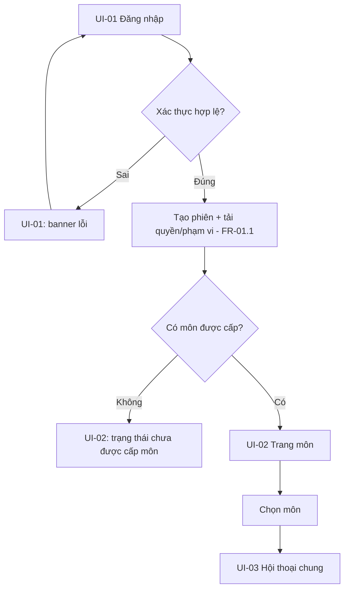
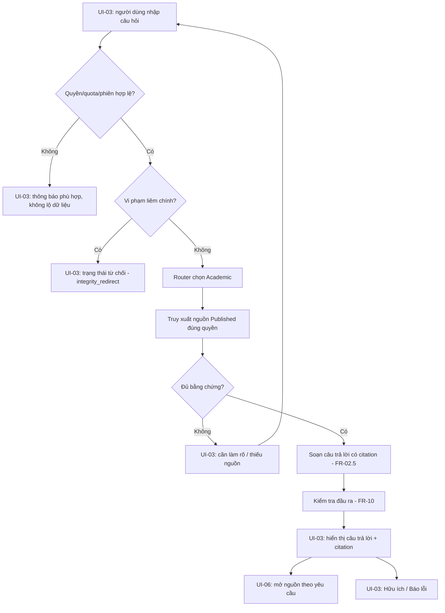
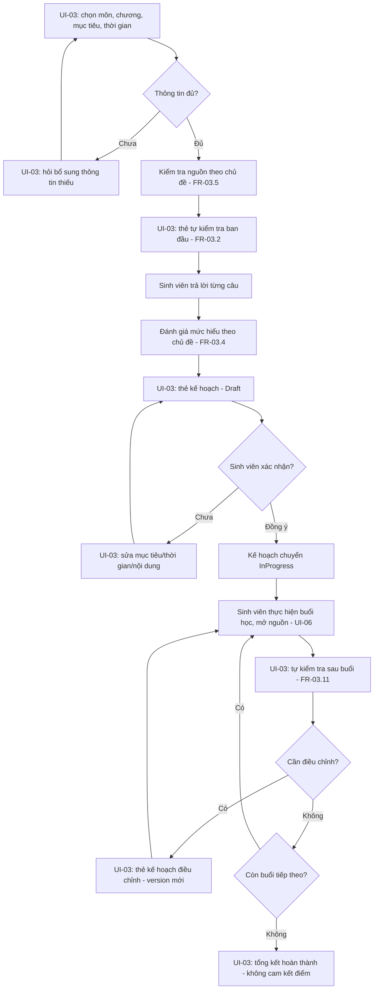
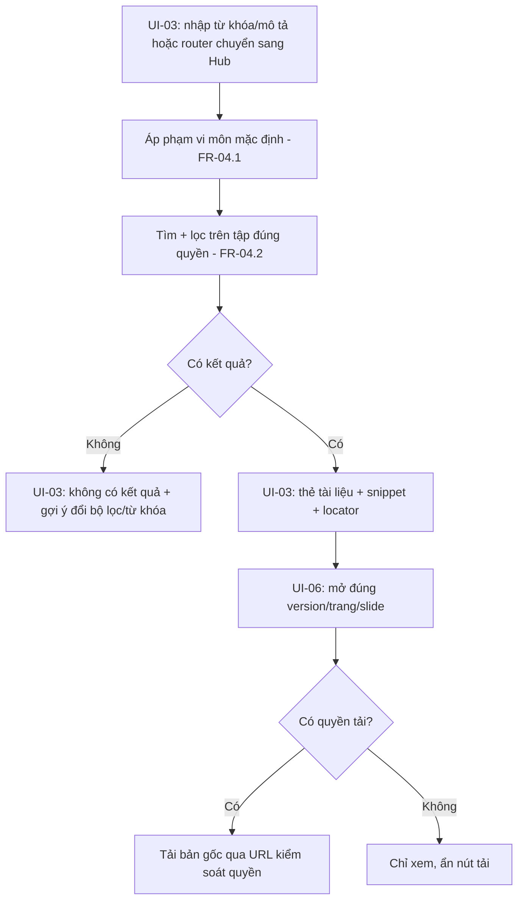
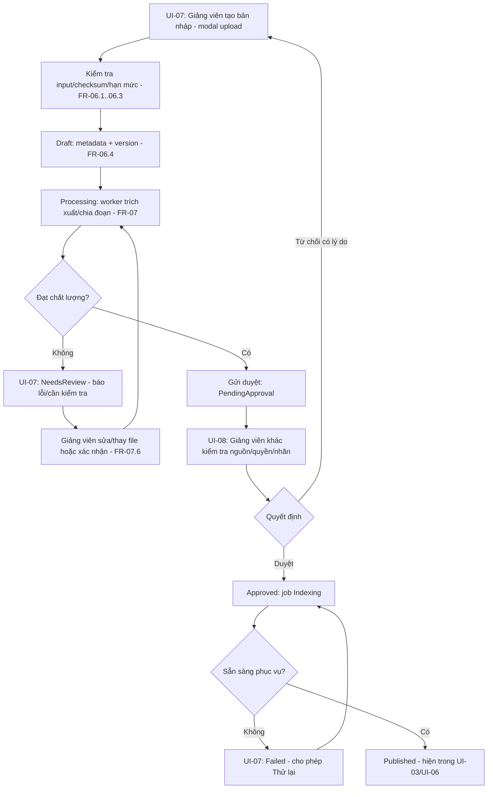
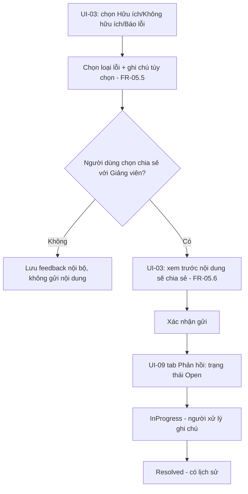
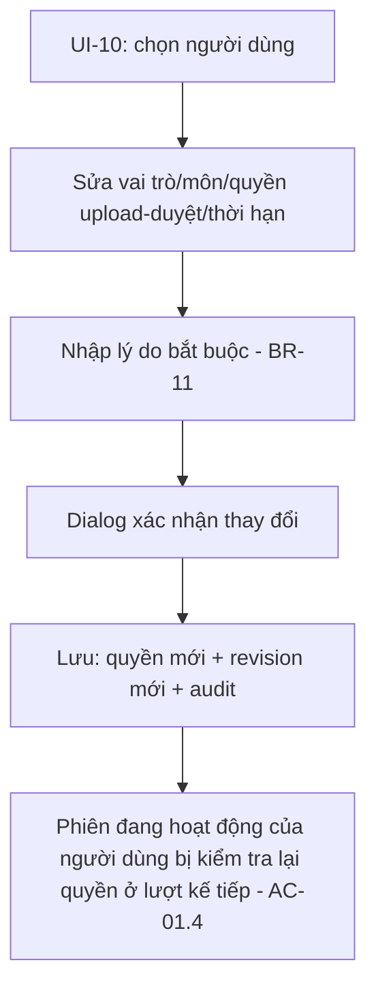

# WIREFRAME & UI FLOW — EDU-04

**Kho tri thức hỗ trợ học thuật X — Bộ trợ lý học thuật & học tập AI**

| Thuộc tính | Giá trị |
|---|---|
| Tài liệu nguồn | [PRD_edu04.md](PRD_edu04.md) (v2.0 — 23/09/2026) |
| Nhóm lĩnh vực | A · AI Giáo dục |
| Tên nhóm | **7 cỏ 10 gió** |
| Phiên bản tài liệu | 2.0 — 23/09/2026  |
| Phạm vi | Đặc tả wireframe khái niệm và luồng tương tác (UI flow) cho toàn bộ màn hình UI-01 → UI-10 ở mục 8 của PRD, bao gồm cả các trạng thái bắt buộc, đường dẫn điều hướng và điểm nối với FR/BR liên quan |

## Quy ước đọc tài liệu

- Đây là **wireframe khái niệm dạng văn bản** (low-fidelity, ASCII), thể hiện bố cục, thành phần và trạng thái — **không phải thiết kế đồ họa/UI kit cuối cùng** (màu sắc, khoảng cách, font là việc của giai đoạn UI design/Figma sau này), đúng tinh thần đã nêu ở PRD mục 8.3.
- Mỗi màn hình được gắn mã **UI-xx** trùng với PRD mục 8.2 để không phát sinh định danh mới.
- Ký hiệu `[...]` là nút bấm/control; `[__________]` là ô nhập liệu; `( )`/`(x)` là radio; `[ ]`/`[x]` là checkbox; `▾` là dropdown; `<...>` là placeholder mô tả.
- Mọi quy tắc hiển thị/ẩn theo quyền đều bám **BR-01 → BR-13** và ma trận quyền ở PRD mục 5.1; tài liệu này không tạo thêm ngoại lệ nghiệp vụ nào ngoài PRD.
- Các mục ghi "đề xuất" là gợi ý UI cần chốt cùng nhóm/Giảng viên, tương tự quy ước "đề xuất" ở PRD mục 1.1; không phải ràng buộc bắt buộc.

## Mục lục

1. Mục đích và phạm vi
2. Nguyên tắc thiết kế tương tác
3. Bản đồ điều hướng (Sitemap)
4. Đặc tả chi tiết từng màn hình (UI-01 → UI-10)
5. Luồng tương tác (UI Flow) theo use case
6. Wireframe responsive (mobile/tablet)
7. Danh mục trạng thái hệ thống & badge
8. Nội dung chuẩn (microcopy)
9. Ma trận truy vết UI ↔ FR/BR ↔ Persona
10. Ghi chú, giả định mở và việc cần chốt tiếp theo

---

## 1. Mục đích và phạm vi

Tài liệu này cụ thể hóa PRD mục 6 (Hành trình và quy trình nghiệp vụ) và mục 8 (Thiết kế giao diện và tương tác) thành wireframe khái niệm và UI flow đủ chi tiết để:

- Đội Frontend dựng khung màn hình và trạng thái mà không cần suy diễn thêm nghiệp vụ.
- Đội BA/QA dùng để viết kịch bản UAT bám đúng UI thật (đối chiếu mục 14 của PRD).
- Đội AI/RAG biết chính xác dữ liệu nào (citation, status, trace) cần trả về để UI hiển thị đúng.

Phạm vi bao gồm toàn bộ 10 màn hình Must ở PRD 8.2 (UI-01…UI-10), các trạng thái bắt buộc đi kèm, và các điểm mở rộng Should (FR-13…FR-17, FR-07 OCR) được đánh dấu rõ **[Nâng cao]** để không lẫn với phạm vi Cơ bản.

## 2. Nguyên tắc thiết kế tương tác

Áp dụng xuyên suốt mọi màn hình, kế thừa trực tiếp từ BR và FR của PRD:

| Nguyên tắc | Nguồn gốc | Thể hiện trong UI |
|---|---|---|
| Không có phạm vi môn thì không truy xuất toàn kho | BR-02, FR-01.3 | Mọi màn hình hội thoại/Hub luôn hiển thị "Môn đang chọn"; đổi môn phải xác nhận trước khi tiếp tục |
| Mọi khẳng định học thuật phải có nguồn | BR-04, FR-10 | Câu trả lời luôn kèm chỉ số trích dẫn `[1] [2]`; không có nút "xem thêm" nào tạo văn bản không trích dẫn được |
| Không đủ bằng chứng thì nói rõ, không bịa | BR-05 | Có trạng thái `partial`/`insufficient_evidence` riêng, khác hẳn với `answered` về màu/nhãn |
| Không đưa lời giải bài tính điểm | BR-06, FR-09 | Trạng thái `integrity_redirect` dùng khối nội dung và nút hành động khác biệt (không có nút "Xem đáp án") |
| Bản Published bất biến, quyền kiểm tra lại mỗi lần | BR-07, BR-03 | UI không cache client-side nội dung nhạy cảm; mở nguồn luôn gọi lại endpoint kiểm quyền (UI-06) |
| Ẩn thông tin ngoài quyền tuyệt đối, kể cả khi từ chối | BR-10 | Thông báo từ chối không nêu tên tài liệu/khóa bị chặn (xem mục 8 PRD, mục 8 tài liệu này) |
| Mọi quyết định có actor/thời gian/lý do | BR-11 | UI-08, UI-09, UI-10 luôn có cột "Lịch sử/Lý do" không cho sửa/xóa |
| Không tin dữ liệu client gửi lên | BR-02 | UI không tự vẽ nút hành động theo state cục bộ khi thiếu xác nhận từ response server (ví dụ nút Duyệt bị vô hiệu cho tới khi server xác nhận `assigned_reviewer = current_user`) |

## 3. Bản đồ điều hướng (Sitemap)

```text
UI-01 Đăng nhập
  └─ UI-02 Trang môn  (sau khi có phiên hợp lệ)
       ├─ UI-03 Hội thoại chung (Router: Academic | Learning | Hub)
       │     ├─ UI-06 Panel xem nguồn (mở từ citation/thẻ tài liệu)
       │     └─ (quay lại) UI-02 khi đổi môn
       ├─ Lịch sử hội thoại cá nhân (danh sách → mở lại vào UI-03)
       ├─ UI-07 Quản lý tài liệu — Giảng viên có quyền upload
       │     ├─ Modal "Tải tài liệu lên"
       │     └─ UI-08 Hàng đợi duyệt — Giảng viên được phân công duyệt
       ├─ UI-09 Dashboard Giảng viên (Must) — gồm các tab: Tài liệu, Hàng đợi duyệt,
       │     Lịch sử, Phản hồi, Thống kê, Nhu cầu bổ sung nguồn
       └─ UI-10 Quản trị — chỉ tài khoản Quản trị
```

Ghi chú điều hướng: UI-07/UI-08 là hai thao tác nằm trong cùng "Quản lý tài liệu (Giảng viên)" ở PRD mục 8.1 — UI-08 vẫn có route riêng để mở trực tiếp từ link thông báo "có tài liệu chờ duyệt", nhưng luôn nested dưới cùng nhóm điều hướng. UI-09 hợp nhất các khu vực chức năng đã liệt kê ở PRD 7.1.10.1 (không phải màn hình tách rời khỏi UI-07/08).

## 4. Đặc tả chi tiết từng màn hình

### UI-01 — Đăng nhập

**Mục tiêu:** xác thực người dùng, khởi tạo phiên (FR-01.1). **Đối tượng:** tất cả vai trò. **Điểm vào:** URL gốc ứng dụng, hoặc redirect khi phiên hết hạn (FR-01.2). **Liên kết:** FR-01, AC-01.1…AC-01.6.

```text
+----------------------------------------------------+
|                                                      |
|                     EDU-04                          |
|      Kho tri thức hỗ trợ học thuật Trung tâm X       |
|                                                      |
|   Định danh đăng nhập   [__________________________] |
|   Mật khẩu              [__________________________] |
|                                                      |
|                  [   Đăng nhập   ]                   |
|                                                      |
|   <thông báo lỗi/hết phiên hiện ở đây nếu có>        |
|   Quên mật khẩu / cần cấp tài khoản? Liên hệ Quản trị |
+----------------------------------------------------+
```

**Trạng thái bắt buộc:**

| Trạng thái | Hiển thị |
|---|---|
| Mặc định | Form trống, nút Đăng nhập sẵn sàng |
| Đang gửi | Nút chuyển "Đang đăng nhập…", vô hiệu hóa double-submit |
| Lỗi | Banner đỏ dưới form: "Định danh hoặc mật khẩu không đúng." — không nêu rõ sai trường nào (chống dò tài khoản); giữ nguyên ô định danh, xóa ô mật khẩu |
| Hết phiên | Banner vàng phía trên form khi bị redirect từ trang cần đăng nhập: "Phiên làm việc đã hết hạn, vui lòng đăng nhập lại." |

**Hành vi:** không tự đăng ký (đúng PRD 7.1.1 — tiền điều kiện có tài khoản cấp sẵn); không log mật khẩu; sau đăng nhập thành công → tải phạm vi/quyền → điều hướng UI-02 (mặc định) hoặc thẳng vào UI-03 nếu người dùng vào từ một liên kết hội thoại/nguồn hợp lệ đã được kiểm quyền lại (FR-01.1).

---

### UI-02 — Trang môn

**Mục tiêu:** chọn phạm vi môn trước khi vào hội thoại (BR-02: không mặc định toàn kho). **Đối tượng:** Sinh viên, Giảng viên, Giảng viên duyệt. Quản trị chỉ thấy nếu được cấp quyền nội dung (mục 5.1 PRD). **Liên kết:** FR-01.3, FR-04.1.

```text
+------------------------------------------------------------------+
| EDU-04                                 [Nguyễn Văn A ▾] [Đăng xuất] |
+------------------------------------------------------------------+
| Chọn môn của bạn                                                   |
|                                                                     |
|  ( ) Nhập môn lập trình         ( ) Cấu trúc dữ liệu & giải thuật   |
|  ( ) Cơ sở dữ liệu               ( ) Mạng máy tính                  |
|                                                                     |
|  Tài liệu gần đây (đúng quyền của bạn):                             |
|   • Giáo trình CTDL — bản 2                          [Mở hội thoại] |
|   • Slide tuần 3 — CTDL                              [Mở hội thoại] |
|                                                                     |
|                  [   Mở / Tạo hội thoại mới   ]                     |
+------------------------------------------------------------------+
```

**Trạng thái bắt buộc:**

| Trạng thái | Hiển thị |
|---|---|
| Đang tải | Skeleton danh sách môn/tài liệu |
| Chưa được cấp môn | Thay khối chọn môn bằng thông báo: "Bạn chưa được cấp quyền vào môn nào. Vui lòng liên hệ Giảng viên hoặc Quản trị để được cấp quyền." — không có ô nhập tự chọn môn |

**Hành vi:** chọn môn → tạo/mở hội thoại thuộc đúng môn đó, không mang lịch sử/chunk của môn trước (FR-01.3); nhấp "Tài liệu gần đây" mở thẳng UI-03 kèm ngữ cảnh tài liệu đã chọn.

---

### UI-03 — Hội thoại chung (Router điều phối 3 trợ lý)

**Mục tiêu:** là màn hình trung tâm — một ô nhập, router chọn Academic/Learning/Hub theo ý định (FR-11), hiển thị kết quả tương ứng cùng một luồng hội thoại. **Đối tượng:** Sinh viên, Giảng viên, Giảng viên duyệt (khi tra cứu). **Liên kết:** FR-02, FR-03, FR-04, FR-05, FR-09, FR-10, FR-11.

#### 4a. Bố cục nền (desktop)

```text
+--------------------------------------------------------------------------+
| EDU-04 | Môn: [Cấu trúc dữ liệu v]                    [Tài khoản v] [Thoát]|
+------------------+---------------------------------------+-----------------+
| [Academic] Learning Knowledge Hub   <chip chuyển thủ công>| Nguồn tham chiếu|
|------------------|                                       |  (UI-06 panel)  |
| + Hội thoại mới  |  <Vùng hội thoại — cuộn dọc>           |                 |
| Lịch sử của tôi  |                                       |  Trống cho tới  |
|   • Ôn CTDL ch1-3 |                                       |  khi có citation|
|   • So sánh AVL.. |                                       |  hoặc thẻ tài   |
|                  |                                       |  liệu được chọn |
| Quản lý tài liệu |---------------------------------------|                 |
| (nếu có quyền)   | [Nhập câu hỏi hoặc yêu cầu...    ][Gửi]|                 |
+------------------+---------------------------------------+-----------------+
```

Trên đầu vùng hội thoại luôn có **nhãn trợ lý xử lý theo lượt** (ví dụ "Router: đã chọn Learning Assistant") để người dùng không cần hiểu cấu trúc graph (FR-11.5), kèm chip cho phép chuyển thủ công ở bản Cơ bản hoặc khi người dùng muốn ép trợ lý khác.

#### 4b. Ba dạng nội dung hiển thị trong cùng khung hội thoại

**(1) Academic Assistant — câu trả lời có trích dẫn**

```text
Bạn: So sánh cây AVL và cây đỏ-đen về độ phức tạp cân bằng.

Trợ lý (Academic):
Cây AVL cân bằng chặt hơn, chiều cao tối đa xấp xỉ 1.44·log(n) [1].
Cây đỏ-đen cho phép lệch nhiều hơn nên số lần xoay khi chèn/xóa
thường ít hơn AVL [2].

Nguồn: [1] [2]           [ Hữu ích ]  [ Báo lỗi ]  [ Hỏi tiếp ]
```

**(2) Learning Assistant — thẻ tự kiểm tra / thẻ kế hoạch (inline card)**

```text
Trợ lý (Learning): Trước khi lập lộ trình, hãy trả lời 3 câu tự
kiểm tra để mình biết bạn đang ở đâu.

+----------------------------------------------------------+
| Câu 1/3 · Chủ đề: Cây nhị phân tìm kiếm                    |
| "Độ phức tạp trung bình của tìm kiếm trên BST là gì?"       |
| [ Nhập câu trả lời...                       ] [Gửi câu này] |
| Tiến độ: ●●○   [Lưu tạm & tiếp tục sau]                     |
+----------------------------------------------------------+
```

```text
Trợ lý (Learning): Đây là đề xuất lộ trình 5 ngày (Draft) — xem lại
và xác nhận trước khi bắt đầu.

+----------------------------------------------------------+
| LỘ TRÌNH ÔN TẬP — CTDL chương 1-3            [Trạng thái: Draft]|
|------------------------------------------------------------|
| Buổi 1 (45') — Nền tảng: Độ phức tạp thuật toán              |
|   Nguồn: Giáo trình CTDL, tr.5-12 [1]                        |
| Buổi 2 (45') — Danh sách liên kết                            |
|   Nguồn: Slide tuần 2 [2]                                    |
| Buổi 3 (45') — Cây nhị phân tìm kiếm                         |
|   ⚠ Thiếu nguồn cho phần "cây đỏ-đen nâng cao"                |
|------------------------------------------------------------|
| Tổng thời lượng: 225 / 225 phút cho phép                     |
| [ Xác nhận kế hoạch ]   [ Sửa mục tiêu/thời gian ]            |
+----------------------------------------------------------+
```

**(3) Knowledge Hub — thẻ kết quả tài liệu**

```text
Trợ lý (Hub): Tìm thấy 4 tài liệu phù hợp trong môn Cấu trúc dữ liệu.

Bộ lọc: [Loại tài liệu v] [Chương/chủ đề v] [Học kỳ v]

+----------------------------------------------------------+
| Giáo trình CTDL — Bản 2 · Giáo trình · Chương 3             |
| "...cây AVL đảm bảo cân bằng bằng cách giới hạn..."           |
| [ Mở tài liệu ]                                              |
+----------------------------------------------------------+
| Slide tuần 3 — Slide · Chương 3                              |
| "...ví dụ minh họa phép xoay trái..."                        |
| [ Mở tài liệu ]                                              |
+----------------------------------------------------------+
              ‹ Trang 1/2 ›
```

#### 4c. Toàn bộ trạng thái bắt buộc (PRD 8.2)

| Trạng thái | Hiển thị trong UI-03 |
|---|---|
| Trống | Khung hội thoại rỗng + placeholder gợi ý 3 mẫu câu hỏi ("Hỏi khái niệm…", "Lập lộ trình ôn…", "Tìm slide…") |
| Đang định tuyến | Dòng hệ thống mờ: "Đang xác định trợ lý phù hợp…" |
| Cần làm rõ | Bong bóng trợ lý dạng câu hỏi ngắn, ô nhập giữ nguyên ngữ cảnh: "Bạn đang hỏi về môn nào — Cấu trúc dữ liệu hay Hệ điều hành?" |
| Đang tìm/soạn | Skeleton 2-3 dòng + nhãn "Đang tìm nguồn…" rồi "Đang soạn câu trả lời…" (phân biệt rõ hai bước theo mục 8.4 PRD) |
| Hoàn tất | Nội dung đầy đủ + citation + hành động (Hữu ích/Báo lỗi/Hỏi tiếp) |
| Thiếu nguồn | Khối cảnh báo màu vàng trước/sau phần trả lời được: "Tôi chưa tìm thấy đủ căn cứ cho phần… Bạn có thể nêu rõ chương hoặc chọn tài liệu cụ thể." (nguyên văn PRD 8.4) |
| Điều chỉnh kế hoạch | Thẻ kế hoạch hiện phiên bản mới bên cạnh phiên bản cũ đã gạch mờ, có nhãn "Đã điều chỉnh — giữ kết quả các buổi đã học" |
| Không có kết quả | Với Hub: "Không tìm thấy tài liệu phù hợp trong phạm vi môn hiện tại. Thử bỏ bớt bộ lọc hoặc đổi từ khóa." |
| Từ chối (integrity) | Khối riêng biệt về màu/icon, không có nút "Xem thêm/đáp án": "Tôi có thể giúp bạn hiểu kiến thức và cách tiếp cận, nhưng không cung cấp đáp án cho bài đang tính điểm." (PRD 8.4) |
| Lỗi dịch vụ | "Chưa thể tạo câu trả lời lúc này. Bạn có thể thử lại hoặc tìm tài liệu trong Knowledge Hub." + nút [Thử lại] dùng lại request ID (không tạo 2 câu trả lời — AC-02.6) |

**Đối chiếu hợp đồng API (PRD mục 11.3–11.4) — quan trọng cho Frontend:** `answered`/`partial`/`needs_clarification`/`insufficient_evidence`/`integrity_redirect` đều là **Assistant Business Result**, trả về HTTP 200 kèm trường `status` trong body — UI dựng các khối này bằng cùng một luồng render "câu trả lời", **không** đi qua bộ xử lý lỗi HTTP của app. Chỉ trạng thái `error` mới tương ứng Technical Error (HTTP 4xx/5xx, ví dụ 401/403/429/5xx) và dùng chung cơ chế toast/banner lỗi kỹ thuật của hệ thống; nút `[Thử lại]` gửi lại đúng `Idempotency-Key` của yêu cầu trước để không tạo hai câu trả lời (PRD 11.4, AC-02.6) — theo NFR-05, chỉ hiện `[Thử lại]` khi lỗi thuộc loại retryable (timeout, network, 503…), không hiện cho lỗi 401/403/422 hay các trạng thái `integrity_redirect`/`insufficient_evidence`.

**Hành vi feedback (FR-05.5, 05.6):** nhấp "Báo lỗi" mở form nhỏ inline (loại lỗi: kiến thức/thiếu nguồn/sai citation/sai phạm vi/UI/khác + ghi chú tùy chọn); nếu người dùng chọn "Chia sẻ với Giảng viên", hiển thị **màn hình xem trước nội dung sẽ chia sẻ** trước khi gửi — mặc định không chia sẻ toàn hội thoại (FR-05.6).

---

### UI-06 — Panel xem nguồn

**Mục tiêu:** mở đúng phiên bản/vị trí nguồn, kiểm quyền lại mỗi lần mở (BR-03, FR-10.6). **Điểm vào:** nhấp `[1]`/`[2]` trên câu trả lời, hoặc nút "Mở tài liệu" từ thẻ Hub. **Liên kết:** FR-04.4, FR-04.5, FR-10.

```text
+------------------------------------------------+
| Nguồn tham chiếu                            [X]|
+------------------------------------------------+
| Giáo trình Cấu trúc dữ liệu — Bản 2              |
| Trang 18                                         |
|---------------------------------------------------|
| "...cây AVL đảm bảo chiều cao cân bằng bằng cách   |
|  giới hạn độ lệch chiều cao hai cây con không quá  |
|  1..." (đoạn liên quan được đánh dấu)              |
|---------------------------------------------------|
| [ Tải bản gốc ]  ← chỉ hiện nếu có quyền tải riêng |
+------------------------------------------------+
```

**Trạng thái bắt buộc:**

| Trạng thái | Hiển thị |
|---|---|
| Bị thu hồi | Thay nội dung bằng: "Nguồn này hiện không còn khả dụng. Hãy tìm phiên bản đang được phép sử dụng." (PRD 8.4), không hiện lại đoạn trích cũ |
| Không quyền | Ẩn nút "Tải bản gốc"; nếu mất cả quyền đọc thì đóng panel và báo lỗi quyền chung, không hiện snippet trước đó |
| Không render được | Dùng text trích xuất hợp lệ kèm ghi chú: "Không hiển thị được bản scan gốc — đang hiện nội dung trích xuất tương ứng trang này." |

**Hành vi:** đóng panel quay lại đúng vị trí hội thoại (không mất ngữ cảnh); mỗi lần mở gọi lại endpoint kiểm quyền hiện tại, không dùng cache client (BR-03, FR-10.6).

---

### UI-07 — Tài liệu Giảng viên

**Mục tiêu:** danh sách, tải lên, tạo phiên bản mới, theo dõi job (FR-06). **Đối tượng:** Giảng viên có quyền upload trong môn phụ trách. **Liên kết:** FR-06, FR-07, mục 9.2 (trạng thái tài liệu).

```text
+---------------------------------------------------------------------------+
| Quản lý tài liệu — Môn: Cấu trúc dữ liệu             [ + Tải tài liệu lên ]|
+---------------------------------------------------------------------------+
| Lọc: [Môn v] [Trạng thái v] [Loại v]                      [Tìm kiếm......] |
|-----------------------------------------------------------------------------|
| Tên tài liệu       | Phiên bản | Trạng thái        | Cập nhật  | Thao tác   |
|-----------------------------------------------------------------------------|
| Giáo trình CTDL    | v2        | ● Published        | 12/09     | Xem·Thu hồi|
| Slide tuần 5       | v1        | ● PendingApproval   | 20/09     | Xem        |
| Bài tập chương 3   | v1        | ● NeedsReview       | 21/09     | Sửa nháp   |
| Đề cương môn       | v3        | ● Failed (Indexing) | 22/09     | Thử lại    |
| Slide tuần 2       | v1        | ● Rejected          | 18/09     | Sửa & gửi  |
+---------------------------------------------------------------------------+
```

**Modal "Tải tài liệu lên" (FR-06.1 → 06.5):**

```text
+---------------------------------------------------+
| Tải tài liệu lên                               [X]|
+---------------------------------------------------+
| File (PDF/PPTX)             [ Chọn file... ]        |
| Môn                          [Cấu trúc dữ liệu v]    |
| Tiêu đề                      [___________________]  |
| Loại tài liệu                 [Giáo trình v]         |
| Phiên bản                     [v1]                   |
| Nguồn gốc / quyền sử dụng      [___________________]  |
| Tác giả / đơn vị cung cấp (nếu biết) [_____________] |
| Đối tượng đọc                 [ ] Sinh viên [x] GV   |
| Cho tải bản gốc                ( ) Có   (x) Không     |
| Nhãn                           [ ] Học liệu           |
|                                [ ] Bài tập             |
|                                [ ] Đáp án              |
| Chương/chủ đề (tùy chọn)       [___________________]  |
| Học kỳ / ngày hiệu lực (tùy chọn) [_________________] |
|                                                        |
|                [ Lưu nháp ]      [ Gửi xử lý ]         |
+---------------------------------------------------+
```

Ràng buộc hiển thị: nếu "Nguồn gốc/quyền sử dụng" chưa xác nhận → nút "Gửi xử lý" bị vô hiệu, chỉ cho "Lưu nháp" (đúng FR-06 bảng 7.1.6.1); nếu "Nhãn" chưa chọn mục nào → hiển thị cảnh báo "Chưa gắn nhãn — không được mặc định coi là an toàn" thay vì cho qua im lặng.

**Trạng thái job/file:** File lỗi (sai loại/quá giới hạn/có mật khẩu) hiện banner đỏ tại dòng tương ứng kèm mã lỗi; Đang xử lý hiện thanh tiến trình theo `stage` (Trích xuất → Kiểm tra chất lượng); Chờ duyệt hiện link sang UI-08; Published hiện badge xanh + link mở trong UI-03/Hub.

---

### UI-08 — Duyệt tài liệu

**Mục tiêu:** người duyệt (khác uploader) xem trước, quyết định duyệt/từ chối theo đúng revision (FR-08). **Đối tượng:** Giảng viên được phân công duyệt trong môn. **Liên kết:** FR-08, BR-11, luồng 6.4 của PRD.

```text
+-----------------------------------------------------------------------+
| Hàng đợi duyệt — Môn: Cấu trúc dữ liệu                                  |
+-----------------------------------------------------------------------+
| ▸ Slide tuần 5 — v1 — gửi bởi Nguyễn Văn A — 20/09        [Đang xem]    |
|   Bài tập chương 3 — v1 — gửi bởi Ngô Thị B — 21/09                     |
+-----------------------------------------------------------------------+
| Bản gốc / Text trích xuất     | Metadata & ACL          | Quyết định   |
|---------------------------------------------------------------------- |
| [ Xem PDF gốc ]                 | Môn: CTDL                | ( ) Duyệt   |
| [ Xem text trích xuất ]         | Loại: Slide               | ( ) Từ chối |
| Trang cần xem lại: 4, 9         | Đối tượng đọc: SV + GV    |             |
| (đánh dấu do OCR/kiểm tra flag) | Cho tải bản gốc: Không    | Lý do (bắt  |
|                                  | Nhãn: Học liệu             | buộc khi    |
|                                  | Chương: 3 — CTDL nâng cao  | Từ chối):   |
|                                  | Revision đang xét: rev-7   | [_________] |
|                                  |                            |             |
|                                  |            [ Gửi quyết định ]           |
+-----------------------------------------------------------------------+
```

**Trạng thái bắt buộc:**

| Trạng thái | Hiển thị |
|---|---|
| Không đủ quyền | Thay khối quyết định bằng: "Bạn không được phân công duyệt tài liệu này." (ẩn hoàn toàn nút Duyệt/Từ chối, không chỉ vô hiệu hóa) |
| Revision thay đổi | Banner cam phía trên: "Nội dung đã được cập nhật sau khi bạn mở xem. Vui lòng tải lại trước khi quyết định." — chặn gửi quyết định trên revision cũ (AC-08.2) |
| Cần sửa | Sau khi Từ chối có lý do → dòng trong danh sách chuyển badge "Rejected", hiện lại ở UI-07 để Giảng viên sửa và gửi lại |

**Hành vi:** "Duyệt" chỉ bật khi đã mở ít nhất bản gốc/text (log thao tác xem, không chỉ dựa vào việc tick checkbox — theo tinh thần FR-08.2/BR-11); sau khi bấm Duyệt → hệ thống tạo job Indexing, UI hiện trạng thái trung gian "Đã duyệt — đang lập chỉ mục" (không được hiện "Đã có trong Hub" ngay theo AC-08.3/FR-08.3) → khi index xong mới chuyển badge "Published".

---

### UI-09 — Dashboard Giảng viên (thống kê/phản hồi) [Must]

**Mục tiêu:** gom các khu vực chức năng quản lý trong phạm vi trách nhiệm (FR-12). **Đối tượng:** Giảng viên/người duyệt theo môn được quản lý.

```text
+-----------------------------------------------------------------------+
| Dashboard — Môn: Cấu trúc dữ liệu           Khoảng thời gian: [30 ngày v]|
+-----------------------------------------------------------------------+
| [ Truy vấn: 342 ] [ Thiếu nguồn: 12 ] [ Lỗi: 3 ] [ Phản hồi mở: 5 ]      |
|-----------------------------------------------------------------------|
| Tab:  Tài liệu | Hàng đợi duyệt | Lịch sử | Phản hồi | Thống kê |       |
|       Nhu cầu bổ sung nguồn                                            |
|-----------------------------------------------------------------------|
|  <Nội dung theo tab đang chọn>                                         |
+-----------------------------------------------------------------------+
```

Nội dung từng tab (theo bảng khu vực chức năng ở PRD 7.1.10.1):

- **Tài liệu / Hàng đợi duyệt** — tái sử dụng trực tiếp UI-07/UI-08 (không có bản sao logic riêng — FR-12.3).
- **Lịch sử** — bảng: Thời điểm | Actor | Hành động (duyệt/từ chối/phát hành/thu hồi) | Tài liệu/revision | Lý do.
- **Phản hồi** — bảng: Loại lỗi | Trạng thái (`Open → InProgress → Resolved`) | Người xử lý | Nội dung được chia sẻ (nếu người dùng đồng ý) | Ghi chú xử lý; nút "Mở lại" giữ lịch sử (FR-12.2).
- **Thống kê** — biểu đồ/khối số: truy vấn theo thời gian, tỷ lệ `insufficient_evidence`, lỗi hệ thống, kết quả eval nếu có — mỗi khối gắn nhãn dataset/config/khoảng thời gian (FR-12.4), không hiển thị số khi chưa đo ("Chưa có dữ liệu").
- **Nhu cầu bổ sung nguồn** — danh sách nhóm chủ đề thiếu căn cứ, tổng hợp ẩn danh từ log đúng quyền; không có nút "tự công bố tài liệu mới" từ đây (FR-12 bảng khu vực).

**Trạng thái bắt buộc:** "Chưa có dữ liệu" (đủ điều kiện nhưng chưa phát sinh số liệu) khác biệt rõ với "Dữ liệu chưa đủ mẫu" (đã có nhưng dưới ngưỡng đáng tin, ví dụ dưới 20 mẫu/nhóm theo mục 13 PRD) — không gộp chung một thông báo để tránh hiểu nhầm là lỗi hệ thống.

---

### UI-10 — Quản trị

**Mục tiêu:** cấp/khóa tài khoản, gán môn/quyền, hạn mức, audit (FR-01.4). **Đối tượng:** chỉ Quản trị.

```text
+-----------------------------------------------------------------------+
| Quản trị hệ thống                                                       |
+-----------------------------------------------------------------------+
| Tab: Người dùng | Môn học | Phân công | Hạn mức | Audit Log              |
|-----------------------------------------------------------------------|
| [ Tìm người dùng...                                 ] [ + Tạo tài khoản]|
| Họ tên      | Định danh  | Vai trò       | Trạng thái | Môn được gán | > |
|-----------------------------------------------------------------------|
| Nguyễn Văn A | nva        | Giảng viên    | Hoạt động  | CTDL, CSDL   | Sửa|
| Ngô Thị B    | ntb        | GV có duyệt   | Hoạt động  | CTDL         | Sửa|
| Trần Văn C   | tvc        | Sinh viên     | Khóa       | CTDL         | Sửa|
+-----------------------------------------------------------------------+
```

**Modal "Sửa quyền":**

```text
+---------------------------------------------------+
| Sửa quyền — Nguyễn Văn A                        [X]|
+---------------------------------------------------+
| Vai trò         [Giảng viên v]                       |
| Môn được gán    [x] CTDL  [x] CSDL  [ ] Mạng MT       |
| Quyền upload     [x] CTDL                            |
| Quyền duyệt      [ ] CTDL                            |
| Thời hạn quyền (tùy chọn)  [__________]               |
| Lý do thay đổi (bắt buộc)  [____________________]     |
|                                                        |
|         [ Hủy ]              [ Lưu & xác nhận ]        |
+---------------------------------------------------+
```

**Trạng thái bắt buộc:**

| Trạng thái | Hiển thị |
|---|---|
| Xác nhận thay quyền | Dialog xác nhận thứ hai trước khi lưu thay đổi ảnh hưởng phạm vi (đặc biệt khi thu hẹp quyền) — nêu rõ hệ quả: "Phiên đang hoạt động của người này sẽ được kiểm tra lại quyền ở lượt yêu cầu tiếp theo." |
| Lỗi lưu | Banner đỏ giữ nguyên dữ liệu đã nhập trong form, không mất thao tác |

**Ràng buộc quan trọng thể hiện trên UI:** không có control nào cho phép Quản trị "xem hội thoại Sinh viên" hay "tải bản gốc" trực tiếp từ đây — đúng AC-01.6 (quản trị không tự đọc hội thoại/tải bằng quyền kỹ thuật); tab Audit Log chỉ đọc, không có nút sửa/xóa dòng log.

---

## 5. Luồng tương tác (UI Flow) theo use case

### 5.1. Đăng nhập & chọn phạm vi



### 5.2. Hỏi đáp Academic (ánh xạ luồng 6.1 PRD vào UI)



### 5.3. Lập lộ trình học nền tảng & ôn tập (ánh xạ luồng 6.2/6.3 PRD)



### 5.4. Tìm và xem tài liệu (Knowledge Hub, FR-04)



### 5.5. Upload → HITL duyệt → Published (ánh xạ luồng 6.4 PRD)



### 5.6. Thu hồi / hết hiệu lực quyền (ánh xạ luồng 6.5 PRD)

```mermaid
flowchart TD
    ACT[UI-07/09: Giảng viên duyệt thu hồi HOẶC UI-10: Quản trị đổi quyền môn] --> UPD[Cập nhật trạng thái/quyền + tăng revision]
    UPD --> STOP[Backend ngừng phục vụ ngay + hủy cache liên quan]
    STOP --> UI03CHK[UI-03/UI-06: yêu cầu đang xử lý được kiểm tra lại quyền]
    UI03CHK --> HASACCESS{Còn quyền truy cập?}
    HASACCESS -- Có --> CONTINUE[Tiếp tục hiển thị/mở nguồn]
    HASACCESS -- Không --> BLOCK[UI-03/UI-06: "Nội dung này hiện không còn khả dụng."]
    UPD --> HIST[Hội thoại/kế hoạch cũ chứa nội dung liên quan]
    HIST --> MASK[UI-03: che nội dung phía server theo nguồn liên quan]
    UPD --> CLEANUP[Job dọn chỉ mục/dữ liệu dẫn xuất chạy nền - UI-07 hiện trạng thái job]
```

### 5.7. Phản hồi (feedback) → xử lý ở Dashboard



### 5.8. Quản trị cấp/thu quyền



## 6. Wireframe responsive (mobile/tablet)

Theo PRD 8.3: "Trên màn hình nhỏ, nguồn mở thành panel có thể đóng; ô nhập và trạng thái xử lý vẫn dễ thấy." Cụ thể hóa:

```text
Màn hình chính (mobile, UI-03)          Khi chạm vào [1] → UI-06 dạng bottom sheet
+---------------------------+           +---------------------------+
| ☰  EDU-04   Môn: CTDL v   |           | ‹ Nguồn tham chiếu          |
+---------------------------+           +---------------------------+
| chip: [Academic] active    |           | Giáo trình CTDL — Bản 2     |
|                             |           | Trang 18                    |
| SV: Câu hỏi của bạn...      |           |------------------------------|
|                             |           | "...đoạn trích liên quan..." |
| Trợ lý: Ý thứ nhất [1].     |           |------------------------------|
|         Ý thứ hai [2].      |           | [ Tải bản gốc ]              |
| [Hữu ích] [Báo lỗi]          |           +---------------------------+
|-----------------------------|
| [Nhập câu hỏi...      ][Gửi]|
+---------------------------+
```

- **Điều hướng mobile:** biểu tượng ☰ mở drawer chứa: chip Academic/Learning/Hub, "+ Hội thoại mới", "Lịch sử của tôi", "Quản lý tài liệu" (nếu có quyền), "Quản trị" (nếu có quyền) — cùng nội dung menu trái của desktop, chỉ đổi cách trình bày.
- **UI-06 trên mobile** mở dạng bottom sheet trượt lên thay vì panel bên phải, có nút "‹" quay lại đúng vị trí hội thoại; đóng sheet không tải lại toàn trang.
- **UI-07/08/09/10 trên tablet:** bảng chuyển sang dạng thẻ xếp dọc (mỗi dòng bảng = 1 card) khi bề rộng dưới ngưỡng đề xuất ~768px; các cột "Thao tác" gộp vào menu "⋮" cuối card.
- Ô nhập câu hỏi và trạng thái xử lý ("Đang tìm nguồn…"/"Đang soạn…") luôn cố định ở đáy màn hình (sticky), không bị cuộn khuất — đây là điểm PRD nhấn mạnh rõ.

## 7. Danh mục trạng thái hệ thống & badge

Tổng hợp toàn bộ trạng thái có trong PRD để UI hiển thị nhất quán, tránh mỗi màn hình tự đặt tên khác nhau cho cùng một khái niệm.

### 7.1. Trạng thái câu trả lời hội thoại (UI-03) — theo PRD 7.1.2.2

| Status (hệ thống) | Nhãn hiển thị đề xuất | Màu badge đề xuất |
|---|---|---|
| answered | Đã trả lời | Xanh lá |
| partial | Trả lời một phần | Vàng |
| needs_clarification | Cần làm rõ | Xanh dương nhạt |
| insufficient_evidence | Chưa đủ căn cứ | Xám/vàng |
| integrity_redirect | Đã chuyển hướng liêm chính | Cam |
| error | Lỗi | Đỏ |

### 7.2. Trạng thái tài liệu (UI-07/08/09) — theo PRD 9.2

| Trạng thái | Nhãn hiển thị | Hiện ở Hub/RAG? | Thao tác khả dụng trên UI |
|---|---|---|---|
| Draft | Nháp | Không | Sửa, Gửi xử lý |
| Processing | Đang xử lý | Không | Xem tiến trình |
| NeedsReview | Cần kiểm tra | Không | Sửa/Thay file, Xác nhận |
| PendingApproval | Chờ duyệt | Không | (UI-08) Duyệt/Từ chối |
| Rejected | Bị từ chối | Không | Sửa & gửi lại |
| Approved | Đã duyệt | Không | Chờ lập chỉ mục |
| Indexing | Đang lập chỉ mục | Không | Xem tiến trình |
| Published | Đã phát hành | Có (đúng ACL) | Mở trong UI-03/06, Thu hồi, Tạo bản mới |
| Failed | Lỗi xử lý/phát hành | Không | Thử lại |
| Withdrawn | Đã thu hồi | Không | Tạo bản mới |
| Archived | Lưu trữ | Không (ngoài truy xuất thường) | Chỉ xem (quyền quản lý) |

### 7.3. Trạng thái lộ trình học (UI-03 thẻ kế hoạch) — theo PRD 7.1.3.4

| Trạng thái | Nhãn hiển thị |
|---|---|
| Draft | Bản đề xuất — chưa bắt đầu |
| Confirmed | Đã xác nhận |
| InProgress | Đang thực hiện |
| Paused | Tạm dừng |
| Cancelled | Đã hủy |
| Completed | Hoàn thành |

### 7.4. Trạng thái quyết định duyệt (UI-08) — theo PRD 7.1.7.1

| Tình huống | Nhãn hiển thị |
|---|---|
| Gửi duyệt | Chờ duyệt |
| Duyệt | Đã duyệt — đang lập chỉ mục |
| Từ chối | Bị từ chối (kèm lý do) |
| Thu hồi | Đã thu hồi |
| Index lỗi | Lỗi lập chỉ mục — có thể thử lại |

### 7.5. Trạng thái phản hồi (UI-09 tab Phản hồi) — theo PRD 7.1.10.1

`Open → InProgress → Resolved` (có thể mở lại, giữ lịch sử theo FR-12.2).

## 8. Nội dung chuẩn (microcopy)

### 8.1. Bốn thông điệp chuẩn bắt buộc (nguyên văn PRD mục 8.4)

| Tình huống | Nội dung |
|---|---|
| Thiếu nguồn | "Tôi chưa tìm thấy đủ căn cứ trong tài liệu bạn được phép truy cập của môn này. Bạn có thể nêu rõ chương hoặc chọn tài liệu cụ thể." |
| Liêm chính | "Tôi có thể giúp bạn hiểu kiến thức và cách tiếp cận, nhưng không cung cấp đáp án cho bài đang tính điểm." |
| Nguồn thu hồi | "Nguồn này hiện không còn khả dụng. Hãy tìm phiên bản đang được phép sử dụng." |
| Lỗi dịch vụ | "Chưa thể tạo câu trả lời lúc này. Bạn có thể thử lại hoặc tìm tài liệu trong Knowledge Hub." |

Nguyên tắc chung áp cho mọi microcopy khác: **không hiển thị trace, prompt hệ thống, khóa API hoặc tên tài liệu bị chặn**; phân biệt rõ "đang tìm nguồn", "đang soạn" và "hoàn tất"; không hiển thị nội dung chưa qua kiểm tra như câu trả lời chính thức (PRD 8.4).

### 8.2. Microcopy bổ sung theo màn hình (đề xuất, cần chốt cùng nhóm)

| Màn hình | Tình huống | Nội dung đề xuất |
|---|---|---|
| UI-01 | Sai định danh/mật khẩu | "Định danh hoặc mật khẩu không đúng." |
| UI-01 | Phiên hết hạn | "Phiên làm việc đã hết hạn, vui lòng đăng nhập lại." |
| UI-02 | Chưa được cấp môn | "Bạn chưa được cấp quyền vào môn nào. Vui lòng liên hệ Giảng viên hoặc Quản trị để được cấp quyền." |
| UI-03 (Hub) | Không có kết quả | "Không tìm thấy tài liệu phù hợp trong phạm vi môn hiện tại. Thử bỏ bớt bộ lọc hoặc đổi từ khóa." |
| UI-03 (Learning) | Mục tiêu quá tải thời gian | "Nội dung bạn chọn cần nhiều thời gian hơn quỹ thời gian đã nhập. Bạn muốn giảm bớt chủ đề hay tăng thời lượng mỗi ngày?" |
| UI-06 | Không render được bản gốc | "Không hiển thị được bản scan gốc — đang hiện nội dung trích xuất tương ứng trang này." |
| UI-07 | Nhãn chưa gắn | "Chưa gắn nhãn học liệu/bài tập/đáp án — tài liệu không được mặc định coi là an toàn để công bố." |
| UI-08 | Không đủ quyền duyệt | "Bạn không được phân công duyệt tài liệu này." |
| UI-08 | Revision đã đổi | "Nội dung đã được cập nhật sau khi bạn mở xem. Vui lòng tải lại trước khi quyết định." |
| UI-10 | Xác nhận thu hẹp quyền | "Phiên đang hoạt động của người này sẽ được kiểm tra lại quyền ở lượt yêu cầu tiếp theo." |

## 9. Ma trận truy vết UI ↔ FR/BR ↔ Persona

| Mã UI | Tên màn hình | FR liên quan | BR liên quan | Persona truy cập |
|---|---|---|---|---|
| UI-01 | Đăng nhập | FR-01 | BR-02, BR-11 | Tất cả vai trò |
| UI-02 | Trang môn | FR-01.3, FR-04.1 | BR-02 | Sinh viên, Giảng viên, GV duyệt |
| UI-03 | Hội thoại chung (Academic/Learning/Hub) | FR-02, FR-03, FR-04, FR-05, FR-09, FR-10, FR-11 | BR-01, BR-04, BR-05, BR-06, BR-08, BR-09, BR-10, BR-13 | Sinh viên, Giảng viên, GV duyệt |
| UI-06 | Panel xem nguồn | FR-04.4, FR-04.5, FR-10.6 | BR-01, BR-03, BR-07, BR-10 | Sinh viên, Giảng viên, GV duyệt |
| UI-07 | Tài liệu Giảng viên | FR-06, FR-07 | BR-01, BR-07, BR-11 | Giảng viên (được phân công upload) |
| UI-08 | Duyệt tài liệu | FR-08, FR-17 [Nâng cao] | BR-07, BR-11 | Giảng viên được phân công duyệt |
| UI-09 | Dashboard Giảng viên | FR-12, FR-14 [Nâng cao] | BR-10, BR-11 | Giảng viên/GV duyệt (phạm vi quản lý) |
| UI-10 | Quản trị | FR-01.4 | BR-11 | Quản trị |

## 10. Ghi chú, giả định mở và việc cần chốt tiếp theo

- Đây là wireframe **khái niệm dạng text**, phục vụ thống nhất nội dung/luồng trước khi dựng UI kit thị giác (màu, spacing, typography, icon cụ thể) — tương tự caveat đã nêu ở PRD 8.3; nhóm cần một vòng thiết kế high-fidelity (Figma) kế thừa đúng cấu trúc và trạng thái trong tài liệu này, không tự phát sinh trạng thái mới ngoài mục 7.
- Số lượng câu tự kiểm tra, ngưỡng similarity gần trùng (FR-16 [Nâng cao]), và các nhãn màu badge ở mục 7 là **đề xuất**, cần chốt cùng nhóm/Giảng viên như quy ước ở PRD mục 1.1; không phải ràng buộc bắt buộc.
- Các màn hình/luồng gắn nhãn **[Nâng cao]** (FR-13 Hybrid/reranker, FR-14 RAGAS, FR-15 Cache, FR-16 gần trùng, FR-17 So sánh phiên bản, FR-07.7 OCR) chỉ bổ sung **chế độ/khối hiển thị** vào UI-03/UI-08/UI-09 hiện có — không mở thêm màn hình trợ lý hay route riêng, đúng nguyên tắc "không mở thêm giao diện trợ lý riêng" ở PRD 7.2.
- Wireframe FR-17 (so sánh phiên bản) chưa được vẽ chi tiết trong tài liệu này vì thuộc phạm vi Nâng cao ưu tiên thấp (mục 7.2 PRD); khi triển khai, nên thêm dưới dạng chế độ "So sánh" ngay trong UI-08, hiển thị đoạn thêm/bớt/sửa và thay đổi ACL/nhãn tách biệt (theo FR-17.1–17.2), không tách route riêng.
- Cần xác nhận lại với nhóm: ngưỡng responsive cụ thể (breakpoint mobile/tablet/desktop), và việc UI-09 có cần export dữ liệu (FR-12.5) hiển thị nút riêng hay gộp vào từng tab — hiện tài liệu PRD chỉ ghi "nếu triển khai".
- **Mở, chưa chốt:** PRD mục 12.1 (NFR-01) nêu khi vượt hạn mức đồng thời phải "báo bận hoặc xếp hàng có giới hạn, không treo vô thời hạn" nhưng mục 8.2 không liệt kê đây là một trạng thái UI-03 bắt buộc riêng. Tài liệu này **chưa tự thêm** trạng thái "hệ thống đang bận/xếp hàng" để không phát sinh ngoài danh mục mục 7 — cần nhóm chốt: dùng chung khối "Đang tìm/soạn" (kèm ước tính thời gian chờ) hay tách badge riêng, trước khi Frontend dựng UI.
