# EDU-04 — WIREFRAME & UI FLOW

**Kho tri thức hỗ trợ học thuật X — Bộ trợ lý học thuật & học tập AI**

| Thuộc tính | Nội dung |
|---|---|
| Tên nhóm | [TỰ ĐIỀN TÊN NHÓM] |
| Phiên bản | 1.0 — 23/09/2026 |
| Trạng thái | Thiết kế đề xuất, chưa phải giao diện đã triển khai |
| Căn cứ | [Brief](brief_edu04.md), [PRD](PRD_edu04.md) |
| Mục đích | Giúp BA, UI/UX, frontend, backend và QA hiểu thống nhất người dùng đi qua những màn hình nào, thao tác gì và hệ thống phản hồi ra sao |

## 1. Cách đọc tài liệu

Tài liệu mô tả **user flow** (chuỗi hành động để hoàn thành mục tiêu), **UI flow** (đường chuyển giữa các màn hình) và **wireframe** (bố trí nội dung ở mức khung). Sơ đồ Mermaid có thể xem bằng trình đọc Markdown hỗ trợ Mermaid; các khung chữ vẫn đọc được trực tiếp trong IDE.

- `UI-01…UI-10` giữ nguyên mã màn hình trong PRD. Hậu tố như `UI-07A` là màn hình con.
- `F-01…F-12` là mã luồng; dùng khi viết test hoặc chia task.
- **Cơ bản:** phải có để hoàn tất phạm vi Must. **Nâng cao:** tương ứng Should trong PRD.
- Trong wireframe, `[Nhãn]` là nút/ô điều khiển; `( )` là lựa chọn; chữ trong dấu `< >` là dữ liệu động.
- Các nhánh xử lý phía hệ thống mô tả hành vi cần có, không đồng nghĩa hiển thị toàn bộ bước kỹ thuật cho người dùng.
- Nếu thiết kế giao diện thay đổi, vẫn phải giữ các quy tắc nguồn, phân quyền, duyệt độc lập và liêm chính của PRD.

## 2. Cấu trúc màn hình và quyền truy cập

### 2.1. Bản đồ màn hình

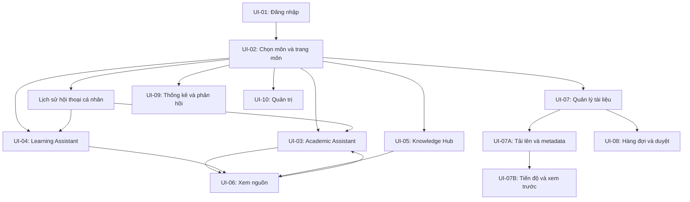

Các đường đến quản lý tài liệu, duyệt, thống kê và quản trị chỉ xuất hiện khi người dùng có quyền. Sơ đồ liệt kê các đường đi có thể có của toàn sản phẩm, không cấp tất cả đường đi cho mọi tài khoản.

### 2.2. Menu theo vai trò

| Khu vực | SV | GV | GV được giao duyệt | Quản trị |
|---|---|---|---|---|
| Ba không gian trợ lý | Môn được cấp | Môn được cấp | Môn được cấp | Khi có quyền nội dung |
| Lịch sử | Của mình | Của mình | Của mình | Của mình nếu sử dụng trợ lý |
| Quản lý tài liệu | Không | Môn phụ trách | Môn phụ trách | Chỉ khi được giao quyền nghiệp vụ |
| Hàng đợi duyệt | Không | Không nếu chưa được giao | Có, trong môn được giao | Không mặc nhiên |
| Thống kê môn | Không | Tổng hợp môn phụ trách | Tổng hợp môn phụ trách | Thống kê vận hành |
| Tài khoản, phân công, hạn mức | Không | Không | Không | Có |

Ẩn menu chỉ giúp trải nghiệm rõ ràng. Backend vẫn phải kiểm tra quyền khi truy cập bằng URL, ID, API hoặc liên kết nguồn trực tiếp.

### 2.3. Quy tắc điều hướng chung

1. Môn đang chọn luôn hiển thị ở đầu trang. Không tự lấy tài liệu từ môn khác để trả lời.
2. Chuyển môn khi đang hội thoại: thông báo “Đổi môn sẽ mở hội thoại mới”, cho chọn **Đổi môn** hoặc **Ở lại**. Hội thoại cũ vẫn thuộc môn cũ.
3. Chuyển Academic ↔ Learning trong cùng môn có thể giữ ngữ cảnh hội thoại và nhãn trợ lý của từng câu trả lời. Không xóa tín hiệu liêm chính khi chuyển.
4. Nút **Hỏi về tài liệu này** mở hội thoại mới với môn và phiên bản tài liệu đã chọn; UI hiển thị phạm vi đó.
5. Mở nguồn từ hội thoại dùng panel hoặc trang con có nút quay lại đúng vị trí hội thoại; không làm mất bản nháp câu hỏi.
6. Đăng xuất hoặc phiên hết hạn phải xóa dữ liệu riêng tư khỏi giao diện. Không khôi phục bản nháp giữa hai tài khoản khác nhau.

## 3. F-01 — Đăng nhập và vào không gian môn

**Vai trò:** mọi người dùng. **Mức:** cơ bản. **Căn cứ:** FR-01, BR-02.

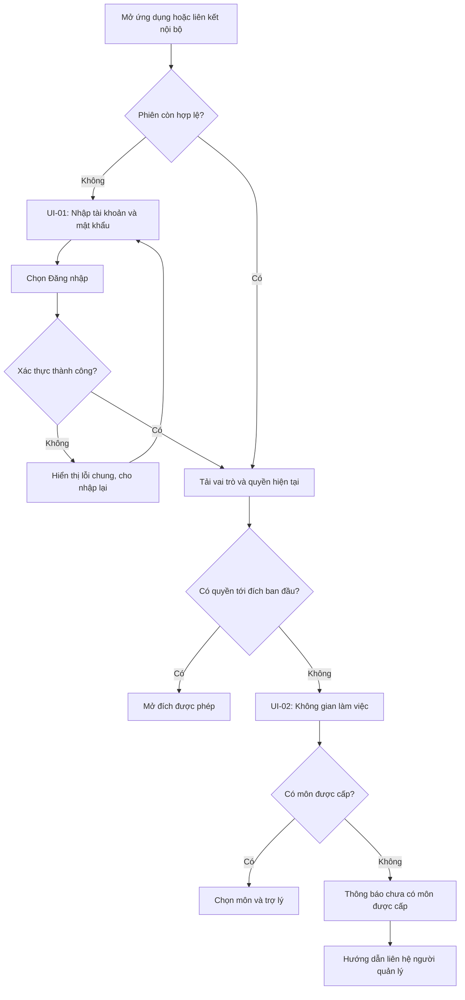

**Lưu ý:** quản trị chưa có quyền nội dung vẫn vào được trang quản trị nếu được cấp. Liên kết đích bị cấm không được hiển thị tên tài liệu để giải thích lỗi.

| Bước | Người dùng | Hệ thống/UI |
|---|---|---|
| 1 | Nhập thông tin | Label rõ, cho hiện/ẩn mật khẩu, kiểm tra trường trống |
| 2 | Chọn Đăng nhập | Disable nút trong lúc gửi, không tạo yêu cầu lặp |
| 3 | Đăng nhập thành công | Nạp danh sách môn/quyền từ server |
| 4 | Chọn môn | Hiển thị tên môn, học kỳ và ba lựa chọn trợ lý |
| 5 | Chọn chức năng | Mở UI tương ứng trong phạm vi môn |

**Nhánh lỗi:** sai thông tin → “Không thể đăng nhập với thông tin đã nhập”; mất mạng → giữ tên tài khoản, cho thử lại; tài khoản bị khóa/phiên hết hạn → không tiếp tục truy vấn bằng phiên cũ. Bản cơ bản dùng tài khoản được cấp, không thêm luồng tự đăng ký hoặc khôi phục mật khẩu tự động ngoài phạm vi.

**Hoàn thành:** người dùng vào đúng không gian được cấp hoặc thấy hướng dẫn rõ khi chưa có quyền.

## 4. F-02 — Hỏi đáp Academic Assistant

**Vai trò:** người có quyền nội dung môn. **Mức:** cơ bản. **Căn cứ:** FR-02, FR-05, FR-10.

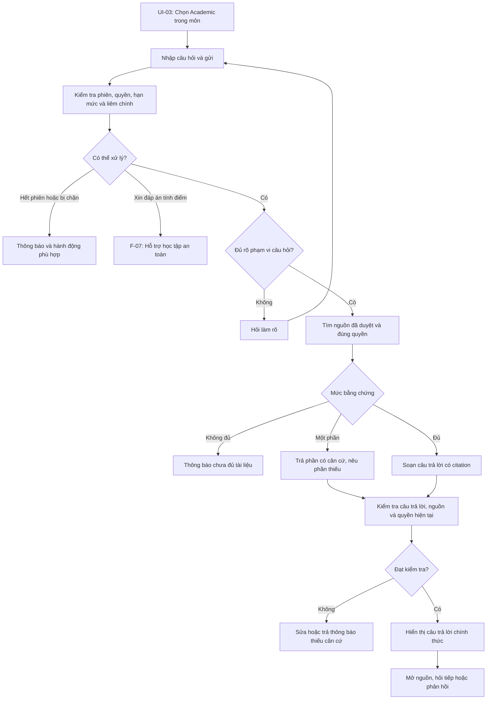

### 4.1. Trình tự màn hình

| Bước | Nội dung hiển thị | Hành động tiếp theo |
|---|---|---|
| Bắt đầu | Môn, trợ lý, phạm vi tài liệu, ví dụ câu hỏi | Nhập/gửi câu hỏi |
| Đang xử lý | “Đang tìm nguồn phù hợp…” rồi “Đang chuẩn bị câu trả lời…” | Không gửi trùng cùng yêu cầu |
| Hoàn tất | Câu trả lời, citation sát từng ý, danh sách nguồn | Mở nguồn, hỏi tiếp, hữu ích/báo lỗi |
| Thiếu nguồn | Nêu rõ chỉ tìm trong phạm vi hiện tại | Làm rõ chủ đề, chọn tài liệu, vào Hub |
| Có mâu thuẫn | Nêu hai ý và phiên bản nguồn liên quan | Mở từng nguồn hoặc liên hệ GV |
| Lỗi kỹ thuật | Thông báo dễ hiểu và mã hỗ trợ | Thử lại hoặc sang Hub |

Không hiện bản nháp chưa kiểm tra như câu trả lời chính thức. Nếu có streaming sau này, từng phần hiển thị phải được kiểm tra hoặc được giữ lại đến khi hợp lệ. Không hiển thị “độ chính xác 95%” suy từ điểm tìm kiếm.

### 4.2. Ví dụ nội dung, không phải đáp án học thuật thật

```text
Bạn: Khái niệm A khác B ở điểm nào theo giáo trình môn này?

Academic Assistant:
• Khác biệt về định nghĩa: <nội dung có căn cứ> [1].
• Khác biệt về phạm vi áp dụng: <nội dung có căn cứ> [2].

Giới hạn: Tài liệu hiện tại chưa đề cập <phần còn thiếu>.

[1] <Tên giáo trình> · <Phiên bản> · Trang <n>
[2] <Tên slide> · <Phiên bản> · Slide <m>
[Hữu ích] [Báo lỗi]
```

**Hoàn thành:** câu hỏi nhận một trạng thái xác định: answered, partial, needs_clarification, insufficient_evidence, integrity_redirect hoặc error; các trạng thái không bị gộp thành “thành công”.

## 5. F-03 — Giải thích và lập lộ trình với Learning Assistant

**Vai trò:** người có quyền nội dung, ưu tiên SV. **Mức:** cơ bản. **Căn cứ:** FR-03, FR-09.

### 5.1. Luồng giải thích

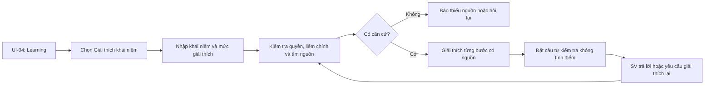

Mức giải thích: **Ngắn gọn**, **Từng bước**, **Chi tiết**. Đây là tùy chọn trình bày, không phải kết quả đánh giá năng lực. Ví dụ AI tự tạo được ghi “Ví dụ minh họa”, có nguyên lý được dẫn nguồn và không được ngụy tạo thành ví dụ trích nguyên văn từ tài liệu.

### 5.2. Luồng lập kế hoạch

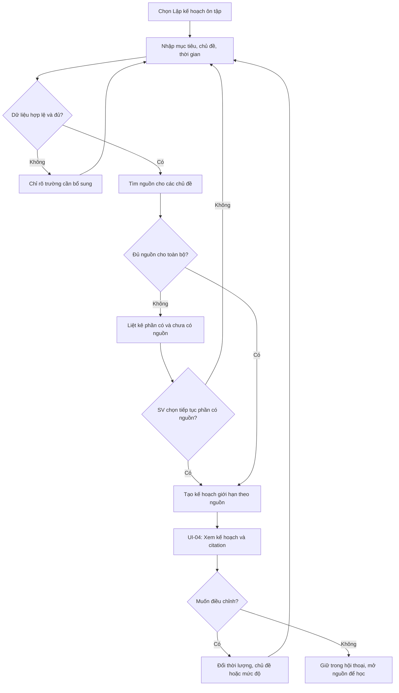

### 5.3. Form và kết quả

| Trường | Bắt buộc | Kiểm tra |
|---|---|---|
| Môn | Có, lấy từ không gian hiện tại | Thuộc quyền người dùng |
| Mục tiêu | Có | Ví dụ hiểu chương, ôn kiến thức; không hứa điểm số |
| Chương/chủ đề | Có | Có thể chọn từ tài liệu hoặc nhập để hệ thống làm rõ |
| Ngày bắt đầu/kết thúc hoặc số ngày | Có một cách nhập | Số ngày dương; ngày kết thúc không trước bắt đầu |
| Số phút mỗi ngày | Có | Số dương, kiểm tra giá trị bất hợp lý và yêu cầu sửa |
| Phần đang khó hiểu | Không | Dùng điều chỉnh cách giải thích |

Kết quả mỗi buổi có: ngày/buổi, mục tiêu, tài liệu/trang cần đọc, hoạt động học, thời lượng và câu tự kiểm tra. Tổng thời lượng không vượt quỹ thời gian đã nhập. Không thêm nút xuất PDF/lịch ngoài phạm vi hiện tại; việc lưu ở đây là lưu trong hội thoại theo chính sách PRD.

## 6. F-04 — Tìm kiếm trong Knowledge Hub

**Vai trò:** người có quyền nội dung. **Mức:** tìm kiếm cơ bản; tổng hợp nhiều nguồn nâng cao. **Căn cứ:** FR-04, FR-12.

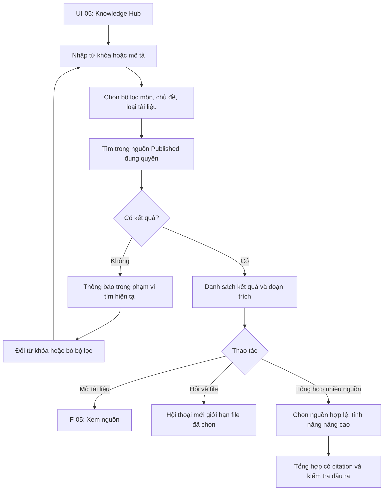

Mỗi kết quả gồm tiêu đề, môn, loại file, phiên bản, đoạn trích và vị trí. Bộ lọc/số lượng kết quả/gợi ý phải được tính sau lọc quyền. Tài liệu chờ duyệt không xuất hiện dưới dạng “kết quả bị khóa” cho SV.

**Không kết quả:** “Chưa tìm thấy tài liệu phù hợp trong môn và bộ lọc hiện tại.” Có nút **Xóa bộ lọc** và **Sửa từ khóa**, không tự đổi sang tìm toàn kho.

**Hoàn thành:** người dùng mở được nguồn phù hợp, bắt đầu hội thoại có phạm vi rõ, hoặc biết cách điều chỉnh tìm kiếm.

## 7. F-05 — Mở citation và xem tài liệu

**Căn cứ:** FR-04, FR-10, BR-12. **Mức:** cơ bản.

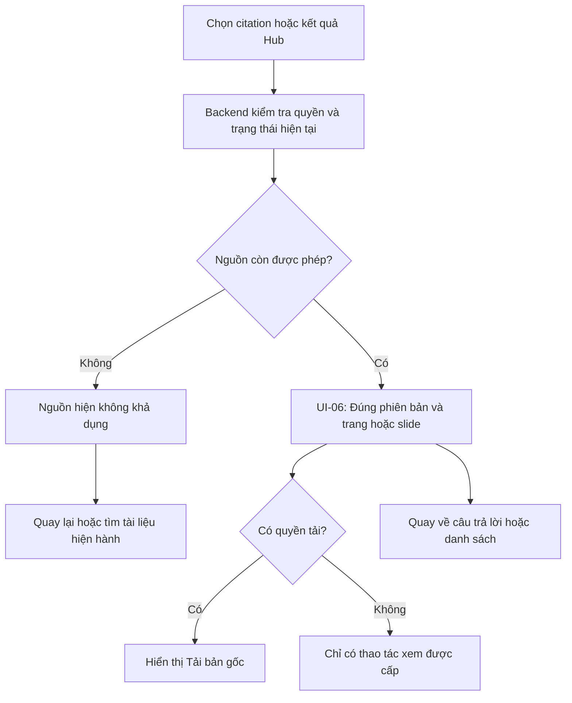

Panel nguồn có tiêu đề, phiên bản, số trang/slide, nội dung liên quan và nút đóng. Nếu PDF dùng số trang in khác số trang vật lý, ghi rõ ví dụ “Trang PDF 20 · trang in 18”. Nếu không render được nhưng text trích xuất còn hợp lệ và được phép, hiển thị text kèm locator; không tạo ảnh/trang giả.

Quyền “không cho tải” là hạn chế chức năng tải bản gốc, không cam kết ngăn người đã được đọc chụp màn hình hay sao chép. Không làm nguồn bị cấm lộ qua URL, tên file hoặc thông báo lỗi.

## 8. F-06 — Lịch sử hội thoại và phản hồi chất lượng

**Căn cứ:** FR-05, FR-13. **Mức:** lịch sử/phản hồi cơ bản; dashboard xử lý nâng cao.

### 8.1. Lịch sử

`Mở lịch sử → tải danh sách của tài khoản hiện tại → chọn hội thoại → kiểm tra quyền môn và từng nguồn → hiện phần được phép → tiếp tục hỏi trong môn của phiên`.

- Nếu môn hết quyền: không mở nội dung hội thoại môn đó; hiển thị trạng thái không khả dụng phù hợp.
- Nếu một nguồn bị thu hồi: che câu trả lời phụ thuộc nguồn theo chính sách PRD, không chỉ ẩn link mà vẫn để nội dung nhạy cảm.
- Đổi tên: chỉnh tiêu đề, không đổi môn hoặc nguồn.
- Xóa: hộp thoại xác nhận có **Xóa hội thoại** và **Hủy**; thông báo dữ liệu ẩn ngay, được xử lý xóa theo thời hạn lưu trữ, không hứa xóa backup tức thì.

### 8.2. Phản hồi

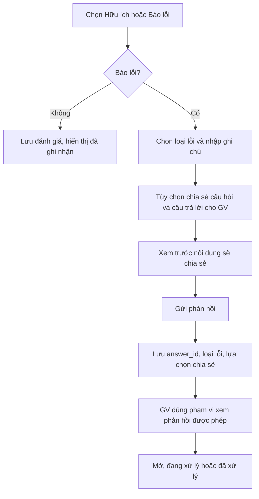

Các loại lỗi: sai kiến thức, nguồn không hỗ trợ, sai trang/slide, thiếu nội dung, lỗi giao diện, khác. Tùy chọn chia sẻ nội dung **không được chọn sẵn**. Nếu không chia sẻ, GV chỉ nhận thông tin được phép/đã tổng hợp, không được mở ngược answer_id để đọc hội thoại riêng. Phản hồi không tự sửa kho hay tạo nhãn học thuật đã được xác nhận.

## 9. F-07 — Liêm chính, thiếu nguồn và yêu cầu không hợp lệ

**Căn cứ:** FR-09, BR-05/06/07/15. **Mức:** cơ bản, áp dụng ở mọi trợ lý.

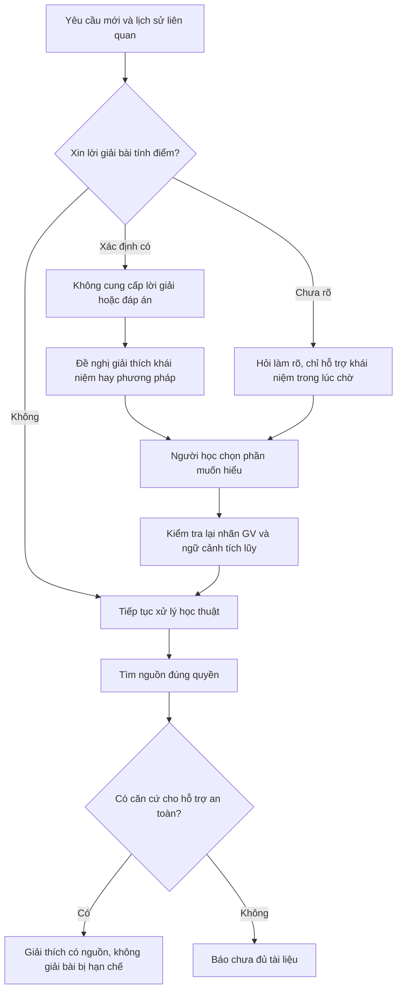

| Tình huống | UI trả lời | Hành động tiếp |
|---|---|---|
| Xin đáp án bài tính điểm | Nêu giới hạn ngắn gọn, không phán xét | Giải thích khái niệm, cách tiếp cận |
| SV nói “không tính điểm” nhưng GV đã gắn nhãn | Giữ giới hạn theo nhãn GV | Hỗ trợ kiến thức nền |
| Hỏi “gợi ý thêm” nhiều lượt thành lời giải | Chặn phần làm lộ đáp án | Quay về nguyên lý hoặc ví dụ khác phù hợp |
| Hỏi bài luyện hợp lệ | Hỗ trợ theo chính sách môn và nguồn | Giải thích chi tiết nếu được phép |
| Không đủ nguồn | Nêu phần thiếu, không dựng citation | Tìm trong Hub hoặc làm rõ câu hỏi |
| Yêu cầu ngoài quyền | Thông báo không thể truy cập nội dung này | Quay về môn được cấp |

Đổi trợ lý, đổi cách diễn đạt hoặc dịch câu hỏi không xóa trạng thái kiểm tra. Không tạo luồng báo cáo gian lận/kỷ luật SV ngoài phạm vi sản phẩm.

## 10. F-08 — GV tải tài liệu và gửi duyệt

**Vai trò:** GV được giao quản lý môn. **Mức:** cơ bản; OCR nâng cao. **Căn cứ:** FR-06/07/08.

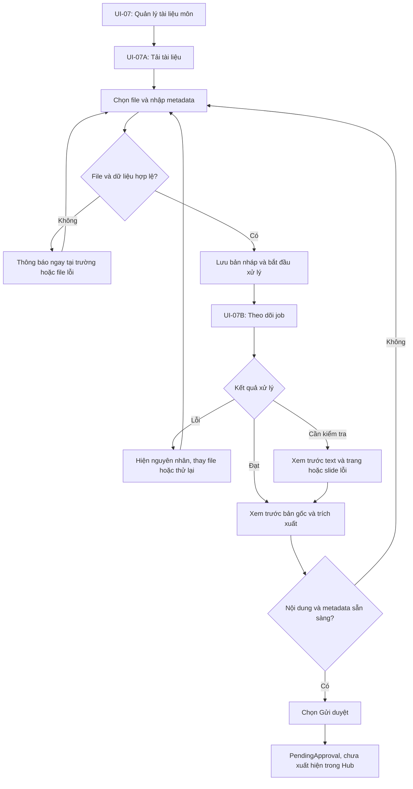

### 10.1. Form tải lên

| Trường | Hiển thị/kiểm tra |
|---|---|
| Môn | Chọn trong môn phụ trách; không nhập tùy ý ID |
| File | PDF văn bản/PPTX; giới hạn đề xuất theo PRD: 50 MB, 300 trang/slide |
| Tiêu đề, loại, phiên bản | Bắt buộc; tên file có thể gợi ý nhưng GV phải kiểm tra |
| Tác giả/đơn vị cung cấp | Nhập nếu biết, không tạo tên giả |
| Nguồn gốc và quyền sử dụng | Bắt buộc xác nhận; chưa rõ thì giữ bản nháp |
| Chủ đề/chương/học kỳ | Tùy chọn, hỗ trợ tìm kiếm |
| Đối tượng đọc | Vai trò/nhóm trong môn; không mặc định công khai toàn kho |
| Cho tải bản gốc | Tùy chọn quyền riêng |
| Nhãn liêm chính | Học liệu, bài tính điểm, đáp án/barème; thông tin kỳ hiệu lực nếu áp dụng |

Nhãn đáp án/barème không được đi kèm ACL cho SV. Nếu người dùng cấu hình mâu thuẫn, form báo lỗi và backend từ chối lưu/công bố cấu hình đó.

### 10.2. Trạng thái job trên UI

| Trạng thái | Nội dung | Thao tác |
|---|---|---|
| Đang nhận file | Tiến độ upload nếu đo được | Chờ hoặc thử lại nếu lỗi |
| Đang trích xuất | Giai đoạn hiện tại | Có thể rời trang, mở lại qua danh sách |
| Cần kiểm tra | Trang/slide bị lỗi hoặc chất lượng thấp | Xem trước, sửa/thay file |
| Sẵn sàng gửi duyệt | Preview và checklist metadata | Gửi duyệt |
| Thất bại | Lỗi dễ hiểu và mã hỗ trợ | Thử lại hoặc thay file |
| Chờ duyệt | Người/nhóm duyệt được phân công nếu có | Xem trạng thái; chưa có nút công bố |

Không hiển thị phần trăm giả nếu backend chỉ biết giai đoạn. PDF scan ở bản cơ bản được thông báo chưa hỗ trợ và yêu cầu bản văn bản; bản nâng cao chạy OCR rồi vẫn phải kiểm tra trước duyệt.

**Hoàn thành:** tài liệu ở PendingApproval, không nằm trong nguồn trả lời của SV.

## 11. F-09 — GV duyệt và phát hành

**Vai trò:** GV có quyền duyệt trong môn, khác người tải bản tài liệu. **Mức:** cơ bản; dashboard đầy đủ nâng cao. **Căn cứ:** FR-08.

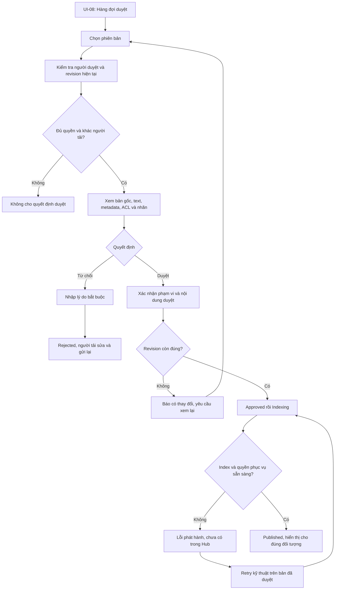

Checklist bắt buộc khi duyệt:

- Nội dung học thuật và nguồn gốc phù hợp.
- Bản trích xuất giữ đúng trang/slide, công thức quan trọng không bị sai.
- Môn, phiên bản và phạm vi được đọc/tải đúng.
- Nhãn bài tính điểm/đáp án chính xác.
- Người duyệt đang xem đúng revision sẽ được phát hành.

Nhấn **Duyệt** không được hiện ngay “Tài liệu đã có trong Hub”. Thông báo đúng là “Đã duyệt nội dung, đang chuẩn bị phát hành”; chỉ hiển thị “Đã phát hành” khi Published. Nếu không có người duyệt độc lập, hiển thị “Chưa có người duyệt được phân công”, giữ trạng thái chờ và hướng dẫn liên hệ quản trị.

## 12. F-10 — Tạo phiên bản mới và thu hồi

**Vai trò:** GV quản lý/duyệt theo quyền. **Mức:** cơ bản; giao diện phiên bản đầy đủ nâng cao. **Căn cứ:** BR-09, FR-08/15.

### 12.1. Tạo phiên bản mới

`UI-07 → Chi tiết tài liệu → Tạo phiên bản mới → tải file và metadata → xử lý → duyệt độc lập → indexing → chuyển bản hiện hành`.

Bản cũ còn Published trong lúc bản mới xử lý, trừ khi đã có quyết định thu hồi. Lúc phát hành thành công, chuyển con trỏ bản hiện hành có kiểm soát; bản cũ chuyển Archived và không xuất hiện trong tìm kiếm mặc định. Citation cũ không được tự trỏ sang trang cùng số của phiên bản mới. Nếu phiên bản cũ không còn được phép phục vụ, hiển thị trạng thái không khả dụng và cung cấp lối tìm bản hiện hành, không coi đó là nguồn thay thế đã được xác minh cho câu trả lời cũ.

### 12.2. Thu hồi

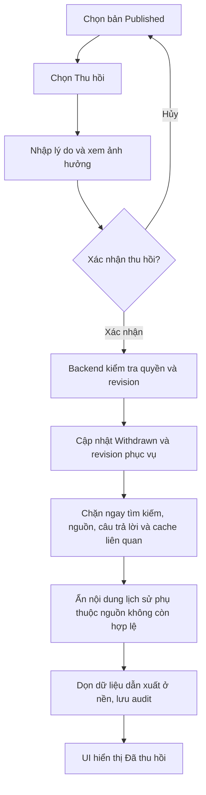

Hộp xác nhận ghi rõ ảnh hưởng tới tìm kiếm, câu trả lời và liên kết nguồn; không hứa xóa được bản người dùng đã tải về trước đó. GV chưa có quyền thu hồi chỉ thấy **Đề nghị thu hồi**, không thấy nút thực thi. Luồng đề nghị là ghi nhận để người có quyền xử lý; không tự đổi trạng thái tài liệu.

## 13. F-11 — Router tự động ba trợ lý [Nâng cao]

**Căn cứ:** FR-11/12. Giao diện cơ bản luôn cho chọn trợ lý thủ công; chế độ **Tự động** chỉ hiển thị khi router đã được triển khai.

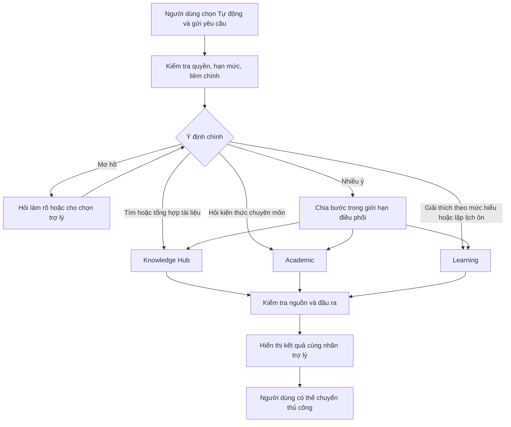

Sơ đồ thể hiện các nhánh có thể chọn, không yêu cầu luôn gọi cả ba trợ lý. Khi chuyển thủ công, giữ phạm vi quyền và tín hiệu liêm chính. Hiển thị “Đang dùng Learning Assistant” thay vì giải thích cấu trúc LangGraph cho người học. Nếu quá số bước/deadline, yêu cầu người dùng thu hẹp câu hỏi hoặc trả phần đã đủ căn cứ, không chạy lặp vô hạn.

## 14. F-12 — Quản trị tài khoản, quyền và vận hành

**Vai trò:** quản trị. **Mức:** thao tác vận hành tối thiểu cơ bản; dashboard hoàn chỉnh nâng cao. **Căn cứ:** FR-01/15, mục 12 PRD.

### 14.1. Phân công quyền

`UI-10 → chọn tài khoản → xem vai trò/phạm vi/hiệu lực → chỉnh quyền môn hoặc phân công duyệt → xem tóm tắt thay đổi → xác nhận → backend kiểm tra → lưu audit và tăng revision quyền`.

Khi thu hồi quyền hoặc khóa tài khoản, hiệu lực áp dụng cho yêu cầu mới, yêu cầu đang chạy trước lúc trả kết quả, nguồn và lịch sử. UI thông báo quyền thay đổi và điều hướng về trang còn được phép. Không để quản trị tự xem toàn bộ nội dung bằng việc mở trang quản trị; cấp quyền nội dung phải là thao tác riêng có lưu vết.

### 14.2. Theo dõi hạn mức

`UI-10 → xem sử dụng/chi phí ước tính → cảnh báo ngưỡng → chỉnh hạn mức trong thẩm quyền → xác nhận → áp dụng cho yêu cầu tiếp theo`.

Nếu chạm hạn mức, UI trợ lý hiển thị “Đã đạt hạn mức sử dụng hiện tại” và **Tìm trong Knowledge Hub** nếu chức năng này còn hoạt động. Không tự chuyển provider hoặc phát sinh ngân sách mới. Thống kê phân biệt chi phí ước tính, token, ingestion và hội thoại; không hiển thị số tiền chính xác khi chưa có dữ liệu đối soát.

## 15. Wireframe các màn hình chính

Các khung dưới đây thể hiện bố cục và nhãn; kích thước, màu sắc, font và component cụ thể được chốt ở bước thiết kế UI. Nội dung trong dấu `< >` là dữ liệu mẫu.

### 15.1. UI-01 — Đăng nhập

```text
+---------------------------------------------------------+
|                       EDU-04                            |
|         Kho tri thức hỗ trợ học thuật X                 |
|                                                         |
| Tài khoản                                               |
| [.....................................................] |
| Mật khẩu                                                |
| [............................................] [Hiện]  |
| <Thông báo kiểm tra/lỗi nếu có>                          |
|                                                         |
|                     [Đăng nhập]                         |
| Chưa có tài khoản? Liên hệ người quản lý của đơn vị.     |
+---------------------------------------------------------+
```

### 15.2. UI-02 — Trang môn

```text
+--------------------------------------------------------------------+
| EDU-04     Môn: [<Tên môn - học kỳ> v]    <Tên người dùng> [Đăng xuất]|
+----------------+---------------------------------------------------+
| Academic       | Xin chào, <Tên>                                   |
| Learning       | Bạn muốn làm gì trong môn <Tên môn>?              |
| Knowledge Hub  |                                                   |
|----------------| [Hỏi kiến thức] [Hiểu bài / ôn tập] [Tìm tài liệu] |
| Lịch sử        |                                                   |
|                | Tài liệu hiện hành trong môn                      |
| Quản lý tài liệu| <Tên tài liệu> · <phiên bản>              [Mở]    |
| (theo quyền)   | <Tên tài liệu> · <phiên bản>              [Mở]    |
+----------------+---------------------------------------------------+
```

### 15.3. UI-03 — Academic và panel nguồn

```text
+------------------------------------------------------------------------+
| EDU-04   Môn: [<Môn> v]                  <Tài khoản>                     |
+------------------+--------------------------------+--------------------+
| Academic         | Academic Assistant             | Nguồn [1]          |
| Learning         | Phạm vi: <môn / file>          | <Tên tài liệu>     |
| Knowledge Hub    |                                | <Phiên bản>        |
|------------------| Bạn: <câu hỏi>                 | Trang/slide <n>    |
| [+ Hội thoại mới]|                                |                    |
| <Lịch sử>        | <Ý trả lời thứ nhất> [1]       | <Đoạn trích>       |
|                  | <Ý trả lời thứ hai> [2]        |                    |
|                  | <Giới hạn bằng chứng nếu có>   | [Xem tài liệu]     |
|                  | [Hữu ích] [Báo lỗi]            | [Đóng]             |
|                  |--------------------------------|                    |
|                  | [Nhập câu hỏi...        ][Gửi] |                    |
+------------------+--------------------------------+--------------------+
```

Panel nguồn đóng mặc định cho đến khi chọn citation; có thể hiển thị danh sách nguồn gọn dưới đáp án. Không tạo cột nguồn trống chiếm chỗ ở màn hình nhỏ.

### 15.4. UI-04 — Learning: form và lộ trình

```text
+---------------------------------------------------------------------+
| Learning Assistant                          Môn: <Môn đang chọn>    |
| [Giải thích khái niệm] [Lập kế hoạch ôn tập]                          |
+-----------------------------+---------------------------------------+
| Mục tiêu [...............]  | Kế hoạch ôn tập                         |
| Chủ đề   [...............]  | Phạm vi: <chương/chủ đề>               |
| Số ngày  [....]             | Quỹ thời gian: <n> ngày x <m> phút     |
| Phút/ngày [....]            |                                       |
| Phần khó [...............]  | Buổi 1 · <mục tiêu> · <thời lượng>     |
|                             | Đọc: <nguồn, trang> [1]               |
| [Tạo kế hoạch]              | Hoạt động: <nội dung>                  |
| <Lỗi tại trường nếu có>     | Tự kiểm tra: <câu hỏi>                 |
|                             |                                       |
|                             | [Điều chỉnh] [Mở nguồn học]           |
+-----------------------------+---------------------------------------+
```

### 15.5. UI-05 — Knowledge Hub

```text
+---------------------------------------------------------------------+
| Knowledge Hub                                  Môn: <Môn>           |
| [Nhập từ khóa hoặc mô tả nội dung........................] [Tìm]     |
| Chủ đề [Tất cả v]   Loại [Tất cả v]   [Xóa bộ lọc]                   |
+---------------------------------------------------------------------+
| <Số kết quả trong phạm vi được phép>                                |
| <Tên tài liệu> · <Loại> · <Phiên bản>                                |
| <Đoạn trích khớp> — Trang/slide <n>                                  |
| [Xem tài liệu] [Hỏi về tài liệu này]                                |
|---------------------------------------------------------------------|
| <Kết quả tiếp theo>                                                 |
|---------------------------------------------------------------------|
| [Trước] <Trang hiện tại> [Sau]                                      |
+---------------------------------------------------------------------+
```

### 15.6. UI-06 — Xem nguồn

```text
+---------------------------------------------------------------------+
| [Quay lại] <Tên tài liệu> · <Phiên bản>                              |
| Trang/slide [<n>] [Trước] [Sau]       [Tải bản gốc - nếu được phép]  |
+---------------------------------------------------------------------+
|                                                                     |
|                       <NỘI DUNG NGUỒN>                             |
|                <Đánh dấu đoạn đang được trích>                      |
|                                                                     |
+---------------------------------------------------------------------+
| Vị trí nguồn: <locator đầy đủ>                                      |
| [Hỏi về tài liệu này]                                               |
+---------------------------------------------------------------------+
```

### 15.7. UI-07 — Danh sách và tải tài liệu

```text
+---------------------------------------------------------------------+
| Quản lý tài liệu · <Môn>                         [+ Tải tài liệu]    |
| Trạng thái [Tất cả v]  [Tìm theo tên...........................]     |
+------------------------+-----------+--------------+-----------------+
| Tài liệu / phiên bản   | Người tải | Trạng thái   | Thao tác        |
| <Tên A / v1>           | <GV A>    | Chờ duyệt    | [Xem]           |
| <Tên B / v2>           | <GV B>    | Published    | [Xem] [Bản mới] |
| <Tên C / v1>           | <GV A>    | Lỗi xử lý    | [Xem lỗi]       |
+------------------------+-----------+--------------+-----------------+

UI-07A: Tải lên
[Chọn file] <Tên file>
Môn [v]  Tiêu đề [...]  Loại [v]  Phiên bản [...]
Nguồn gốc/quyền sử dụng [...]
Đối tượng đọc [...]  [ ] Cho tải bản gốc
Nhãn liêm chính [v]  Thời gian áp dụng [...]
[Lưu và xử lý] [Hủy]

UI-07B: Xem trước
<Trạng thái job / lỗi cần sửa>
[Bản gốc] [Text trích xuất] [Metadata và quyền]
[Sửa bản nháp] [Gửi duyệt - chỉ khi sẵn sàng]
```

### 15.8. UI-08 — Duyệt tài liệu

```text
+---------------------------------------------------------------------+
| [Về hàng đợi] <Tên tài liệu> · <Phiên bản/revision>                  |
| Người tải: <Tên> · Môn: <Môn> · Trạng thái: Chờ duyệt               |
+----------------------------------+----------------------------------+
| Bản gốc - trang/slide <n>        | Text trích xuất cùng vị trí       |
| <Preview>                        | <Nội dung>                        |
+----------------------------------+----------------------------------+
| Nguồn gốc: <Thông tin>       Đối tượng đọc: <Vai trò/nhóm>           |
| Nhãn: <Học liệu/bài tính điểm/đáp án>   Tải bản gốc: <Có/Không>     |
| <Cảnh báo chất lượng hoặc xung đột nếu có>                           |
| [ ] Đã kiểm tra nội dung, nguồn, vị trí, quyền và nhãn               |
| Lý do/nhận xét [.................................................]  |
| [Từ chối - cần lý do]                            [Duyệt nội dung]  |
+---------------------------------------------------------------------+
```

Checkbox chỉ hỗ trợ người duyệt nhớ việc; không thay thế kiểm tra backend, xem preview thật hay quyền duyệt độc lập.

### 15.9. UI-09 và UI-10 — Thống kê, quản trị

```text
UI-09: Thống kê môn và phản hồi
Môn [v]  Khoảng ngày [........]
[Số truy vấn] [Thiếu nguồn] [Phản hồi đang mở]
Loại lỗi [v]  Trạng thái [v]
<Danh sách phản hồi trong phạm vi được phép>
[Xem nội dung được chia sẻ] [Đang xử lý] [Đã xử lý]

UI-10: Quản trị
[Tài khoản] [Môn và phân công] [Hạn mức] [Audit]
<Danh sách theo tab được chọn>
[Xem chi tiết] [Chỉnh sửa]
<Tóm tắt thay đổi trước khi xác nhận>
[Xác nhận thay đổi] [Hủy]
```

Dashboard không có dữ liệu phải ghi “Chưa có dữ liệu”, không điền số mẫu vào như số đo thật. Không hiển thị tỷ lệ chất lượng là KPI chính thức nếu chưa có lượt đánh giá gắn dataset/config version.

## 16. Trạng thái UI và xử lý lỗi dùng chung

| Trạng thái | Hiển thị | Hành động | Điều cần tránh |
|---|---|---|---|
| Chưa có dữ liệu | Mô tả ngắn cách bắt đầu | Tạo hội thoại/tìm/tải theo quyền | Trang trắng |
| Đang tải | Skeleton hoặc chỉ báo đang xử lý | Chờ; rời trang nếu job chạy nền | Đếm tiến độ giả |
| Gửi thành công | Kết quả và trạng thái xác nhận từ server | Tiếp tục luồng | Báo thành công trước khi lưu |
| Lỗi trường nhập | Báo tại trường, giữ giá trị hợp lệ | Sửa rồi gửi lại | Xóa toàn bộ form |
| Không có kết quả | Nêu phạm vi hiện tại | Đổi từ khóa/bộ lọc | Suy ra toàn kho không có |
| Không đủ bằng chứng | Nêu phần có/thiếu | Làm rõ hoặc Hub | Trả lời bịa cho đầy đủ |
| Nguồn mất quyền/thu hồi | Nội dung không khả dụng | Quay lại/tìm nguồn hiện hành | Hiện tên hoặc đoạn bị hạn chế |
| Xung đột revision | Có thay đổi mới, cần tải lại | Xem revision mới | Ghi đè quyết định người khác |
| Hết phiên | Yêu cầu đăng nhập lại | Đăng nhập, kiểm tra lại quyền | Giữ nội dung nhạy cảm trên màn hình |
| Timeout/provider lỗi | Chưa thể tạo câu trả lời | Thử lại hoặc Hub | Retry vô hạn |
| Vượt hạn mức | Hạn mức hiện tại đã đạt | Chờ kỳ tiếp theo/Hub nếu có | Tự tăng ngân sách |
| Mất mạng sau khi gửi | Chưa xác định kết quả | Kiểm tra request/job cũ trước retry | Gửi tác vụ mới gây lặp phí |

Mọi thao tác gửi có trạng thái pending và chống nhấn lặp. Retry dùng lại định danh/idempotency thích hợp, không giả định “UI chưa thấy kết quả” đồng nghĩa “server chưa xử lý”.

## 17. Responsive và khả năng tiếp cận

- Desktop: sidebar trái, nội dung chính giữa; nguồn mở panel phải khi cần.
- Tablet/mobile: sidebar thành menu, form xếp một cột, panel nguồn mở toàn chiều rộng với nút quay lại; giữ môn hiện tại dễ nhận biết.
- Bảng GV trên mobile có thể chuyển thành danh sách card chứa cùng trạng thái/thao tác, không bỏ thông tin phiên bản hoặc quyền quan trọng.
- Nút có nhãn rõ, đi được bằng bàn phím; focus quay về citation sau khi đóng panel và quay về nút gọi sau khi đóng modal.
- Thông báo lỗi gắn với trường, đọc được bằng công cụ hỗ trợ; không chỉ dùng màu để phân biệt Published/Rejected/Withdrawn.
- Giữ ô nhập trên bàn phím mobile sử dụng được; nội dung dài cuộn trong trang, không che nút gửi hoặc nút đóng nguồn.

## 18. Ma trận chuyển màn hình cho frontend và QA

| Từ | Sự kiện | Điều kiện | Đến/kết quả |
|---|---|---|---|
| UI-01 | Đăng nhập | Xác thực thành công | UI-02 hoặc đích hợp lệ đã kiểm tra quyền |
| UI-02 | Chọn Academic | Có quyền môn | UI-03 |
| UI-02 | Chọn Learning | Có quyền môn | UI-04 |
| UI-02 | Chọn Hub | Có quyền môn | UI-05 |
| UI-03/04 | Gửi câu hỏi | Phiên/quota hợp lệ | Trạng thái xử lý rồi kết quả tại chỗ |
| UI-03/04 | Chọn citation | Nguồn còn được phép | UI-06/panel nguồn |
| UI-05 | Chọn kết quả | Published, đúng quyền | UI-06 |
| UI-05/06 | Hỏi về tài liệu | Nguồn còn hợp lệ | UI-03 mới với phạm vi file |
| UI-03/04 | Đổi môn | Người dùng xác nhận | Hội thoại mới trong môn mới |
| UI-07 | Tải lên | GV đúng phạm vi | UI-07A |
| UI-07A | Lưu và xử lý | File/metadata hợp lệ | UI-07B |
| UI-07B | Gửi duyệt | Nội dung sẵn sàng | PendingApproval; về chi tiết/danh sách |
| UI-08 | Duyệt | Đủ quyền, không tự duyệt, revision đúng | Approved/Indexing; chờ Published |
| UI-08 | Từ chối | Có lý do, revision đúng | Rejected |
| UI-07 | Thu hồi | Người có quyền xác nhận | Withdrawn, chặn phục vụ ngay |
| UI-09 | Xem phản hồi | Đúng môn và quyền nội dung chia sẻ | Chi tiết phản hồi được phép |
| UI-10 | Lưu quyền | Có quyền quản trị và dữ liệu hợp lệ | Audit + revision quyền mới |
| Bất kỳ | Hết phiên | Server xác nhận | UI-01, xóa nội dung riêng khỏi UI |

## 19. Checklist kiểm thử flow và truy vết PRD

| Flow | FR liên quan | Kiểm thử chính |
|---|---|---|
| F-01 | FR-01 | UAT-01/02: đăng nhập, không môn, sai quyền, link trực tiếp |
| F-02 | FR-02/05/10 | UAT-03/04/20: đúng nguồn, thiếu nguồn, mâu thuẫn |
| F-03 | FR-03/09 | UAT-05/06/07: giải thích, quỹ thời gian, bài tính điểm |
| F-04 | FR-04/12 | Tìm đúng quyền, bộ lọc, count, không kết quả, tổng hợp |
| F-05 | FR-04/10 | UAT-03/11: đúng phiên bản/trang, nguồn bị thu hồi |
| F-06 | FR-05/13 | UAT-19: hội thoại cá nhân, xóa, chia sẻ phản hồi có lựa chọn |
| F-07 | FR-09/10 | UAT-07/13: đa lượt, injection, không đủ căn cứ |
| F-08 | FR-06/07 | UAT-08/10/12: file lỗi, scan, retry, chưa phát hành |
| F-09 | FR-08 | UAT-09/10/14: tự duyệt, index lỗi, revision xung đột |
| F-10 | FR-08/15 | UAT-11/15: thu hồi, cache, lịch sử và truy vấn đang chạy |
| F-11 | FR-11/12 | UAT-18: ý định mơ hồ, thủ công, giới hạn điều phối |
| F-12 | FR-01/15 | UAT-15/16: đổi quyền, khóa tài khoản, quota |

Trước khi chốt thiết kế, nhóm walkthrough ít nhất ba hành trình đầu cuối: **SV hỏi → mở nguồn → phản hồi**, **GV tải → GV khác duyệt → SV tìm thấy**, **thu hồi tài liệu → cache/lịch sử/nguồn ngừng phục vụ**. Thử cả nhánh lỗi, không chỉ màn hình thành công.

## 20. Thứ tự triển khai và các điểm cần thống nhất

**Lịch nhóm đã chốt: 6 tuần, bản cơ bản hoàn tất cuối tuần 3.** Tuần 1 xây UI-01/02 và UI-07/08 tối thiểu cùng luồng nguồn mẫu; tuần 2 tích hợp UI-03/04/05/06, lịch sử và phản hồi; tuần 3 kiểm thử/sửa lỗi toàn bộ luồng cơ bản và nghiệm thu. Tuần 4–5 mới mở router/dashboard và các phần nâng cao theo capacity; tuần 6 ổn định, regression và bàn giao. Không dành ba tuần đầu chỉ để làm wireframe hoặc giao diện mock.

UI quản lý/duyệt cơ bản dùng form và danh sách tối giản nhưng vẫn phải kiểm tra quyền, duyệt độc lập và trạng thái phát hành thật. Thiết kế dưới đây giữ nguyên các nhánh lỗi/an toàn; ưu tiên hoàn thiện chức năng trước trang trí. Chi tiết phân công và mốc tuần xem [Backlog](backlog_edu04.md).

1. Xây UI-01/02 và kiểm tra quyền, sau đó UI-07/08 tối thiểu để có kho được duyệt.
2. Xây UI-05/06 để kiểm chứng tìm kiếm và nguồn trước khi nối AI.
3. Xây UI-03/04 cùng trạng thái thiếu nguồn, liêm chính, lỗi và phản hồi.
4. Kiểm thử thu hồi/quyền thay đổi qua toàn bộ UI và backend.
5. Hoàn thiện dashboard, router và các tính năng nâng cao sau khi luồng cơ bản đạt.

Các điểm chưa chốt: tên/nhận diện nhóm; môn pilot; người duyệt độc lập; cơ chế cấp tài khoản; giới hạn file cuối cùng; cấu hình lưu trữ; phạm vi đăng ký nâng cao. Giữ các giá trị theo PRD ở dạng đề xuất đến khi được nhóm/GV thống nhất. Tài liệu này không bổ sung yêu cầu tự đăng ký, xuất lịch, gửi email tự động hoặc tích hợp LMS ngoài phạm vi đã xác định.
