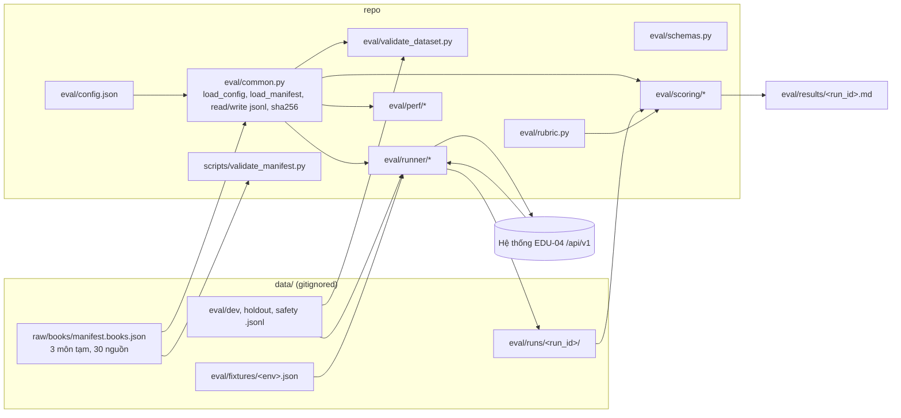

# KẾ HOẠCH CODE THEO USE CASE — TV1 (Ngô Đinh Minh Nhật) · BẢN MVP

> Thư mục cục bộ, **không push** (`docs/plans/` bị `.gitignore`). Coding agent phải đọc [luật](../rules/coding_agent_rules.md), sau đó đọc file plan của đúng use case trước khi code. Nếu plan khác PRD/backlog thì **PRD/backlog là chuẩn**: dừng lại và hỏi người dùng.

## 0. Quyết định giai đoạn MVP (người dùng chốt ngày 25/09/2026)

| # | Quyết định | Hệ quả khi code |
|---|---|---|
| ~~MVP-1~~ | Làm **bản MVP đầy đủ** cho các use case Must của TV1 (UC-01…UC-06). | UC-07 và UC-08 (Should) **ngoài MVP**, chưa code. |
| **MVP-6** | (25/09/2026, thay MVP-1) **Nhắm mức Nâng cao**: đưa BL-36 (UC-07) và BL-40 (UC-08) vào phạm vi. Được thêm `ragas==0.4.3`; `get_llm()` đọc `AI_*`. | Code UC-07/UC-08 theo cấu trúc mục 3. Ngưỡng đạt vẫn theo PRD; ngưỡng RAGAS là **đề xuất**, phải được xác nhận trước khi chạy nghiệm thu. |
| MVP-2 | Dùng **dữ liệu đang có**: 3 môn tạm, 30 sách thật trong `data/raw/`. Sau này sẽ thay đổi. | **Không hard-code môn, số môn, source_id hay đường dẫn.** Mọi thứ đọc từ manifest và `eval/config.json`. Đổi môn chỉ cần sửa dữ liệu/config, không sửa code. |
| MVP-3 | **Không viết test** ở giai đoạn này. | Không tạo `tests/unit/eval/`. Vẫn bắt buộc chạy `ruff check` + `ruff format --check`, và chạy thử CLI trên dữ liệu thật để báo kết quả thật. |
| MVP-4 | Làm **đúng cấu trúc** ở mục 3. | Không tạo file ngoài cây thư mục này. Muốn thêm file thì hỏi trước. |
| MVP-5 | Manifest chuẩn là `data/raw/books/manifest.books.json`. File `data/raw/manifest.json` cũ đã mất trên máy; người dùng chốt ngày 25/09/2026 (D-03). | Validator và eval chỉ đọc file theo `config.manifest_path`. |

Các yêu cầu **không đổi** trong MVP vì là yêu cầu gốc của PRD/backlog: holdout 100 mẫu, 5 nhóm × 20 mẫu, ngưỡng ≥80/100, rubric 4 tiêu chí, safety ≥40 ca, BR-12 (không dùng holdout để tinh chỉnh), không dùng mock làm bằng chứng.

## 1. Danh sách use case

| File | BL | Tên | Trong MVP | Code gì |
|---|---|---|---|---|
| [UC-01](UC-01_BL-01_chot_pham_vi.md) | BL-01 | Chốt phạm vi và quyết định mở | ✅ | Chỉ tài liệu |
| [UC-02](UC-02_BL-02_kiem_ke_nguon.md) | BL-02 | Kiểm kê nguồn, quyền, nhãn môn | ✅ | `scripts/validate_manifest.py` |
| [UC-03](UC-03_BL-03_bo_nhan_rubric_safety.md) | BL-03 | Dev/holdout, rubric, safety | ✅ | `eval/config.json`, `eval/common.py`, `eval/schemas.py`, `eval/rubric.py`, `eval/validate_dataset.py` |
| [UC-04](UC-04_BL-27_eval_accuracy.md) | BL-27 | Eval accuracy 100 mẫu | ✅ | `eval/runner/*`, `eval/scoring/*` |
| [UC-05](UC-05_BL-28_safety_regression.md) | BL-28 | Safety & regression | ✅ | `eval/runner/run_safety.py`, `actions.py`, `assertions.py` |
| [UC-06](UC-06_BL-30_uat_ban_giao.md) | BL-30 | UAT, hiệu năng, bàn giao | ✅ | `eval/perf/*` + tài liệu `docs/uat/`, `docs/handover/` |
| [UC-07](UC-07_BL-36_ragas.md) | BL-36 | RAGAS và mở rộng eval | ✅ (MVP-6) | `eval/ragas/*`, `eval/router/*` |
| [UC-08](UC-08_BL-40_nghiem_thu_nang_cao.md) | BL-40 | Nghiệm thu nâng cao | ✅ (MVP-6) | `eval/benchmark/*`, `docs/uat/advanced_acceptance.md` |
| [UC-09](UC-09_BL-05_dang_nhap_toi_gian.md) | BL-05 (tối giản) | Đăng nhập cơ bản MVP — owner gốc TV2 | ✅ (yêu cầu 25/09) | `src/services/auth.py`, `src/api/auth.py`, `scripts/seed_users.py` |
| [UC-10](UC-10_BL-07_frontend_ui01_ui02.md) | BL-07 (tối giản) | Frontend Next.js UI-01 + UI-02 — owner gốc TV4 | ✅ (yêu cầu 25/09) | `frontend/`, `docs/handover/huong_dan_chay.md` |
| [UC-11](UC-11_MVP_toan_san_pham.md) | BL-04…BL-24, BL-35 (tối giản) | MVP toàn sản phẩm — phần của TV2/TV3/TV4 | ✅ (yêu cầu 25–26/09) | `src/` (db, orm, acl, ingestion, retrieval, assistants, api/*), `frontend/` UI-03…UI-10 |

**Thứ tự code:** UC-02 → UC-03 (nền dùng chung) → UC-04 → UC-05 → UC-06 → UC-07 → UC-08. UC-01 làm song song vì là tài liệu.

**Viết code được ngay, chạy thật khi API có sẵn.** UC-02 và UC-03 chạy được ngay trên dữ liệu hiện có. UC-04, UC-05 và UC-06 viết code theo hợp đồng API ở PRD 11. Khi endpoint chưa tồn tại, CLI phải báo `blocked` hoặc `not_implemented`, **không sinh kết quả giả**.

## 2. Kiến trúc chung

Phần TV1 là **bộ công cụ quản trị dữ liệu và kiểm chứng**, không nằm trong runtime sản phẩm (`src/`).

1. **Kiểm thử hộp đen qua API thật.** Runner chỉ gọi `/api/v1/...` (PRD 11.2) bằng tài khoản test. Không import `src.agents` hay `src.services` để chấm (PRD 14.1).
2. **Cấu hình tập trung, không hard-code.** Môn học đọc từ `manifest.json` → `courses`. Phân bổ mẫu theo môn, đường dẫn và timeout đọc từ `eval/config.json`.
3. **Tách code và dữ liệu.** Code, schema, config và checksum nằm trong repo. Nội dung dev/holdout/safety, output thô và phiếu chấm nằm trong `data/eval/` (bị ignore).
4. **Người chấm là chuẩn.** Máy chỉ gắn cờ và tính số liệu (PRD 13.4).



## 3. Cấu trúc thư mục MVP (chuẩn duy nhất)

Ký hiệu: ✅ đã tồn tại · 🆕 tạo trong MVP · 🔒 gitignored.

```text
P-134/
├── data/                                        🔒 .gitignore: data/
│   ├── raw/
│   │   ├── manifest_report.md                   🆕 output của validate_manifest --report
│   │   └── books/
│   │       ├── manifest.books.json              ✅ manifest chuẩn (MVP-5)
│   │       └── <Tên môn>/<Tên sách>.pdf         ✅ 30 PDF thật
│   └── eval/                                    🆕
│       ├── dev/dev_v1.jsonl                     do người gán nhãn tạo
│       ├── holdout/holdout_v1.jsonl             do người gán nhãn tạo; chỉ TV1 + GV
│       ├── safety/safety_v1.jsonl               do người gán nhãn tạo
│       ├── fixtures/<env>.json                  tên fixture → tài khoản/ID thật (không có password)
│       └── runs/<run_id>/                       output mỗi lần chạy (UC-04/05/06)
├── eval/
│   ├── __init__.py                              🆕
│   ├── config.json                              🆕 UC-03: đường dẫn, phân bổ, timeout, ngưỡng
│   ├── common.py                                🆕 UC-03: tiện ích dùng chung
│   ├── schemas.py                               🆕 UC-03: Manifest*, TestCase, SafetyCase, RubricGrade, RunRecord
│   ├── rubric.py                                🆕 UC-03
│   ├── validate_dataset.py                      🆕 UC-03
│   ├── datasets/
│   │   ├── README.md                            🆕 UC-03
│   │   └── checksums.json                       🆕 UC-03: ghi khi --lock
│   ├── runner/
│   │   ├── __init__.py                          🆕
│   │   ├── client.py                            🆕 UC-04
│   │   ├── run_accuracy.py                      🆕 UC-04
│   │   ├── actions.py                           🆕 UC-05
│   │   ├── assertions.py                        🆕 UC-05
│   │   └── run_safety.py                        🆕 UC-05
│   ├── scoring/
│   │   ├── __init__.py                          🆕
│   │   ├── auto_checks.py                       🆕 UC-04
│   │   ├── grade_sheet.py                       🆕 UC-04
│   │   └── report.py                            🆕 UC-04 (+ --safety cho UC-05)
│   ├── perf/
│   │   ├── __init__.py                          🆕
│   │   ├── load_test.py                         🆕 UC-06
│   │   └── perf_report.py                       🆕 UC-06
│   └── results/
│       ├── report.md                            ✅ template BTC
│       └── <run_id>.md                          🆕 báo cáo tổng hợp, không chứa nội dung holdout
├── scripts/
│   └── validate_manifest.py                     🆕 UC-02
└── docs/
    ├── decisions/                               🆕 UC-01: decision_log.md, open_questions.md, pain_point_evidence.md
    ├── uat/                                     🆕 UC-06: uat_checklist.md, uat_report.md, value_measurement.md, release_gate.md
    ├── bugs/                                    🆕 UC-05: BUG-<số>.md
    ├── handover/                                🆕 UC-06
    ├── plans/  rules/                           ✅ 🔒
    └── work/                                    ✅ log R-10
```

Bổ sung theo MVP-6 (Nâng cao):

```text
eval/
├── ragas/                                       🆕 UC-07
│   ├── __init__.py
│   ├── config.json                              version thư viện, metric, nguồn context, ngưỡng đề xuất + cờ đã xác nhận
│   ├── adapter.py                               output + dataset → mẫu RAGAS
│   ├── run_ragas.py                             CLI chấm RAGAS (judge qua get_llm)
│   ├── retrieval_metrics.py                     độ trúng nguồn/vị trí từ citation (không cần thư viện)
│   └── report.py
├── router/                                      🆕 UC-07 (router accuracy, PRD 13.5)
│   ├── __init__.py
│   └── run_router.py
└── benchmark/                                   🆕 UC-08
    ├── __init__.py
    ├── compare.py
    └── configs/{baseline,advanced}.json
data/eval/router/router_v1.jsonl                 🔒 tập router riêng
data/eval/extended/extended_v1.jsonl             🔒 bộ mở rộng vượt 100 mẫu
docs/uat/advanced_acceptance.md                  🆕 UC-08
```

**Không tạo:** `tests/unit/eval/` (MVP-3).

## 4. `eval/config.json` — điểm thay đổi duy nhất khi đổi môn

> File thật trong repo là chuẩn. Đoạn dưới là phiên bản ban đầu; bản thật có thêm `manifest_enums`, `fixtures_dir`, `second_grader_ratio`, `api.contract` (D-10), `perf`.

```json
{
  "config_version": "mvp-1",
  "manifest_path": "data/raw/books/manifest.books.json",
  "datasets": {
    "dev": "data/eval/dev/dev_v1.jsonl",
    "holdout": "data/eval/holdout/holdout_v1.jsonl",
    "safety": "data/eval/safety/safety_v1.jsonl"
  },
  "runs_dir": "data/eval/runs",
  "results_dir": "eval/results",
  "checksums_path": "eval/datasets/checksums.json",
  "holdout": {
    "total": 100,
    "per_question_type": 20,
    "course_allocation": {"COURSE-01": 34, "COURSE-02": 33, "COURSE-03": 33},
    "pass_threshold": 80
  },
  "dev_size": {"min": 20, "max": 30},
  "safety_min_per_category": {"access_leak": 12, "integrity": 12, "missing_conflict_withdrawn": 8, "injection_fake_citation_bad_file": 8},
  "near_duplicate_ratio": 0.9,
  "api": {"base_url": "http://localhost:8000", "prefix": "/api/v1", "timeout_s": 30, "concurrency": 1}
}
```

Nguồn gốc từng giá trị:

- **Theo PRD:** `total`, `per_question_type`, `pass_threshold` (13.1–13.2), `safety_min_per_category` (13.6), `dev_size` (13.2), `timeout_s` = 30 (NFR-02).
- **Đề xuất MVP, cần xác nhận:**
  - `course_allocation` 34/33/33: PRD chia 6 môn là 17/17/17/17/16/16. Với 3 môn tạm thì chia gần đều. Khi đổi môn chỉ sửa khối này.
  - `near_duplicate_ratio` 0,9.
  - `concurrency` 1.
- Code **phải kiểm tra** tổng `course_allocation` = `total`, và mọi key có trong `manifest.courses`. Sai thì báo lỗi config.

## 5. Quy ước kỹ thuật

- Python 3.11. Chỉ dùng `pydantic` v2, `httpx` và thư viện chuẩn, vì đã có sẵn trong `requirements.txt`. **Không thêm dependency** (R-06).
- CLI dùng `argparse`. Chạy từ gốc repo: `python -m eval.<module>` hoặc `python scripts/validate_manifest.py`.
- Mọi đường dẫn và tham số mặc định lấy từ `eval/config.json` qua `eval.common.load_config()`. Có thể ghi đè bằng tham số CLI.
- I/O luôn dùng `encoding="utf-8"`. Khi in ra console, gọi `sys.stdout.reconfigure(encoding="utf-8")` trong `main()` vì Windows mặc định cp1258, gây lỗi tiếng Việt.
- Exit code thống nhất: `0` OK · `1` có lỗi dữ liệu/kiểm tra · `2` lỗi config/đọc file · `3` blocked (API/endpoint chưa có).
- Thông báo CLI viết tiếng Việt, tên hàm/biến viết tiếng Anh. Có type hints.
- Kiểm tra trước khi báo xong: `ruff check eval/ scripts/` và `ruff format --check eval/ scripts/`, sau đó chạy CLI thật.

## 6. Phụ thuộc vào thành viên khác

| Cần | Từ BL | Owner | Dùng cho |
|---|---|---|---|
| `POST /auth/login`, `GET /me` | BL-05 | TV2 | UC-04/05/06 đăng nhập |
| ACL, membership, seed tài khoản | BL-06 | TV2 | Fixtures UC-05 |
| `POST /conversations`, `.../messages` theo PRD 11.3 | BL-19, BL-21 | TV2, TV3 | UC-04, UC-05 |
| `GET /documents` | BL-16 | TV4 | UC-06 đo tìm kiếm |
| Log token/latency | BL-25 | TV2 | Báo cáo chi phí |
| Docker demo | BL-29 | TV4 | UC-06 |

## 7. Mâu thuẫn tài liệu đang mở (không tự quyết)

1. PRD ghi 6 môn, BL-02 ghi 2 môn. MVP dùng 3 môn tạm theo MVP-2, nhưng việc này cần ghi vào decision log là quyết định tạm thời.
2. PRD ghi Nhật là "Thành viên 2", backlog và brief ghi là TV1.
3. `data/raw/manifest.json` tham chiếu "D-16 trong docs/decisions/scope.md", nhưng file này đã mất. Cần ghi lại quyết định trong UC-01.
4. ~~Hai manifest lệch nhau~~: đã xử lý bằng D-03 (chỉ còn một manifest).
