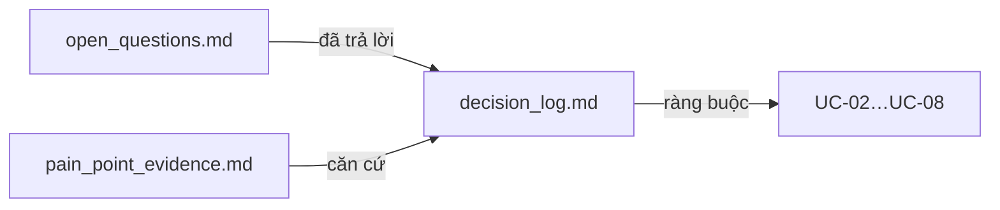

# UC-01 — BL-01: Chốt phạm vi và quyết định mở

| Thuộc tính | Nội dung |
|---|---|
| Backlog | BL-01 · E1 · Must · Ưu tiên A · 3 SP |
| Owner | TV1 |
| Phụ thuộc | — |
| Truy vết | PRD mục 4, 5, 17; Brief mục 3 (PP-01…PP-10) |
| Loại | **Tài liệu, không có code** |

## 1. User story

> Là nhóm thực hiện, tôi muốn thống nhất yêu cầu và mức nghiệm thu để tránh mỗi người hiểu sản phẩm khác nhau.

## 2. Tiêu chí nghiệm thu (backlog)

- Mỗi quyết định có người xác nhận, ngày và phạm vi áp dụng. Giả định chưa xác nhận phải được đánh dấu rõ.
- Không trộn phạm vi ngoài dự án, Must/Should và các ngưỡng đề xuất với kết quả đã đạt.
- Có bảng ánh xạ người phụ trách nghiệp vụ, nguồn và nhãn. Điểm chưa chốt mà chặn công việc phụ thuộc phải được ghi thành blocker.

**Bằng chứng:** phiên bản tài liệu đã review và decision log.

## 3. Phạm vi

| Làm | Không làm |
|---|---|
| Decision log, danh sách câu hỏi mở, sổ bằng chứng pain point | Viết lại toàn bộ PRD/Brief |
| Ghi nhận mâu thuẫn tài liệu và người cần xác nhận | Tự chọn đáp án cho câu hỏi chưa có người xác nhận |
| Bảng ánh xạ người phụ trách nghiệp vụ, nguồn, nhãn | Tạo số liệu khảo sát giả |

## 4. Kiến trúc

Ba file Markdown liên kết với nhau: decision log là trung tâm; câu hỏi mở khi được trả lời sẽ chuyển thành quyết định; sổ pain point là bằng chứng cho các quyết định phạm vi.



## 5. Cấu trúc thư mục

```text
docs/decisions/                     🆕 commit được (tài liệu nhóm, không có dữ liệu nhạy cảm)
├── decision_log.md                 Bảng quyết định D-xx
├── open_questions.md               Câu hỏi Q-xx, trạng thái, người cần trả lời, blocker cho BL nào
└── pain_point_evidence.md          PP-01…PP-10: loại bằng chứng, nguồn, ngày, ghi chú
```

> Có nên commit `docs/decisions/` hay không cần người dùng xác nhận trước khi tạo. Mặc định không commit (R-05).

## 6. Mẫu nội dung

**decision_log.md**

| ID | Quyết định | Lý do | Phạm vi áp dụng | Căn cứ (PRD/BL/BR) | Người xác nhận | Ngày | Trạng thái |
|---|---|---|---|---|---|---|---|
| D-01 | … | … | … | … | … | YYYY-MM-DD | Đề xuất / Đã xác nhận / Thay thế bởi D-xx |

**open_questions.md**

| ID | Câu hỏi | Chặn BL | Người cần trả lời | Hạn | Trạng thái | Kết quả → D-xx |
|---|---|---|---|---|---|---|

**pain_point_evidence.md**

| PP | Mô tả (Brief mục 3) | Loại bằng chứng: sự cố thực tế / lời người dùng / rủi ro dự phòng | Nguồn (phỏng vấn/quan sát) | Ngày | Ghi chú |
|---|---|---|---|---|---|

## 7. Danh sách câu hỏi mở cần đưa vào `open_questions.md`

Mỗi mục dưới đây đều lấy từ tài liệu gốc, không phải câu hỏi tự đặt ra:

| Câu hỏi | Căn cứ | Chặn |
|---|---|---|
| Mức nghiệm thu: cơ bản hay có thêm nâng cao? | BL-01 task | BL-36, BL-40 |
| Danh sách môn pilot chính thức: 6 môn (PRD 4.2/13.2) hay 2 môn (BL-02)? MVP tạm dùng 3 môn hiện có (MVP-2) | Mâu thuẫn tài liệu | BL-02, BL-03 (sau MVP) |
| Phân bổ holdout theo môn cho 3 môn tạm (đề xuất 34/33/33 trong `eval/config.json`) | plans/README mục 4 | BL-03 |
| Người duyệt tài liệu và người xác nhận nhãn là GV nào? | BL-01, PRD 13.3 | BL-02, BL-03, BL-12 |
| Ngân sách, retention, giới hạn file | BL-01 task | BL-25, BL-26, BL-09 |
| Ngưỡng NFR-01…05 (đang là "đề xuất pilot cần xác nhận") | PRD 12.1 | BL-30 |
| Ngưỡng RAGAS (đề xuất, cần phê duyệt trước khi chạy) | PRD 13.5 | BL-36 |
| Chọn kho vector chính | PRD 10.2 | BL-15 |
| Cloud/provider deploy | PRD 16.1 | BL-29 |
| Định dạng dữ liệu kiểm chứng (JSONL đề xuất) | plans/README | BL-03 |
| Tái lập quyết định D-16 (bộ sách tạm cho dev) vì file scope.md đã mất | data/raw/manifest.json | BL-02 |

## 8. Các bước

0. Ghi ngay các quyết định MVP-1…MVP-5 (plans/README mục 0) vào `decision_log.md`: người xác nhận là Ngô Đinh Minh Nhật (TV1), ngày 25/09/2026, phạm vi là giai đoạn MVP, trạng thái "Đã xác nhận, tạm thời".
1. Tạo 3 file theo mẫu, **chỉ với tiêu đề bảng** (không điền quyết định giả).
2. Đưa các câu hỏi ở mục 7 vào `open_questions.md`, để trạng thái "Chưa trả lời".
3. Walkthrough Brief/PRD/wireframe cùng nhóm, ghi quyết định kèm người xác nhận thật.
4. Phỏng vấn hoặc quan sát ngày 1–2, ghi vào `pain_point_evidence.md`.
5. Ghi mọi câu hỏi chưa chốt mà chặn BL khác thành blocker trên board.

## 9. Không được làm

- Không điền tên người xác nhận, ngày hay kết quả khi chưa có thật.
- Không gán số liệu cho pain point.
- Không coi PRD v2.0 là đã phê duyệt: bảng thay đổi trong PRD đang ghi "[Chưa xác nhận]".
