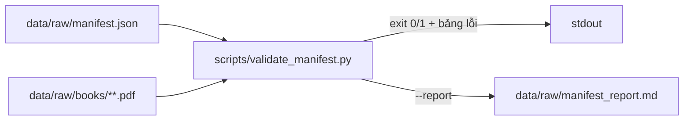

# UC-02 — BL-02: Kiểm kê nguồn, quyền sử dụng và nhãn môn

| Thuộc tính | Nội dung |
|---|---|
| Backlog | BL-02 · E1 · Must · Ưu tiên A · 5 SP |
| Owner | TV1 |
| Phụ thuộc | BL-01 |
| Truy vết | FR-06, BR-01, BR-06; PRD 9.1 (Document, DocumentVersion, DocumentACL, IntegrityLabel), 9.3 |
| Loại | Manifest JSON + script kiểm tra |

## 1. User story

> Là GV, tôi muốn biết nguồn nào được phép đưa vào pilot và ai được đọc để giữ đúng quyền sử dụng.

## 2. Tiêu chí nghiệm thu (backlog)

- Mỗi nguồn có chủ sở hữu hoặc người xác nhận, môn, loại file, phiên bản và trạng thái quyền sử dụng.
- Nguồn chưa được phép không được đưa vào pipeline phục vụ. Đáp án của GV không được có ACL của SV.
- Có mẫu đại diện cho các loại file: hợp lệ, scan, lỗi, trùng, và hai phiên bản, để kiểm thử.

**Bằng chứng:** data inventory và quyết định sử dụng nguồn. Không đưa dữ liệu nhạy cảm vào tài liệu công khai.

## 3. Hiện trạng

> **Cập nhật 25/09/2026 (D-03):** `data/raw/manifest.json` đã mất. Manifest chuẩn giờ là `data/raw/books/manifest.books.json`; file này không có `enums`, `owner`, `local_status`, `test_samples_required`. Vì vậy: enum chuyển vào `config.manifest_enums`; M-10 tính độ phủ mẫu từ chính dữ liệu; bỏ M-12; thêm M-13 (thư mục khác tên môn). Phần bên dưới mô tả file cũ, chỉ để tham khảo.

### Hiện trạng cũ (trước khi file mất)

- `data/raw/manifest.json`: 30 nguồn, 3 môn tạm (COURSE-01 Toán rời rạc, COURSE-02 CTDL&GT, COURSE-03 PT&TK thuật toán). Tất cả nguồn đang có `usage_permission=pending`, `ai_processing_allowed=null`, `acl.roles=[]`, nghĩa là mặc định bị từ chối.
- `data/raw/books/manifest.books.json`: danh mục tải về, có thêm `url`, `has_text_layer`, `encrypted`, `fetch_error`.
- `test_samples_required`: đã có `valid_pdf_text` và `duplicate`. **Còn thiếu:** `valid_pptx`, `pdf_scan`, `corrupt`, `two_versions`, `graded_material`.
- Có mâu thuẫn giữa hai manifest (xem plans/README mục 7). Chưa có script kiểm tra.
- **MVP:** `manifest.json` là manifest chuẩn (MVP-5). Ba môn tạm có thể đổi sau, nên script **không được hard-code** `course_id`, số môn hay số nguồn.

## 4. Phạm vi

| Làm | Không làm |
|---|---|
| Script `validate_manifest.py` kiểm tra đúng luật của AC | Tự đổi `usage_permission` thành `allowed` |
| Báo cáo nguồn nào đủ hoặc thiếu điều kiện | Sinh file PDF/PPTX giả cho các loại mẫu còn thiếu (R-09) |
| Đối chiếu sha256 và page_count với file thật | Đưa nguồn vào pipeline ingestion (việc của BL-09/10) |
| Hợp nhất hoặc chọn một manifest chuẩn **sau khi người dùng quyết định** | Commit PDF |

## 5. Kiến trúc



Luồng kiểm tra trong `validate_manifest.py`:

1. Đọc JSON với utf-8 và kiểm tra cấu trúc bằng model Pydantic.
2. Kiểm tra từng nguồn theo luật ở mục 7.
3. Kiểm tra file thật: tồn tại, sha256 khớp, `local_status` khớp thực tế.
4. Kiểm tra độ phủ của `test_samples_required`.
5. In bảng kết quả. Trả exit code 1 nếu có lỗi mức ERROR.

## 6. Cấu trúc thư mục

```text
scripts/
└── validate_manifest.py        🆕 CLI, commit được (không chứa dữ liệu)
data/raw/                       🔒
├── manifest.json               ✅ nguồn chuẩn cho kiểm kê (cần người dùng xác nhận)
├── manifest_report.md          🆕 output --report
└── books/manifest.books.json   ✅ danh mục tải về
```

## 7. Luật kiểm tra (mỗi luật truy về AC/BR)

| Mã | Luật | Mức | Căn cứ |
|---|---|---|---|
| M-01 | Có đủ `source_id`, `course_id`, `title`, `file_type`, `version`, `usage_permission` | ERROR | AC 1 |
| M-02 | `course_id` phải tồn tại trong `courses` | ERROR | AC 1 |
| M-03 | Giá trị enum nằm trong `enums` của manifest | ERROR | AC 1 |
| M-04 | `usage_permission != "allowed"` thì `acl.roles` phải rỗng. Không được coi nguồn này là đủ điều kiện phục vụ. | ERROR | AC 2, BR-01 |
| M-05 | `usage_permission == "allowed"` thì phải có `confirmed_by` và `confirmed_at` | ERROR | AC 1, BR-11 |
| M-06 | `is_graded_material == true` thì `acl.roles` không được chứa `student` | ERROR | AC 2, BR-06 |
| M-07 | Nguồn chưa có `owner` hoặc `confirmed_by` | WARNING (liệt kê) | AC 1 |
| M-08 | `local_status == "downloaded"` thì file ở `storage_ref` phải tồn tại và sha256 khớp | ERROR | toàn vẹn |
| M-09 | `supersedes` phải trỏ tới `source_id` có thật, không tạo vòng | ERROR | BR-07 |
| M-10 | Mỗi `test_samples_required` có `status=missing` được liệt kê | WARNING | AC 3 |
| M-11 | `source_id` là duy nhất; `sha256` trùng nhau được báo | ERROR / WARNING | FR-16 |
| M-12 | (tùy chọn `--compare-books`) So sánh với `manifest.books.json` theo `source_id`: thiếu/thừa nguồn, lệch `sha256`, `usage_permission`, `acl` → chỉ **báo cáo**, không sửa | WARNING | MVP-5 |

## 8. Interface

```text
python scripts/validate_manifest.py [--manifest PATH (mặc định: config.manifest_path)] [--check-files] [--compare-books PATH] [--report PATH]
exit 0: không có ERROR · exit 1: có ERROR · exit 2: lỗi đọc file/JSON
```

Pydantic model đặt trong `eval/schemas.py` (dùng chung với UC-03/04). Script import `eval.common.load_config` và `eval.schemas.Manifest`:
`Course`, `Acl(roles: list[str], download_allowed: bool)`, `Source`, `TestSampleRequirement`, `Manifest`. Trường nào có thể null trong dữ liệu thật thì khai báo `| None`.

## 9. Các bước

1. Dùng `manifest.json` làm chuẩn (MVP-5). Mâu thuẫn chỉ báo qua M-12.
2. Viết model Pydantic đúng theo cấu trúc JSON hiện có. Không đổi tên trường.
3. Cài các luật M-01…M-11, rồi chạy trên dữ liệu thật.
4. Báo kết quả thật. Kết quả dự kiến là có WARNING M-07 cho cả 30 nguồn và M-10 cho 5 loại mẫu còn thiếu.
5. Ghi log `docs/work/`.

## 10. Kiểm tra (MVP, không viết test)

- `ruff check eval/ scripts/` và `ruff format --check eval/ scripts/`.
- Chạy `python scripts/validate_manifest.py --check-files --compare-books data/raw/books/manifest.books.json` trên dữ liệu thật. Output thật chính là bằng chứng, ghi vào log `docs/work/`.

## 11. Không được làm

- Không sửa giá trị trong manifest để script pass.
- Không điền `confirmed_by` hay `owner` khi chưa có người thật.
- Không sinh file giả cho các loại mẫu còn thiếu. Ghi rõ là "missing".
