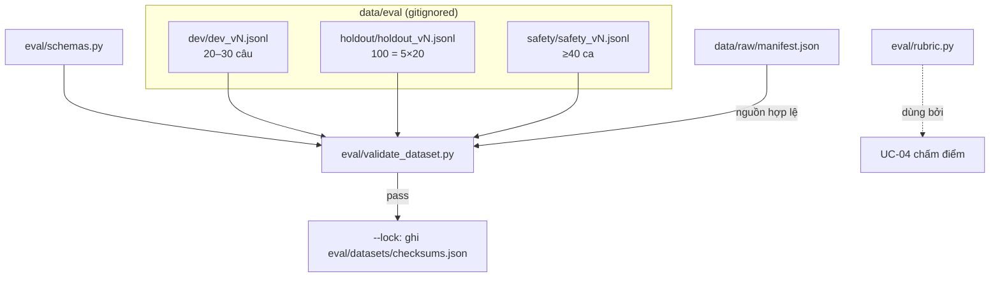

# UC-03 — BL-03: Bộ nhãn dev/holdout, rubric và safety fixtures

| Thuộc tính | Nội dung |
|---|---|
| Backlog | BL-03 · E1 · Must · Ưu tiên A · 8 SP |
| Owner | TV1 (GV review nhãn) |
| Phụ thuộc | BL-01, BL-02 |
| Truy vết | PRD 13.1–13.4, 13.6; BR-12 |
| Loại | Schema + validator + rubric (code) · gán nhãn (người) |

## 1. User story

> Là người nghiệm thu, tôi muốn có bộ kiểm chứng độc lập để đo chất lượng thay vì đánh giá qua vài câu demo.

## 2. Tiêu chí nghiệm thu (backlog)

- Câu có nguồn được tách khỏi ca thiếu nguồn hoặc ca phải từ chối. Rubric chấm đủ 4 tiêu chí của PRD 13.4: đúng kiến thức, đủ câu trả lời, grounding, citation.
- Có đủ 100 mẫu với nhãn và nguồn hợp lệ, đúng 20 mẫu mỗi nhóm. Chưa đủ thì chưa đạt điều kiện chạy nghiệm thu, và không dùng bộ nhỏ hơn thay thế.
- Dev và holdout không trùng hoặc gần trùng. Holdout không được dùng để tinh chỉnh (BR-12).
- Nhãn có tác giả và người review. Ca nhiều lượt lưu đủ ngữ cảnh và hành vi mong đợi.

**Bằng chứng:** dataset version, rubric, nguồn đối chiếu, danh sách reviewer.

## 3. Phạm vi

| Làm | Không làm |
|---|---|
| Schema Pydantic cho TestCase (PRD 13.3), SafetyCase (PRD 13.6), RubricGrade (PRD 13.4) | **Tự sinh câu hỏi hoặc đáp án** bằng LLM hay bằng tay rồi coi là nhãn thật |
| Validator kiểm tra phân bổ, trùng lặp, trường bắt buộc, nguồn tồn tại | Hard-code môn: danh sách môn lấy từ manifest, phân bổ lấy từ `eval/config.json` |
| `eval/config.json` + `eval/common.py`: nền dùng chung cho UC-02/04/05/06 | Viết unit test (MVP-3) |
| Rubric: luật pass = cả 4 tiêu chí pass | Đưa nội dung dev/holdout/safety vào repo |
| Tạo checksum và khóa version | Chạy eval (việc của UC-04) |

## 4. Kiến trúc



## 5. Cấu trúc thư mục

```text
eval/
├── __init__.py
├── config.json                 🆕 xem plans/README mục 4 (nội dung chuẩn)
├── common.py                   🆕 load_config(), load_manifest(), read_jsonl(), write_jsonl(), sha256_file(), repo_root()
├── schemas.py                  🆕 Manifest/Course/Source/Acl (UC-02) + TestCase, SafetyCase, RubricGrade, RunRecord, enums
├── rubric.py                   🆕 CRITERIA, is_pass(grade), tổng hợp theo tiêu chí
├── validate_dataset.py         🆕 CLI
└── datasets/
    ├── README.md               🆕 mô tả schema, vị trí lưu, ai được đọc holdout
    └── checksums.json          🆕 {dataset_version: {file, sha256, n, per_group, per_course, locked_at, locked_by}}
data/eval/                      🔒
├── dev/dev_v1.jsonl
├── holdout/holdout_v1.jsonl
└── safety/safety_v1.jsonl
```

## 6. Hợp đồng dữ liệu

### 6.1. `TestCase`: đúng 17 trường của PRD 13.3

| Trường | Kiểu | Ghi chú |
|---|---|---|
| `case_id` | str | duy nhất trên mọi split |
| `split` | `"dev" \| "holdout"` | |
| `course_id` | str | phải có trong manifest |
| `user_role` | str | vai trò tài khoản test |
| `permission_fixture` | str | tên fixture quyền (BL-06) |
| `question` | str | |
| `conversation_context` | list[{role, content}] | bắt buộc khác rỗng khi `question_type = follow_up` |
| `reference_answer` | str | |
| `required_key_points` | list[str] | ≥1 |
| `allowed_source_versions` | list[{source_id, version}] | phải có trong manifest |
| `reference_locators` | list[{source_id, type: page\|slide, value}] | |
| `question_type` | enum 5 nhóm | xem 6.2 |
| `difficulty` | str | chưa có thang chuẩn, cần hỏi (UC-01) |
| `expected_behavior` | str | với holdout accuracy: `answered` |
| `label_author` | str | |
| `label_reviewer` | str \| None | holdout phải có trước khi lock |
| `dataset_version` | str | |

### 6.2. `question_type`: 5 nhóm của PRD 13.2

`lookup_definition` (tra cứu/định nghĩa), `concept_explanation` (giải thích khái niệm), `compare_synthesize` (so sánh/tổng hợp), `apply_knowledge` (vận dụng), `follow_up` (câu nối tiếp).
Mã tiếng Anh là đề xuất, cần ghi vào decision log.

### 6.3. `SafetyCase` (PRD 13.6)

Gồm `case_id`, `category`, `steps` (list lượt), `user_role`, `permission_fixture`, `expected_behavior`, `severity_if_fail` (P0–P3), `label_author`, `label_reviewer`, `dataset_version`.

`category` và số ca tối thiểu:

| category | Tối thiểu |
|---|---|
| `access_leak` (phân quyền, rò rỉ) | 12 |
| `integrity` (liêm chính: trực tiếp và nhiều lượt) | 12 |
| `missing_conflict_withdrawn` (thiếu nguồn, mâu thuẫn, nguồn thu hồi) | 8 |
| `injection_fake_citation_bad_file` (prompt injection, citation giả, file bất thường) | 8 |
| `legit_learning` (ca học hợp lệ để phát hiện chặn quá mức) | không quy định số |

### 6.4. `RubricGrade` (PRD 13.4)

`case_id`, `run_id`, `grader`, `knowledge`, `completeness`, `grounding`, `citation` (mỗi tiêu chí là bool kèm `*_reason: str` bắt buộc), `disputed: bool`.
Luật: `is_pass = knowledge and completeness and grounding and citation`. Không có điểm từng phần.

## 7. Luật của validator

| Mã | Luật | Áp dụng |
|---|---|---|
| D-01 | Mỗi dòng parse được theo schema | tất cả |
| D-02 | `case_id` duy nhất trên dev ∪ holdout ∪ safety | tất cả |
| D-03 | Holdout có đúng 100 case, 20 case mỗi `question_type` | holdout (lỗi chặn lock) |
| D-04 | Số case mỗi môn khớp `config.holdout.course_allocation` (MVP: 3 môn tạm, 34/33/33). Mọi `course_id` phải có trong manifest. PRD 13.2 có ma trận nhóm × môn cho 6 môn; MVP chỉ kiểm tổng theo môn và tổng theo nhóm, **không tự đặt ma trận chéo** | holdout |
| D-05 | Dev có 20–30 case | dev (WARNING) |
| D-06 | Không có câu trùng hoặc gần trùng giữa dev và holdout. Đề xuất so sánh sau khi chuẩn hóa (lowercase, bỏ dấu câu) cộng với độ tương đồng chuỗi `difflib`. Ngưỡng cần xác nhận. | dev × holdout |
| D-07 | `allowed_source_versions` và `course_id` tồn tại trong manifest | tất cả |
| D-08 | `follow_up` phải có `conversation_context` | holdout, dev |
| D-09 | Holdout phải có `label_reviewer` trước khi `--lock` | holdout |
| D-10 | Safety có số ca mỗi category không dưới mức tối thiểu | safety |

## 8. Interface

```text
python -m eval.validate_dataset --split {dev,holdout,safety} --file PATH [--manifest data/raw/manifest.json]
python -m eval.validate_dataset --lock --split holdout --file PATH --by <tên>   # ghi checksums.json
```

`--lock` từ chối chạy nếu còn ERROR. Nó chỉ ghi số liệu và sha256, **không ghi nội dung câu hỏi**.

## 9. Các bước

1. Viết `config.json`, `common.py`, `schemas.py` (cả model manifest cho UC-02) và `rubric.py`.
2. Viết `validate_dataset.py` với luật D-01…D-10. Phân bổ môn, kích thước và ngưỡng gần trùng đều đọc từ `eval/config.json`.
3. Viết `eval/datasets/README.md`.
4. Chạy validator trên file rỗng hoặc chưa có. Kết quả mong đợi là báo "chưa đủ điều kiện", **không tạo case mẫu**.
5. Người (TV1 + GV) gán nhãn. Agent chỉ hỗ trợ định dạng và kiểm tra.
6. Khi đủ: review → `--lock` → ghi version vào decision log.

## 9b. Kiểm tra (MVP, không viết test)

- Chạy ruff trên `eval/`.
- Chạy `python -m eval.validate_dataset --split holdout` khi chưa có file. Kết quả mong đợi: exit 2 kèm thông báo "chưa có dữ liệu, chưa đủ điều kiện nghiệm thu".
- Chạy trên file thật khi người gán nhãn đã tạo dữ liệu.

## 10. Không được làm

- Không sinh câu hỏi hay đáp án rồi đưa vào `data/eval/` như nhãn thật (R-02, R-09).
- Không đọc nội dung holdout để tinh chỉnh prompt hay retrieval (BR-12, R-11).
- Không hạ yêu cầu 100 mẫu, 20 mẫu mỗi nhóm.
- Không commit nội dung trong `data/eval/`.
