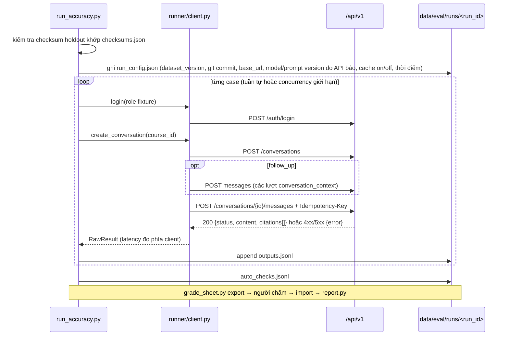

# UC-04 — BL-27: Chạy eval accuracy trên holdout và phân tích lỗi

| Thuộc tính | Nội dung |
|---|---|
| Backlog | BL-27 · E6 · Must · Ưu tiên A · 8 SP |
| Owner | TV1 (GV chấm và xử lý bất đồng) |
| Phụ thuộc | BL-03 (dữ liệu), BL-21/22/23 (trợ lý), BL-25 (token/latency) |
| Truy vết | PRD 13.1–13.4, 13.7, 13.8; UAT-17; BR-12 |
| Loại | Runner HTTP + phiếu chấm + báo cáo |

## 1. User story

> Là người nghiệm thu, tôi muốn kết quả có thể kiểm tra lại để biết hệ thống đạt KPI hay chưa.

## 2. Tiêu chí nghiệm thu (backlog)

- Báo số đạt trên tổng với mẫu số khóa là 100. Không đổi mẫu số sau khi biết điểm.
- **Cần ≥80/100 mẫu đạt cả 4 tiêu chí.** Không làm tròn kết quả dưới 80.
- Timeout, từ chối sai, citation sai đều tính là không đạt. Không trộn safety vào accuracy.
- Nếu chưa đạt thì tạo bug hoặc task sửa. Lần chạy lại tuân BR-12 và PRD 13.7 bước 7.
- Mock LLM không được dùng làm bằng chứng.

## 3. Phạm vi

| Làm | Không làm |
|---|---|
| Runner gọi API thật, lưu output thô | Import `src.agents` để gọi trực tiếp thay cho API |
| Xuất phiếu chấm CSV cho người chấm | Tự chấm bằng LLM rồi coi là kết quả |
| Kiểm tra máy móc: có citation không, `source_id`/`version` có nằm trong `allowed_source_versions` không, có timeout không | Dùng output holdout để sửa prompt |
| Báo cáo tổng, theo nhóm, theo môn, và nguyên nhân lỗi | Bỏ case lỗi khỏi mẫu số |

## 4. Kiến trúc



**Kiểm tra tự động** (chỉ để hỗ trợ, không thay người chấm):

| Mã | Kiểm tra | Hệ quả |
|---|---|---|
| A-01 | HTTP lỗi hoặc timeout (NFR-02: 30 giây) | case **không đạt**, ghi lý do |
| A-02 | `status` khác `answered` hoặc `partial` với câu có nguồn | đánh dấu "nghi từ chối sai" để người chấm xem |
| A-03 | `citations` rỗng | đánh dấu tiêu chí citation "nghi fail" |
| A-04 | Citation có (`document_id`/`version_id`) ngoài `allowed_source_versions` | đánh dấu "nghi fail" |

> Cách ánh xạ `document_id`/`version_id` của API sang `source_id`/`version` của manifest **chưa có hợp đồng**. Cần chốt với TV2/TV3 và ghi vào UC-01.

## 5. Cấu trúc thư mục

```text
eval/
├── runner/
│   ├── __init__.py
│   ├── client.py            🆕 ApiClient(httpx): login, create_conversation, send_message; Idempotency-Key uuid4; timeout lấy từ config
│   └── run_accuracy.py      🆕 CLI
├── scoring/
│   ├── __init__.py
│   ├── auto_checks.py       🆕 A-01…A-04
│   ├── grade_sheet.py       🆕 export/import CSV, chọn ngẫu nhiên ≥20% mẫu cho người chấm thứ 2 (seed ghi lại)
│   └── report.py            🆕 tính accuracy, xuất markdown theo mẫu PRD 13.8
└── results/<run_id>.md      🆕 chỉ số liệu tổng hợp, không có câu hỏi holdout
data/eval/runs/<run_id>/     🔒
├── run_config.json
├── outputs.jsonl            {case_id, http_status, body, latency_ms, error}
├── auto_checks.jsonl
└── grades/
    ├── primary_<grader>.csv
    └── second_<grader>.csv
```

## 6. Interface

```text
python -m eval.runner.run_accuracy --dataset data/eval/holdout/holdout_v1.jsonl --base-url http://localhost:8000 \
       --run-id <auto: YYYYMMDD-HHMM-holdout_v1> [--concurrency 1] [--timeout 30]
python -m eval.scoring.grade_sheet export --run-id ID --grader <tên> [--second-ratio 0.2 --seed N]
python -m eval.scoring.grade_sheet import --run-id ID --file PATH
python -m eval.scoring.report --run-id ID
```

- Tài khoản test đọc từ biến môi trường `EVAL_*` trong `.env`. **Không in password.** Tên biến cụ thể cần chốt, không được hard-code.
- Mỗi case được chạy trong conversation mới để tránh ngữ cảnh rò giữa các case.
- Phiếu CSV có cột: `case_id, question_type, course_id, question, answer, citations, auto_flags, knowledge, knowledge_reason, completeness, completeness_reason, grounding, grounding_reason, citation, citation_reason, disputed`.

## 7. Báo cáo (`report.py`)

- `n_pass / 100` và phần trăm. **Đạt khi n_pass ≥ 80.**
- Theo 5 nhóm (mẫu số 20) và theo môn (mẫu số lấy từ `config.holdout.course_allocation`; MVP là 34/33/33; tên môn lấy từ manifest).
- Tỷ lệ pass của từng tiêu chí, dùng để chẩn đoán.
- Nguyên nhân lỗi: data, retrieval, generation, citation, routing. Người chấm điền cột `failure_cause`.
- Độ trễ p50/p95, số timeout. Token và chi phí lấy từ BL-25 nếu API trả về; nếu không có thì ghi "không có dữ liệu".
- Bất đồng giữa hai người chấm được liệt kê kèm quyết định của GV.
- Ghi rõ lần chạy thứ mấy. Nếu trước đó đã sửa dựa trên lỗi holdout thì ghi **"regression trên bộ đã biết"**.

## 8. Các bước

1. Chốt hợp đồng response và cách ánh xạ ID nguồn với TV2/TV3.
2. Viết `client.py` theo PRD 11.2–11.5 và `run_accuracy.py`.
3. Viết `auto_checks.py`, `grade_sheet.py`, `report.py`.
4. Chạy thử trên **dev**, không dùng holdout, khi API thật đã có.
5. Khóa cấu hình, rồi chạy holdout một lần đầy đủ **đầu tuần 3**.
6. Chấm → báo cáo → tạo bug theo mẫu backlog mục 15.2.

## 8b. Kiểm tra (MVP, không viết test)

- Chạy ruff trên `eval/`.
- Khi API chưa có: `run_accuracy` trên **dev** phải trả exit 3 (`blocked`) và ghi rõ endpoint thiếu. Không tạo `outputs.jsonl` giả.
- `report.py` khi chưa có phiếu chấm: báo "chưa chấm" và không tính accuracy.

## 9. Không được làm

- Không chạy holdout khi checksum không khớp hoặc dataset chưa lock.
- Không chạy lại nhiều lần rồi chỉ báo lần tốt nhất (PRD 13.7).
- Không đổi rubric hoặc mẫu số sau khi thấy điểm (R-11).
- Không lưu câu hỏi hay đáp án holdout vào `eval/results/`.
