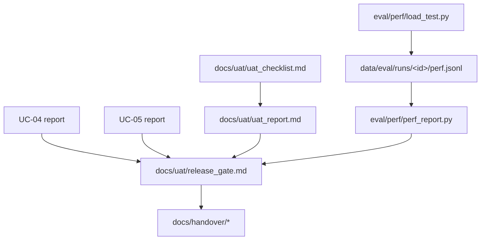

# UC-06 — BL-30: Cổng cơ bản, UAT, hiệu năng và bàn giao

| Thuộc tính | Nội dung |
|---|---|
| Backlog | BL-30 · E6 · Must · Ưu tiên B · 5 SP |
| Owner | TV1 |
| Phụ thuộc | BL-16, BL-23, BL-24, BL-27, BL-28, BL-29, BL-35 |
| Truy vết | PRD 12.1 (NFR-01…05), 14.2, 14.3, 16; Brief mục 3 |
| Loại | Checklist UAT + script đo hiệu năng + tài liệu |

## 1. User story

> Là GV/người nhận bàn giao, tôi muốn sử dụng sản phẩm theo các luồng thực tế và biết rõ chất lượng, cách chạy, giới hạn còn lại.

## 2. Tiêu chí nghiệm thu (backlog)

Cần đủ các điều kiện sau:

- BL-01…BL-29 và BL-35 hoàn tất, cùng các Must liên quan.
- ≥80/100 mẫu holdout đạt.
- Safety đạt, không còn lỗi P0/P1.
- Báo p50/p95, trạng thái cache, corpus và tải thật, rồi đối chiếu với ngưỡng đã chốt.
- Có URL/demo, version phát hành, hướng dẫn và người xác nhận.

Nếu chưa đạt thì **giữ cổng mở**.

## 3. Phạm vi

| Làm | Không làm |
|---|---|
| Checklist UAT-01…UAT-20 theo vai trò, ghi kết quả thật | Tự đánh dấu đạt khi chưa có người dùng đại diện |
| Script đo latency: tìm kiếm (NFR-01) và câu trả lời (NFR-02) | Tự chọn ngưỡng. NFR đang là "đề xuất cần xác nhận". |
| Tổng hợp accuracy (UC-04) và safety (UC-05) | Chạy lại eval chỉ để lấy số đẹp |
| Hướng dẫn SV/GV/vận hành, biên bản lỗi/phạm vi | Viết hướng dẫn cho tính năng chưa tồn tại |

## 4. Kiến trúc



**Đo hiệu năng** (NFR-01/02). Chỉ dùng `httpx` async, không thêm locust:

- Warm-up N yêu cầu, không tính vào kết quả.
- Tìm kiếm: 100 truy vấn tới `GET /api/v1/documents`, 20 phiên đồng thời (NFR-01), ghi p50/p95.
- Câu trả lời: đo toàn bộ luồng POST message tới khi nhận response đã kiểm tra, timeout 30 giây (NFR-02).
- Ghi kèm môi trường, corpus version, trạng thái cache bật/tắt, số phiên đồng thời, thời điểm.
- Truy vấn dùng cho đo tải lấy từ tập **dev**, không dùng holdout.

## 5. Cấu trúc thư mục

```text
eval/perf/
├── __init__.py
├── load_test.py              🆕 CLI: --scenario {search,answer} --sessions 20 --requests 100 --warmup N
└── perf_report.py            🆕 p50/p95/max, timeout, lỗi
docs/uat/                     🆕 (hỏi trước khi commit)
├── uat_checklist.md          UAT-01…UAT-20: tiền điều kiện, bước, kết quả chấp nhận (chép từ PRD 14.2)
├── uat_report.md             người thực hiện, vai trò, ngày, pass/fail, bằng chứng (ảnh/đường dẫn), bug
├── value_measurement.md      tác vụ theo pain point Brief mục 3: baseline, số mẫu, giới hạn; "chưa đo" nếu chưa có
└── release_gate.md           bảng cổng phát hành (backlog mục 16) + kết luận Mở/Đóng + người xác nhận
docs/handover/                🆕
├── huong_dan_sinh_vien.md
├── huong_dan_giang_vien.md
├── van_hanh.md               deploy, health/ready, backup/restore, runbook PRD 16.2
└── bien_ban_loi_pham_vi.md   lỗi còn lại, phạm vi bị bỏ/hoãn
data/eval/runs/<id>/perf.jsonl 🔒
```

## 6. Các bước

1. Tạo `uat_checklist.md` từ PRD 14.2. Chỉ chép, không thêm kịch bản mới.
2. Viết `load_test.py` và `perf_report.py`. Chạy khi BL-29 (Docker demo) đã có.
3. Walkthrough UI-01…UI-03 và UI-06…UI-09 cùng người dùng đại diện, ghi `uat_report.md`.
4. Lấy kết quả UC-04/05 và điền `release_gate.md`.
5. Viết hướng dẫn **theo tính năng đã chạy được thật**.
6. Họp chốt cổng: Đóng hoặc Mở kèm việc khắc phục có owner.

## 6b. Kiểm tra (MVP, không viết test)

- Chạy ruff trên `eval/perf/`.
- `load_test` khi API chưa có: exit 3 (`blocked`), không ghi số liệu.
- Truy vấn và tham số mặc định lấy từ `eval/config.json` và tập dev.

## 7. Không được làm

- Không điền p50/p95 hay mức hài lòng khi chưa đo.
- Không dùng mức hài lòng thay cho accuracy (backlog BL-30).
- Không đóng cổng khi còn P0/P1 hoặc accuracy dưới 80/100.
- Không đưa tài khoản hay secret demo vào tài liệu bàn giao công khai (PRD 16.3).
