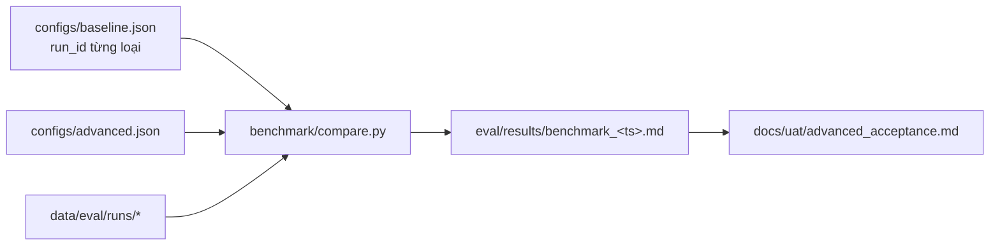

# UC-08 — BL-40: Benchmark và nghiệm thu nâng cao (Should · trong phạm vi theo MVP-6)

| Thuộc tính | Nội dung |
|---|---|
| Backlog | BL-40 · E7 · Should · Ưu tiên C · 5 SP |
| Owner | TV1 |
| Phụ thuộc | BL-34, BL-36, BL-37, BL-38, BL-39 |
| Truy vết | UAT-18, PRD 14.3 (bản nâng cao) |
| Quyết định | MVP-6 (người dùng chốt 25/09/2026) |

## 1. User story

> Là người nghiệm thu, tôi muốn biết bản nâng cao cải thiện gì và có giữ các kiểm soát bắt buộc hay không.

## 2. Tiêu chí nghiệm thu (backlog)

- Mọi Should đã cam kết đều có bằng chứng.
- Accuracy vẫn ≥80%, không có P0/P1.
- RAGAS không thay cho accuracy.
- Có phân tích trade-off chi phí/độ trễ/chất lượng, kèm giới hạn.
- Hạng mục bị bỏ phải ghi thay đổi phạm vi.

## 3. Kiến trúc

Không có runner mới. `compare.py` đọc kết quả các lần chạy đã có (UC-04/05/06/07) của hai cấu hình **baseline** và **advanced**, rồi xuất bảng so sánh.



**File cấu hình** (`configs/*.json`): `label`, `git_commit`, `corpus_version`, `description`, và `runs` gồm `{accuracy, safety, perf_search, perf_answer, ragas, router}`, mỗi mục là một `run_id` hoặc `null`. `ragas` là tên file `ragas_<ts>.jsonl` nằm trong run accuracy.

**So sánh:**

| Khía cạnh | Chỉ số | Nguồn |
|---|---|---|
| Chất lượng | accuracy /100, theo nhóm | `report.accuracy_report` (UC-04) |
| RAGAS (tách riêng) | mean từng metric, số lượt lỗi | UC-07 |
| An toàn | pass/fail/needs_human/blocked, số P0/P1 fail | UC-05 |
| Độ trễ | p50/p95 search và answer | UC-06 |
| Router | accuracy router | UC-07 |
| Chi phí, cache | token/chi phí, hit/miss | BL-25/BL-37: không có dữ liệu thì ghi "không có dữ liệu" |

Cảnh báo tự động:
- Hai cấu hình dùng **dataset version khác nhau**: không so sánh trực tiếp.
- Advanced có cờ `known_set_regression`: ghi "regression trên bộ đã biết".
- Accuracy của advanced dưới ngưỡng, hoặc còn P0/P1: kết luận **chưa đạt nâng cao**.

## 4. Cấu trúc thư mục

```text
eval/benchmark/
├── __init__.py
├── compare.py              CLI: --baseline --advanced → eval/results/benchmark_<ts>.md
└── configs/
    ├── baseline.json       run_id đều null cho tới khi có lần chạy thật
    └── advanced.json
docs/uat/
└── advanced_acceptance.md  Checklist BL-31…BL-39: cam kết / bằng chứng / bỏ (có người xác nhận)
```

## 5. Các bước

1. Viết `compare.py` và 2 file cấu hình với `run_id` đều là `null`.
2. Tạo `advanced_acceptance.md` từ bảng E7 của backlog (BL-31…BL-39, trừ BL-35 vì đã chuyển sang Must).
3. Khi có các lần chạy thật: điền `run_id`, chạy compare, viết phần trade-off.

## 6. Kiểm tra (MVP, không viết test)

- Chạy ruff trên `eval/`.
- Chạy `compare` khi mọi `run_id` đều null: báo "chưa có lần chạy", exit 2.

## 7. Không được làm

- Không ghi "đạt nâng cao" khi còn Should đã cam kết mà chưa có bằng chứng.
- Không dùng kết quả của bản cơ bản làm bằng chứng cho cấu hình đã thay đổi.
- Không so sánh các lần chạy khác corpus hoặc khác dataset mà không cảnh báo.
