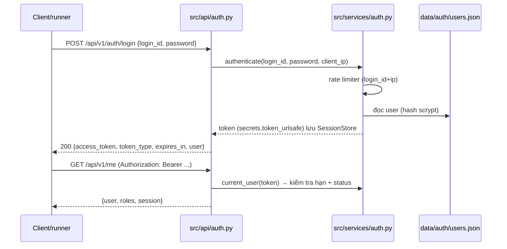

# UC-09 — BL-05 (tối giản): Đăng nhập cơ bản cho MVP

| Thuộc tính | Nội dung |
|---|---|
| Backlog | BL-05 · E2 · Must (owner gốc **TV2**). TV1 viết bản tối giản theo yêu cầu người dùng ngày 25/09/2026 để runner eval chạy được sớm. **Cần báo TV2** |
| Truy vết | FR-01.1/01.2, PRD 9.1 (User, Membership), 11.2 (`/auth/login`, `/auth/logout`, `/me`, `/me/courses`), 11.4 (định dạng lỗi), NFR-06/08/09, BR-02 |
| Quyết định | D-17 (đăng nhập cơ bản), D-18 (Bearer token thay cookie) |

## 1. User story

> Là SV/GV, tôi muốn đăng nhập bằng tài khoản được cấp và chỉ thấy các môn mình được phân công, để hệ thống tự xác định tôi là ai mà không tin dữ liệu do client gửi lên (BR-02).

## 2. Phạm vi MVP

| Làm | Không làm (để TV2 làm ở BL-05/BL-06 đầy đủ) |
|---|---|
| Login `{login_id, password}` → trả Bearer token; logout thu hồi token | SSO/LMS, tự đăng ký tài khoản (ngoài phạm vi PRD 17) |
| Mật khẩu lưu dạng hash scrypt kèm salt (PRD 9.1: không lưu mật khẩu thô) | Database: MVP dùng file `data/auth/users.json` (gitignored) |
| Phiên trong bộ nhớ, có hạn dùng, kiểm tra `status` tài khoản mỗi request (khóa tài khoản có hiệu lực ngay) | Phiên sống sót khi restart |
| Giới hạn số lần đăng nhập sai (PRD 11.2 "Rate limit") → 429 | Quota/ngân sách (BL-25) |
| Lỗi đăng nhập chung chung, không lộ tài khoản có tồn tại hay không | Membership có `valid_from/to` (BL-06) |
| `GET /me`, `GET /me/courses` do backend quyết định | ACL tài liệu (BL-06) |

**D-18:** dùng Bearer token trong header `Authorization` thay cho cookie. Cách này không dùng cookie phiên, nên không phát sinh yêu cầu CSRF của NFR-08, và vẫn đơn giản cho MVP. Fixtures để `token_field: "access_token"`.

## 3. Kiến trúc



## 4. Cấu trúc thư mục

```text
src/
├── config.py            + auth_users_file, auth_session_ttl_minutes, auth_max_failed_logins, auth_failed_window_seconds
├── models/schemas.py    + LoginRequest, LoginResponse, UserPublic, MeResponse, CourseItem, ErrorBody
├── services/auth.py     🆕 hash/verify scrypt, UserStore, SessionStore, LoginRateLimiter, AuthService
├── api/auth.py          🆕 router: /auth/login, /auth/logout, /me, /me/courses + dependency get_current_user
└── main.py              + include auth router dưới /api/v1; handler lỗi theo PRD 11.4
scripts/
└── seed_users.py        🆕 tạo data/auth/users.json từ data/eval/fixtures/<env>.json + .env (hash mật khẩu), tên môn lấy từ manifest
data/auth/users.json     🔒 gitignored
```

## 5. Định dạng users.json

```json
{"users": [{"id": "u_student_course_01", "login_id": "...", "display_name": "...", "role": "student",
            "status": "active", "courses": ["COURSE-01"], "password_hash": "scrypt$<n>$<r>$<p>$<salt_b64>$<hash_b64>"}],
 "courses": {"COURSE-01": {"code": null, "name": "Toán rời rạc", "term": null}}}
```

## 6. Kiểm tra (MVP, không viết test)

- Chạy ruff.
- Chạy `seed_users.py`, khởi động app, rồi thử đăng nhập đúng và sai, gọi `/me`, `/me/courses`, logout, thử quá số lần sai. Chạy `run_accuracy` preflight để thấy runner đăng nhập được.

## 7. Không được làm

- Không log hay in mật khẩu, token, hash.
- Không nhận role hay user_id do client gửi (BR-02).
- Không trả thông báo khác nhau cho "sai mật khẩu" và "không có tài khoản".
