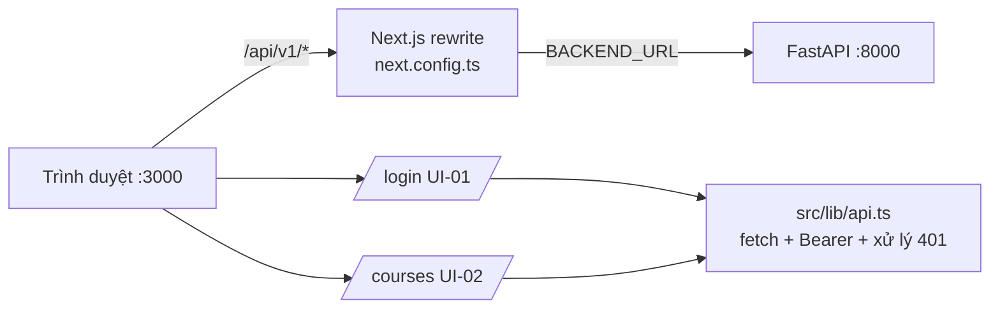

# UC-10 — BL-07 (tối giản): Frontend Next.js — UI-01 Đăng nhập, UI-02 Trang môn

| Thuộc tính | Nội dung |
|---|---|
| Backlog | BL-07 · E2 · Must (owner gốc **TV4**). TV1 dựng khung theo yêu cầu người dùng ngày 25/09/2026. **Cần báo TV4** |
| Truy vết | UI-01, UI-02 (Wireframe v2.0 mục 4, 5.1, 6, 8), FR-01.1/01.2/01.3, BR-02, BR-10 |
| Quyết định | D-19: Next.js 16 + React 19 + TypeScript 5.9; phạm vi UI-01 + UI-02 |

## 1. User story

> Là SV/GV, tôi đăng nhập bằng tài khoản được cấp, rồi thấy đúng các môn mình được phân công để chọn phạm vi trước khi hỏi đáp (không mặc định toàn kho, BR-02).

## 2. Phạm vi

| Làm | Không làm (chờ backend/owner) |
|---|---|
| UI-01: form login; trạng thái mặc định, đang gửi (chặn double-submit), lỗi (banner đỏ, giữ định danh, xóa mật khẩu), hết phiên (banner vàng) | Tự đăng ký, quên mật khẩu (ngoài phạm vi) |
| UI-02: header tên người dùng + Đăng xuất; danh sách môn từ `/me/courses`; skeleton khi tải; trạng thái "chưa được cấp môn" | "Tài liệu gần đây": chưa có API tài liệu (BL-16/17) nên hiển thị ghi chú, không dựng dữ liệu giả |
| Nút "Mở / Tạo hội thoại mới" vô hiệu, ghi rõ UI-03 chưa có trong MVP | UI-03…UI-10 |
| Gọi API cùng origin qua rewrite `/api/*` → backend (không cần CORS) | |

## 3. Kiến trúc



- Token lưu trong `sessionStorage` (mất khi đóng tab), không dùng `localStorage`. Mọi dữ liệu đều lấy lại từ server, không cache nội dung.
- 401 từ API → xóa token → chuyển về `/login?expired=1`.
- Vai trò và danh sách môn chỉ lấy từ `/me` và `/me/courses`. UI không tự suy ra (BR-02).
- Microcopy lấy theo Wireframe mục 8.

## 4. Cấu trúc thư mục

```text
frontend/
├── package.json            next 16.3.6, react/react-dom 19.3.0, typescript 5.9.3
├── next.config.ts          rewrites /api/:path* → ${BACKEND_URL}/api/:path*
├── tsconfig.json
├── next-env.d.ts
├── .env.example            BACKEND_URL=http://localhost:8000
└── src/
    ├── app/
    │   ├── layout.tsx
    │   ├── globals.css     responsive (mobile trước)
    │   ├── page.tsx        điều hướng: có token → /courses, không → /login
    │   ├── login/page.tsx  UI-01
    │   └── courses/page.tsx UI-02
    └── lib/
        ├── api.ts          login, logout, me, myCourses, ApiError
        ├── session.ts      token trong sessionStorage
        └── messages.ts     microcopy Wireframe mục 8
docs/handover/huong_dan_chay.md   hướng dẫn chạy backend + frontend
```

## 5. Kiểm tra (MVP, không viết test)

- `npm run typecheck` và `npm run build`.
- Chạy backend + frontend, thử login đúng/sai, đăng xuất, tài khoản có môn/không có môn (admin), token hết hạn → banner vàng.
